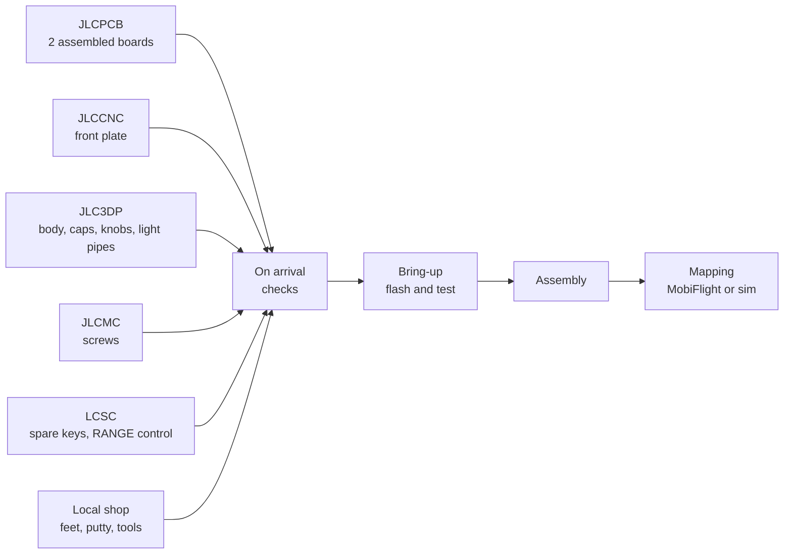

# Avionics Panel

DIY desktop panel for GA avionics in flight sims (G1000, GTN 750, GNS 530/430, Bendix/King, GFC 500):
autopilot, audio, radio and FMS keys, three dual concentric knobs and a RANGE knob that tilts to pan. It shows
up on the PC as two USB joysticks, mapped in MobiFlight or directly in the sim.

[Open the interactive 3D view](https://saschagrunert.de/avionics-panel/) (seated, exploded, top and front
views).

## Build one

Everything is ordered from the JLC group with the files in [production/](production/), and the boards arrive
fully assembled: nothing to solder, a few checks, then screws and knobs.

1. **Order** ([details, shopping list](docs/building/building.md)), in the sequence of
   [Order step by step](docs/building/building.md#order-step-by-step): the six encoders into JLCPCB's Parts
   Manager first, JLCCNC before JLC3DP. Every file name below starts with `avionics-panel-rev1-`:

   | Shop | What | Files |
   | --- | --- | --- |
   | JLCPCB | the board, 2 fully assembled | [gerbers.zip](production/avionics-panel-rev1-gerbers.zip), [BOM-full.csv](production/avionics-panel-rev1-BOM-full.csv), [CPL-full.csv](production/avionics-panel-rev1-CPL-full.csv) |
   | JLCCNC | the aluminium front plate | [plate.step](production/avionics-panel-rev1-plate.step), [plate-drawing.pdf](production/avionics-panel-rev1-plate-drawing.pdf), [plate.dxf](production/avionics-panel-rev1-plate.dxf) |
   | JLC3DP | body, USB-C filler, four key cap sets, knobs, light pipes | [body.step](production/avionics-panel-rev1-body.step), [usb-filler.step](production/avionics-panel-rev1-usb-filler.step), [caps-A.zip](production/avionics-panel-rev1-caps-A.zip) to [caps-D.zip](production/avionics-panel-rev1-caps-D.zip), `knob-*.step`, [lightpipes.step](production/avionics-panel-rev1-lightpipes.step) |
   | JLCMC | six M3 x 8 flanged button-head screws | |
   | LCSC | spare keys (5, LCSC's minimum; 2 needed) and a reference RANGE control (hand-soldering option: the through-hole parts, spares included) | |
   | local | feet, putty, sandpaper, a few tools | optional [steel.dxf](production/avionics-panel-rev1-steel.dxf) |

   Option for those who like to solder: JLCPCB fits only the SMD bottom side
   ([BOM.csv](production/avionics-panel-rev1-BOM.csv), [CPL.csv](production/avionics-panel-rev1-CPL.csv)), and
   the keys, encoders and RANGE control come from LCSC
   ([THT-LCSC.csv](production/avionics-panel-rev1-THT-LCSC.csv)) and are soldered by hand
   ([assembly variants](docs/building/building.md#assembly-variants)).
2. **What arrives**: two assembled boards (and three bare ones), the plate, the body with two USB-C fillers,
   four sets of 28 key caps (one of them fits), the knobs with tighter and looser spares, two light pipe bars,
   the screws and the LCSC parts.
3. **Check on arrival**: break off the board's rail, try the plate threads, check that the encoders and the
   RANGE control sit flat and the J1 shell tabs are soldered, choose the cap set
   ([On arrival](docs/building/assembly.md#on-arrival); with hand-soldering only the threads and the cap set).
4. **Bring-up**: flash CircuitPython and the [firmware](firmware/), then test every key, knob and light on the
   bare board ([Bring-up](docs/building/bring-up.md); with hand-soldering, the J1 tabs, the keys and last the
   encoders and RANGE control are soldered along the way). Optional before the boards arrive: the
   [Pico bench](docs/building/bring-up.md#pico-bench).
5. **Assemble**: caps onto the keys, light pipes into the plate, the board face down into the plate, the body
   over it with four screws, the USB-C filler, the knobs and the feet
   ([Assembly](docs/building/assembly.md#assembly)).
6. **Map**: two joysticks, every function a fixed button ([Mapping](docs/using/mapping.md),
   [BUTTONS.md](firmware/BUTTONS.md)); then the knob timing check of the
   [first board](docs/building/bring-up.md#first-board).

## Docs

Using the panel:

- [Controls](docs/using/controls.md): what each key and knob does, [SHIFT](docs/using/controls.md#shift),
  workflows, [knobs](docs/using/controls.md#knobs),
  [keys](docs/using/controls.md#keys-label-shift-legend-in-parentheses)
- [Compatibility](docs/using/compatibility.md): what each control does on the G1000, GFC 500, GTN, GNS and
  Bendix/King, by aircraft
- [Mapping](docs/using/mapping.md): the two joysticks, update mode and GUIDs, the device name

Building one, in build order (order, check on arrival, bring up, assemble):

- [Building](docs/building/building.md): what to order where, the order remarks, the
  [shopping list](docs/building/building.md#shopping-list), review questions, shipping
- [Arrival and assembly](docs/building/assembly.md): on arrival (before bring-up), hand-soldering, assembly
  (after bring-up), disassembly
- [Bring-up](docs/building/bring-up.md): flashing, testing, first-board checks, the Pico bench

How it works:

- [Electronics](docs/architecture/electronics.md): RP2040 board, USB protection, GPIO map, lights,
  [schematic](docs/architecture/avionics-panel-rev1-schematic.pdf)
- [Firmware](docs/architecture/firmware.md): state, knob timing, switch bounce, USB, tests
- [Mechanics](docs/architecture/mechanics.md): stack, fastening, seating, caps, light pipes, knobs,
  [dimensions](docs/architecture/mechanics.md#dimensions)

Renders: [hero](renders/1-hero.png), [top](renders/2-top.png), [exploded](renders/3-exploded.png),
[seated view](renders/4-seated.png), [PCB top](renders/5-pcb-top.png), [PCB bottom](renders/6-pcb-bottom.png),
[plate artwork](renders/7-plate-artwork.png), [fit check](renders/8-fit-check.png).

## Working on the design

Every output is generated; generated files are named `avionics-panel-rev1-*`.

| Directory | Contents | Start with |
| --- | --- | --- |
| [pcb/](pcb/) | board generator: RP2040 on the underside, 4 layers, routed and checked | [board.py](pcb/board.py), [check.py](pcb/check.py) |
| [mech/](mech/) | body, front plate, knobs, light pipes, key caps, plate artwork | [stack.py](mech/stack.py) (every height and fit), [check_fit.py](mech/check_fit.py) |
| [firmware/](firmware/) | CircuitPython for the panel's RP2040 | [code.py](firmware/code.py), [panel.py](firmware/panel.py), [buttonmap.py](firmware/buttonmap.py) |
| [viewer/](viewer/) | three.js 3D view, [live here](https://saschagrunert.de/avionics-panel/) | [index.html](viewer/index.html) |
| [production/](production/) | the files to order | [Building](docs/building/building.md) |
| [renders/](renders/) | pictures | |

`./build.sh` regenerates everything, runs every check and copies the results to `production/` and `renders/`
(`--route` also re-runs the board routing first). It runs the independent parts (board, plate artwork, knobs,
caps with body and fit check, plate with viewer data, firmware) in parallel and prints each one's output when
it ends; a part stops at its first failed check, and the build fails after all parts have ended, naming the
ones that failed. Renders 1 to 4 are screenshots of the 3D view (`#shot-h`, `#shot-c`, `#shot-e`, `#shot-a`
after the URL; `#shot-c` is the clean top view).

The steps one by one, with Nix from the repository root:

- `nix-shell nix/shells.nix -A gen` (numpy, scipy, matplotlib, scikit-image, pillow, librsvg). Inside `pcb/`:
  `python3 precheck.py` (placement clearances and bottom-side part bodies), `python3 run_route.py 5` (routing,
  writes `routed.json`; seed 5 routes every net without a detour and within the USB length limits, as do 1, 2,
  3, 4, 7, 9, 13 and 14 of seeds 1 to 14; `run_route.py <seed> x` writes `routed_<seed>.json` instead, for
  trying seeds in parallel), `python3 make.py` (Gerbers), `python3 check.py` (every electrical and
  manufacturing check on the Gerbers, see [Electronics](docs/architecture/electronics.md)), `python3
  render.py`, `python3 make_bom.py`, `python3 make_schematic.py`; `dbg.py` plots a region of the routed board.
  Inside `mech/`: `python3 make_plate_art.py`.
- `nix-shell nix/shells.nix -A occ` (OpenCascade, for the exact solids). Inside `mech/`: `python3
  make_caps.py` (key caps), `python3 make_mech.py` (body, steel plate DXF), `python3 make_plate_step.py`
  (plate STEP and drawing), `python3 make_knobs.py` (knobs, light pipes), `python3 check_fit.py` (sections and
  clearances), `python3 make_viewer_data.py` (`viewer/geometry.js`, every dimension the 3D view uses).
- `nix-shell nix/shells.nix -A firmware`: `pytest` from the repository root
  ([firmware tests](docs/architecture/firmware.md#code-and-tests)).

Every Nix package comes from the nixpkgs revision locked in `flake.lock`, so a local build and CI write the
same files (STEP, STL, PDF and PNG output depends on the OpenCascade and matplotlib versions).
`nix/nixpkgs.nix` reads the lock without the flakes feature, and `nix/shells.nix` defines the environments
above from it. Dependabot proposes newer nixpkgs-unstable revisions as pull requests (weekly, each at least a
week old), and CI fails on any output that the update changes: run `./build.sh` on that branch and commit what
changed. To move nixpkgs by hand: `nix --extra-experimental-features 'nix-command flakes' flake update
nixpkgs`, then `./build.sh`, and commit `flake.lock` with every output that changed.

## License

[Apache-2.0](LICENSE) for everything in this repository (code, board, mechanics, docs) except the vendored
parts: the Barlow Semi Condensed fonts in `mech/fonts/` and `viewer/fonts/` (SIL Open Font License, `OFL.txt`
next to them) and three.js in `viewer/vendor/` (MIT, `three-LICENSE`).
