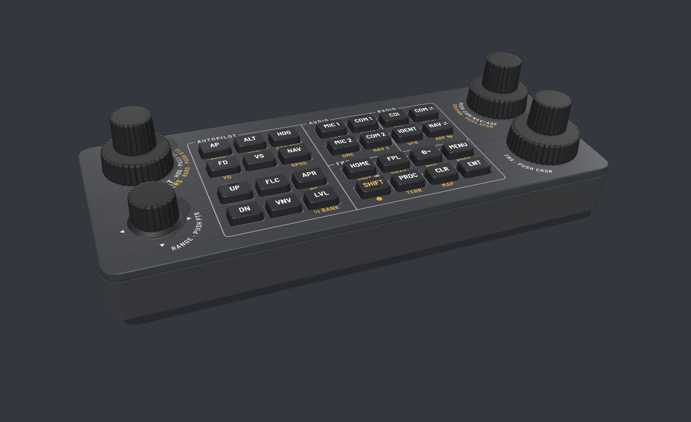

# Avionics Panel

DIY desktop panel for GA avionics in flight sims (G1000, GTN 750, GNS 530/430, Bendix/King, GFC 500):
autopilot, audio, radio and FMS keys, three dual concentric knobs and a RANGE knob that tilts to pan.
Shows up on the PC as two joysticks (unit 1 and unit 2), mapped in MobiFlight or directly in the sim.



## Docs

Rev 1 is the first version to be built. The docs in [docs/](docs/) are its spec; the 3D view, the board
and the mechanics follow them.

| Doc | Contents |
|---|---|
| [Controls](docs/controls.md) | principles, [SHIFT](docs/controls.md#shift), HOTAS split, workflows, [knobs](docs/controls.md#knobs), [keys](docs/controls.md#keys-label-shift-legend-in-parentheses) |
| [Compatibility](docs/compatibility.md) | what each control does on the G1000, GFC 500, GTN, GNS and Bendix/King, by aircraft |
| [Firmware](docs/firmware.md) | joystick devices, knob timing, [install and bring-up](docs/firmware.md#install-and-bring-up) |
| [Electronics](docs/electronics.md) | RP2040 board, GPIO map, lights |
| [Mechanics](docs/mechanics.md) | stack heights, assembly, [dimensions](docs/mechanics.md#dimensions) |
| [Ordering](docs/ordering.md) | suppliers, placement preview, quotes, [checklist](docs/ordering.md#checklist) |
| [Status](docs/status.md) | open items, rev 2 notes, what is done |
| [BUTTONS.md](firmware/BUTTONS.md) | every joystick button of both units, for mapping in MobiFlight or the sim |

## Layout

Generated files are named `avionics-panel-rev1-*`.

| Directory | Contents | Start with |
|---|---|---|
| [pcb/](pcb/) | board generator: RP2040 on the underside, 4 layers, routed and checked | [board.py](pcb/board.py), [check.py](pcb/check.py) |
| [mech/](mech/) | body, front plate, knobs, light pipes, key caps, plate artwork | [stack.py](mech/stack.py) (every height and fit), [check_fit.py](mech/check_fit.py) |
| [firmware/](firmware/) | CircuitPython for the panel's RP2040 | [code.py](firmware/code.py), [panel.py](firmware/panel.py), [buttonmap.py](firmware/buttonmap.py) |
| [viewer/](viewer/) | three.js 3D view, published to GitHub Pages; or open it in a browser | [index.html](viewer/index.html) |
| [production/](production/) | the files to order | see below |
| [renders/](renders/) | pictures | see below |

Production files, by supplier (details in [Ordering](docs/ordering.md)):

- JLCPCB: [gerbers](production/avionics-panel-rev1-gerbers.zip),
  [BOM](production/avionics-panel-rev1-BOM.csv), [CPL](production/avionics-panel-rev1-CPL.csv)
- LCSC: [through-hole parts](production/avionics-panel-rev1-THT-LCSC.csv)
- JLCCNC: [plate STEP](production/avionics-panel-rev1-plate.step),
  [thread drawing](production/avionics-panel-rev1-plate-drawing.pdf),
  [marking DXF](production/avionics-panel-rev1-plate.dxf)
- JLC3DP: [body](production/avionics-panel-rev1-body.step),
  [spacer](production/avionics-panel-rev1-spacer.step), [key caps](production/avionics-panel-rev1-caps.zip),
  [light pipes](production/avionics-panel-rev1-lightpipes.step), knobs
  ([outer 22](production/avionics-panel-rev1-knob-outer-22.step),
  [outer 24](production/avionics-panel-rev1-knob-outer-24.step),
  [inner](production/avionics-panel-rev1-knob-inner.step),
  [RANGE](production/avionics-panel-rev1-knob-range.step), plus `-tight` and `-loose` fit variants)

Renders: [hero](renders/1-hero.png), [top](renders/2-top.png), [exploded](renders/3-exploded.png),
[seated view](renders/4-seated.png), [PCB top](renders/5-pcb-top.png),
[PCB bottom](renders/6-pcb-bottom.png), [plate artwork](renders/7-plate-artwork.png),
[fit check](renders/8-fit-check.png).

## Tooling

The board and caps need numpy, scipy, matplotlib, scikit-image and pillow. On NixOS:

```
nix-shell -p "python3.withPackages (ps: with ps; [ numpy scipy matplotlib scikit-image pillow ])"
```

Inside `pcb/`: `python3 precheck.py` (placement clearances), `python3 run_route.py 4` (routing, writes
`routed.json`; seed 4 routes every net), `python3 make.py` (Gerbers), `python3 check.py` (electrical check, DRC and bottom-side pin
order on the Gerbers), `python3 render.py`, `python3 make_bom.py`. `dbg.py` plots a region of the routed
board.
Inside `mech/`: `python3 make_caps.py`, `python3 make_plate_art.py`.

The body, plate, knobs and light pipes are exact solids (STEP + STL) built with OpenCascade:

```
nix-shell -p "python3.withPackages (ps: with ps; [ pythonocc-core numpy matplotlib ])"
```

Inside `mech/`: `python3 make_mech.py` (body, spacers), `python3 make_plate_step.py` (plate STEP and
thread drawing), `python3 make_knobs.py` (knobs, light pipes), `python3 check_fit.py` (sections and
clearances).

The firmware logic runs on the PC: `python3 firmware/test_panel.py`.

`./build.sh` does all of the above in one go (`--route` also re-runs the routing), stops at the first
failed check and copies the results to `production/` and `renders/`. Renders 1 to 4 are screenshots of
the 3D view.

GitHub Actions: [build](.github/workflows/build.yml) runs `./build.sh` on every push and fails if a
check fails or the committed Gerbers, BOM, CPL or button map are stale. [pages](.github/workflows/pages.yml)
publishes the 3D view to GitHub Pages (Settings, Pages, source "GitHub Actions").
[Dependabot](.github/dependabot.yml) proposes action updates once a month in one PR.
