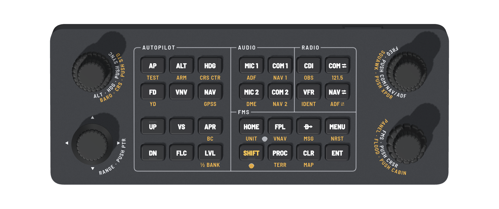

# Avionics Panel

DIY desktop panel for GA avionics in flight sims (G1000, GTN 750, GNS 530/430, Bendix/King, GFC 500):
autopilot, audio, radio and FMS keys, three dual concentric knobs and a RANGE knob that tilts to pan.
Shows up on the PC as two joysticks (device 1 carries everything plus unit 1, device 2 the unit 2 copies),
mapped in MobiFlight or directly in the sim. Ready-made MobiFlight profiles are planned
([#13][issue-13]); until then you map the buttons yourself with [BUTTONS.md](firmware/BUTTONS.md).



[Open the interactive 3D view](https://saschagrunert.de/avionics-panel/) (seated, exploded, top and front views).

## Docs

Rev 1 is the first version to be built; nothing is ordered yet. The docs in [docs/](docs/) are its spec;
the 3D view, the board and the mechanics follow them. Open items and rev 2 ideas are
[GitHub issues](https://github.com/saschagrunert/avionics-panel/issues): MobiFlight profiles per avionics
family ([#13][issue-13]), a keyboard mode ([#12][issue-12]), and for rev 2 USB ESD protection and a fuse
([#14][issue-14]) and one decoupling capacitor per IOVDD pin ([#15][issue-15]).

| Doc | Contents |
| --- | --- |
| [Controls](docs/controls.md) | principles, [SHIFT](docs/controls.md#shift), HOTAS split, workflows, [knobs](docs/controls.md#knobs), [keys](docs/controls.md#keys-label-shift-legend-in-parentheses) |
| [Compatibility](docs/compatibility.md) | what each control does on the G1000, GFC 500, GTN, GNS and Bendix/King, by aircraft |
| [Firmware](docs/firmware.md) | joystick devices, knob timing, [install and bring-up](docs/firmware.md#install-and-bring-up), [Pico bench](docs/firmware.md#pico-bench) |
| [Electronics](docs/electronics.md) | RP2040 board, GPIO map, lights, [schematic](docs/avionics-panel-rev1-schematic.pdf) |
| [Mechanics](docs/mechanics.md) | stack heights, assembly, [on arrival](docs/mechanics.md#on-arrival), [dimensions](docs/mechanics.md#dimensions) |
| [Ordering](docs/ordering.md) | [assembly variants](docs/ordering.md#assembly-variants), suppliers, [before paying](docs/ordering.md#before-paying), quotes, [checklist](docs/ordering.md#checklist) |
| [BUTTONS.md](firmware/BUTTONS.md) | every joystick button of both units, for mapping in MobiFlight or the sim |

## Layout

Generated files are named `avionics-panel-rev1-*`.

| Directory | Contents | Start with |
| --- | --- | --- |
| [pcb/](pcb/) | board generator: RP2040 on the underside, 4 layers, routed and checked | [board.py](pcb/board.py), [check.py](pcb/check.py) |
| [mech/](mech/) | body, front plate, knobs, light pipes, key caps, plate artwork | [stack.py](mech/stack.py) (every height and fit), [check_fit.py](mech/check_fit.py) |
| [firmware/](firmware/) | CircuitPython for the panel's RP2040 | [code.py](firmware/code.py), [panel.py](firmware/panel.py), [buttonmap.py](firmware/buttonmap.py) |
| [viewer/](viewer/) | three.js 3D view, [live here](https://saschagrunert.de/avionics-panel/) | [index.html](viewer/index.html) |
| [production/](production/) | the files to order | see below |
| [renders/](renders/) | pictures | see below |

Production files, by supplier (details in [Ordering](docs/ordering.md)):

- JLCPCB: [gerbers](production/avionics-panel-rev1-gerbers.zip), then one of the two
  [assembly variants](docs/ordering.md#assembly-variants): economic, the SMD bottom side only
  ([BOM](production/avionics-panel-rev1-BOM.csv), [CPL](production/avionics-panel-rev1-CPL.csv)), or full,
  both sides with the through-hole parts ([BOM](production/avionics-panel-rev1-BOM-full.csv),
  [CPL](production/avionics-panel-rev1-CPL-full.csv))
- LCSC (economic variant): [through-hole parts](production/avionics-panel-rev1-THT-LCSC.csv), hand-soldered
- JLCCNC: [plate STEP](production/avionics-panel-rev1-plate.step),
  [drawing](production/avionics-panel-rev1-plate-drawing.pdf),
  [marking DXF](production/avionics-panel-rev1-plate.dxf)
- JLC3DP: [body](production/avionics-panel-rev1-body.step),
  key caps in four fit sets ([A](production/avionics-panel-rev1-caps-A.zip),
  [B](production/avionics-panel-rev1-caps-B.zip), [C](production/avionics-panel-rev1-caps-C.zip),
  [D](production/avionics-panel-rev1-caps-D.zip); one file per cap in `caps-single-A.zip` etc.),
  [light pipes](production/avionics-panel-rev1-lightpipes.step), knobs
  ([outer](production/avionics-panel-rev1-knob-outer.step),
  [outer FMS](production/avionics-panel-rev1-knob-outer-fms.step),
  [inner](production/avionics-panel-rev1-knob-inner.step),
  [RANGE](production/avionics-panel-rev1-knob-range.step), plus `-tight` and `-loose` fit variants)
- Local: standoffs, screws, consumables (see [Ordering](docs/ordering.md)), optional
  [steel plate](production/avionics-panel-rev1-steel.dxf)

Renders: [hero](renders/1-hero.png), [top](renders/2-top.png), [exploded](renders/3-exploded.png),
[seated view](renders/4-seated.png), [PCB top](renders/5-pcb-top.png),
[PCB bottom](renders/6-pcb-bottom.png), [plate artwork](renders/7-plate-artwork.png),
[fit check](renders/8-fit-check.png).

## Tooling

The board and the plate artwork need numpy, scipy, matplotlib, scikit-image and pillow (and librsvg for
the plate preview). With Nix, from the repository root:

```sh
nix-shell nix/shells.nix -A gen
```

Inside `pcb/`: `python3 precheck.py` (placement clearances and bottom-side part bodies),
`python3 run_route.py 11` (routing, writes `routed.json`; seed 11 routes every net without a detour and
within the USB length limits, the only one of seeds 1 to 16 that does; `run_route.py <seed> x` writes
`routed_<seed>.json` instead, for trying seeds in parallel), `python3 make.py` (Gerbers),
`python3 check.py` (electrical check, DRC, drills, paste, mask dams, hand-soldering clearances,
decoupling, net lengths and USB, nothing under the USB-C shell, legend clearances, JLC footprints and CPL
rotations, through-hole footprints and their top-side CPL, bottom-side pin order, on the Gerbers),
`python3 render.py`, `python3 make_bom.py`, `python3 make_schematic.py` (schematic PDF from the netlist).
`dbg.py` plots a region of the routed board.
Inside `mech/`: `python3 make_plate_art.py`.

The caps, body, plate, knobs and light pipes are exact solids (STEP, STL or OBJ) built with OpenCascade:

```sh
nix-shell nix/shells.nix -A occ
```

Inside `mech/`: `python3 make_caps.py` (key caps), `python3 make_mech.py` (body, steel plate DXF),
`python3 make_plate_step.py` (plate STEP and drawing), `python3 make_knobs.py` (knobs, light pipes),
`python3 check_fit.py` (sections and clearances), `python3 make_viewer_data.py` (`viewer/geometry.js`,
every dimension the 3D view uses).

The firmware tests run on the PC with `pytest` (from the repository root): `firmware/test_panel.py` covers
the logic, `firmware/test_code.py` runs `code.py` and `firmware/test_boot.py` runs `boot.py` against stub
hardware modules, `tests/test_pins.py` checks the firmware pins against the board nets, and
`tests/test_micropython.py` compiles the board files with CircuitPython 9.2's own `mpy-cross` (the board's
compiler, passed in `MPY_CROSS`) and with the MicroPython unix port (`micropython` on the PATH). Each check
skips without its compiler; `build.sh` provides MicroPython and sets `REQUIRE_MICROPYTHON=1`, which makes
that check fail instead; it provides `mpy-cross` (and sets `REQUIRE_MPY_CROSS=1`) only on Linux x86-64 and
ARM64, and elsewhere prints a notice and that check skips. `nix-shell nix/shells.nix -A firmware` has
pytest and MicroPython.

`./build.sh` does all of the above in one go (`--route` also re-runs the routing first) and copies the
results to `production/` and `renders/`. It runs the independent parts (board, plate artwork, knobs, caps
with body and fit check, plate with viewer data, firmware) in parallel and prints each one's output when it
ends; a part stops at its first failed check, and the build fails after all parts have ended, naming the
ones that failed. Renders 1 to 4 are screenshots of the 3D view (`#shot-h`, `#shot-c`, `#shot-e`,
`#shot-a` after the URL; `#shot-c` is the clean top view).

Every Nix package comes from the nixpkgs revision locked in `flake.lock`, so a local build and CI write
the same files (STEP, STL, PDF and PNG output depends on the OpenCascade and matplotlib versions).
`nix/nixpkgs.nix` reads the lock without the flakes feature, and `nix/shells.nix` defines the environments
above from it. Dependabot proposes newer nixpkgs-unstable revisions as pull requests (weekly, each at least a
week old), and CI fails on any output that the update changes: run `./build.sh` on that branch and commit
what changed. To move nixpkgs by hand:
`nix --extra-experimental-features 'nix-command flakes' flake update nixpkgs`, then `./build.sh`, and commit
`flake.lock` with every output that changed.

## License

[Apache-2.0](LICENSE) for everything in this repository (code, board, mechanics, docs) except the vendored
parts: the Barlow Semi Condensed fonts in `mech/fonts/` and `viewer/fonts/` (SIL Open Font License, `OFL.txt`
next to them) and three.js in `viewer/vendor/` (MIT, `three-LICENSE`).

[issue-12]: https://github.com/saschagrunert/avionics-panel/issues/12
[issue-13]: https://github.com/saschagrunert/avionics-panel/issues/13
[issue-14]: https://github.com/saschagrunert/avionics-panel/issues/14
[issue-15]: https://github.com/saschagrunert/avionics-panel/issues/15
