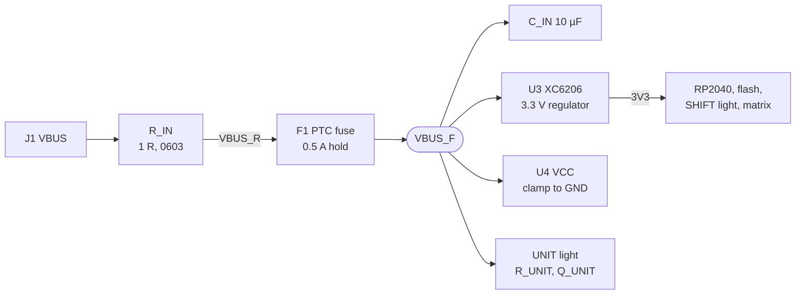
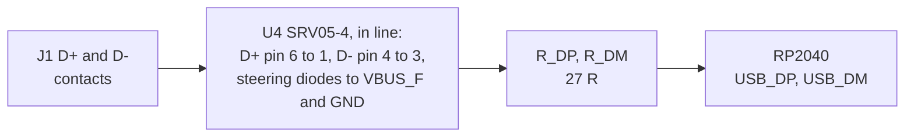

# Electronics

The board has four layers (signals, GND, 3V3, signals). The RP2040, W25Q16 flash, a 12 MHz crystal, an XC6206
regulator and USB-C with an ESD (electrostatic discharge) array and a fuse ([USB protection](#usb-protection))
sit on the bottom; the keys, encoders and RANGE control on the top. It has 93 nets and 30 unconnected pins.

[pcb/board.py](../../pcb/board.py) generates it ([Generators](generators.md)). The
[schematic](avionics-panel-rev1-schematic.pdf) (four A3 sheets: USB-C and power, RP2040, key matrix, knobs and
lights) is drawn from the same netlist by [make_schematic.py](../../pcb/make_schematic.py), which fails if any
pad of the board is missing from it. Renders: [top](../../renders/5-pcb-top.png),
[bottom](../../renders/6-pcb-bottom.png).

[pcb/check.py](../../pcb/check.py) checks the result:

- On the Gerbers: shorts and opens, on a raster and again on the copper as exact geometry, the solder mask,
  the paste, the legend and the planes.
- On the design data the Gerbers are written from: the clearances of the outer copper and the holes.
- The files against that data, one for one: the copper Gerbers (every pad, via and trace), the drill files,
  the outline with its cutouts, and a cathode bar at every diode and LED.
- The BOM and CPL against `board.py` and each other: every part on its side with its value and LCSC number,
  each BOM line's quantity, and the hand-soldering files the bottom side of the full ones.

It prints what each build reaches, and the build passes when:

| Check | Passes when |
| --- | --- |
| Shorts, opens, nets with a detour | There are none, and no contact or neck in a net is under 0.08 mm wide (a point contact is an open) |
| Plane copper | Nowhere narrower than 0.15 mm (`make.py` clears what is under 0.2 mm) |
| Copper to copper | At least 0.15 mm |
| Holes on different nets | At least 0.5 mm apart (JLCPCB's minimum) |
| Holes on the same net | At least 0.254 mm apart |
| Vias | None is in or within 0.1 mm of an SMD (surface-mount) pad or a paste opening, apart from the GND vias in the RP2040's exposed pad; a tented one keeps 0.13 mm of solder mask to the nearest opening |
| Paste | It is on every assembled pad and nowhere else |
| Smallest drills | At least 0.3 mm plated, 0.5 mm unplated |
| Smallest annular rings | At least 0.075 mm on vias, 0.15 mm on pads |
| JLC's footprints | Every bottom-side part's footprint lands, mirrored, on our pads of the same number ([Assembly data](#assembly-data)) |
| BOM and CPL | They name every part of `board.py` on its side, with its value, LCSC number and quantity |

## GPIO map

| GPIO | Use |
| --- | --- |
| GP11, GP8, GP5, GP2 | Key matrix rows 0-3 |
| GP0 | Matrix row 4: RANGE A, B, C, D, com (columns 0-4), ALT/HDG push (5), FMS push (6) |
| GP1, GP3, GP4, GP6, GP7, GP9, GP10 | Key matrix columns 0-6 |
| GP18-21 | ALT/HDG encoder (outer, inner) |
| GP24/25, GP22/23 | FREQ encoder (outer, inner); GP25 through R_GP25, 1 k ([why](firmware.md#pins)) |
| GP26/27, GP16/17 | FMS encoder (outer, inner) |
| GP28/29 | RANGE encoder |
| GP13 | FREQ push (direct to GND) |
| GP12, GP15 | SHIFT light (amber), UNIT light (white, through a transistor) |
| GP14 | Spare: its fan-out stub ends under the solder mask, not connected (boxed in, no room for a pad) |
| SWCLK, SWDIO | SWD (serial wire debug) points |

SWCLK and SWDIO end on exposed pads (0.6 and 0.7 mm) on the bottom at the RP2040's north side, for thin wires
to an SWD probe; GND is on the USB-C shell. RUN stays tied to 3V3; the probe resets the chip over SWD.

35 diodes (1N4148W): one per key, five for the RANGE switches, one each for the ALT/HDG and FMS pushes. The
RANGE control's "Push" pin is common to its five switches; a centre push closes com without A to D.

Each of the seven columns has a 10 k pull-up to 3V3 (R_PU0 to R_PU6, C25804), on its bus between key rows 1
and 2. `KeyMatrix` drives a row low, reads the columns, drives the row high again and waits about 1 µs before
the next one; only the pull-ups then lift a column whose key was pressed. With 10 k the column's time constant
is 0.2 to 0.3 µs, well inside the 1 µs wait. The RP2040's own pull-up alone (50 to 80 k, against 20 to 30 pF
of copper and five diodes) would give 1 to 2.4 µs, long enough for a phantom press in the same column of the
next row. CircuitPython drives the scanned row at 12 mA, so a pressed key reads at most about 0.74 V, also with
all seven keys of its row held, under the RP2040's 0.8 V input-low limit.

So reversed diodes cannot be made up for in the firmware:

- All 35 reversed: scanning with the roles swapped (`KeyMatrix(row_pins=COL_PINS, column_pins=ROW_PINS,
  columns_to_anodes=True)`, `boot.py` driving GP6 and reading GP2 for SHIFT) leaves the read lines on the
  weak internal pull-ups, and the phantom presses come back.
- `columns_to_anodes=False` reads the columns against internal pull-downs, which R_PU0 to R_PU6 overpower
  (every key reads pressed) until they come off the board.
- A mixed reversal cannot be scanned at all.

The encoders feed the RP2040 directly, without the RC filters Bourns suggests: CircuitPython's `rotaryio`
decodes the quadrature in one PIO (programmable I/O) state machine per ring (7 of the 8), and quadrature
decoding tolerates the contacts' bounce. The encoders' metal mounting lugs are plated slots on GND (through
the plane), an ESD path from the shaft.

## USB protection

| Part | Value | Job |
| --- | --- | --- |
| R_CC1, R_CC2 | 5.1 k (C23186, C25905) | Pull-downs on CC1 and CC2 (configuration channel): a USB-C source switches VBUS on only after it sees them |
| U4 | SRV05-4 ESD array, SOT-23-6 (hongjiacheng at JLCPCB, R+O at LCSC; C7420376) | Takes discharges on D+, D- and VBUS_F to GND |
| R_IN | 1 R, 0603, 0.1 W (C22936, basic) | Damps VBUS at a hot plug; opens first on a short on VBUS_F |
| F1 | Bourns MF-NSMF050-2 PTC (resettable) fuse, 1206, 13.2 V, 100 A (C75464) | Sustained overloads |
| C_IN | 10 µF, 10 V X5R, 0603 (C19702) | U3's input capacitor |
| U3 | XC6206P332MR regulator, SOT-23 (C5446) | 3.3 V for every load; its current limit covers faults on 3V3 |

U4 has four channels of steering diodes to its VCC pin and a clamp from VCC to GND.

| U4 | Value |
| --- | --- |
| Working voltage | 5.0 V (VBUS may reach 5.25 V, 5.5 V under USB 2.0's VBUS Max Limit ECN (engineering change notice) and USB-C) |
| Breakdown | At least 6.0 V at 1 mA |
| Capacitance | 1.0 pF per channel to GND |
| ESD | ±30 kV contact discharge (IEC 61000-4-2) |
| Surge (8/20 µs) | 4 A at 13.5 V typical, 15 V maximum |

- In line: D+ and D- each run through two channels, in at one pad and out at the opposite one, so the array
  has no stub and each line sees 2 pF, far less than full speed tolerates.
- Behind the fuse: VCC is on VBUS_F (over the top layer to a via on the line from the fuse to the regulator),
  GND on a via under the body. A clamp that fails short, or U4 placed turned by 180° (its VCC on GND, the
  clamp diode forward across VBUS_F), then sits behind R_IN and the fuse instead of shorting the host's VBUS
  (see below for what gives way).
- Part choice: the SRV05-4 ([Ordering](../building/ordering.md#parts-and-stock)); a USBLC6-2SC6 does the same
  job with the same pinout. JLC's datasheet link for C7420376 opens another part; R+O's SRV05-4 datasheet has
  the pinout (I/O on pins 1, 3, 4 and 6, GND on 2, VCC on 5).
- Checked: `check.py` cuts U4's pads out of the bottom copper and checks that J1's contacts then no longer
  reach the 27 R resistors (no copper runs past the array), and that U4 is at most 5 mm of copper from J1.

| Limit | Value |
| --- | --- |
| F1's hold current | 0.5 A at 23 °C, 0.40 A at 50 °C |
| F1's trip current | 1.0 A at 23 °C |
| Series resistance | F1 0.15 to 0.7 ohm; with R_IN at most 1.7 ohm |
| U3's input | 7.0 V absolute maximum |
| U3's dropout | At most 0.68 V at 100 mA |
| U3's output | 200 mA guaranteed; folds back at about 0.35 to 0.5 A (Torex's curve for the 3.0 V type), about 0.1 A into a short |
| Capacitance on VBUS at attach | 10 µF (USB 2.0, 7.2.4.1), which C_IN alone reaches |

The board draws about 90 mA at most (RP2040 a few tens of mA, flash up to 25 mA writing, the SHIFT light up to
17.2 mA, the UNIT light up to 14.2 mA from VBUS_F past U3, 0.3 mA per pressed key). From 4.40 V, the lowest
VBUS of a USB 2.0 port, R_IN, F1 and U3's dropout still leave 3.3 V out at 100 mA. From 5.25 V, U3 dissipates
under 0.2 W of the 0.25 W its SOT-23 takes. The capacitors behind U3 add to C_IN while VBUS comes up, which
puts the board over the intent of the attach limit; U3's current limit, behind R_IN and F1, limits that
inrush, and on PC ports it is no practical issue.

What gives way on a fault:

- A short on VBUS_F (a bridge across C_IN, a failed U3, U4 shorted or placed turned): R_IN opens, or drifts or
  scorches, before F1 trips in practically every case. At 1 to 3.5 A, F1 takes about 7 s to 25 ms, and R_IN
  takes 1 to 12 W meanwhile; a port that limits its current at 0.5 to 1 A may never trip F1 and leaves R_IN at
  0.25 to 1 W. The host's port and the cable are protected. Afterwards replace R_IN, perhaps F1, and U4 if it
  was turned or shorted. A 1206 resistor (0.25 W) would overheat as well, and does not fit between the VBUS
  via and F1.
- A sustained overload under about 1 A: F1 (only 1.0 A and more is a guaranteed trip; R_IN already runs over
  its 0.1 W from about 0.32 A).
- A fault on 3V3: U3's current limit. F1 will not reliably trip.

`check.py` checks that each net of the chain holds only its pads (VBUS: J1 and R_IN; VBUS_R: R_IN and F1;
VBUS_F: F1, C_IN, U3, U4's VCC and R_UNIT; `CHAIN_PADS` and `LOADS`) and that no copper runs past or across
R_IN or F1 (the parts in `VBUS_CHAIN`).

Hot plug: a live USB-A port (with an A to C cable) switches VBUS on hard, where a USB-C source ramps it with a
controlled slope. The cable's inductance then rings with C_IN, a ceramic capacitor with next to no loss. R_IN
damps it: with the cable's and F1's resistance, 1 R takes the circuit to critical damping or past it
(2 x √(L / C) is 0.8 to 1.3 ohm up to 1 µH).

A step model of the circuit, not kept in the repository, gives the peaks on VBUS_F. It assumes a 5.25 V step,
no load, no contact bounce, no U4 clamp and C_IN's DC-bias loss (about 3 µF at 5 V and 2.3 to 2.5 µF at 7 V;
a pessimistic curve 1.8 µF at 5 V and 1.4 µF at 7 V). The cable and fuse ranges are in the comment at C_IN in
[board.py](../../pcb/board.py). With 1 R the peak stays within 0.05 V of 5.25 V up to 1 µH of cable. On 2 to
3 µH with little resistance it reaches 5.8 V with the nominal curve and 6.6 V with the pessimistic one, under
U3's 7.0 V maximum; with a 5.5 V step the pessimistic worst case scales to about 6.9 V, still under it.

- Value: without R_IN, a short, low-resistance cable peaks at 9.7 V, above the 7.0 V maximum for about 3 µs;
  0.33 R gives 6.4 V there and 0.5 R 5.7 V. A smaller value would also do; 1 R is the lowest basic one.
- Pulse: R_IN takes the inrush: at most 4.1 A, about 17 W at its peak and above half that current for 5 to
  7 µs, under 0.1 mJ in all. An 0603 thick-film resistor takes about 25 W for a 5 µs single pulse (Vishay's
  CRCW0603 pulse curve, as a stand-in for the Uniroyal part).
- Clamp: a TVS (transient voltage suppressor) diode from VBUS to GND instead of R_IN would not keep U3
  reliably under 7.0 V: an SMF5.0A breaks down at 6.4 to 7.0 V and clamps no lower.

## Crystal

The crystal (Abracon ABM8-272-T3) has the crystal itself on pins 1 and 3, diagonally opposite, and GND on 2
and 4. R_X (1 k) sits between XOUT and XO_R; the load capacitors (15 pF) are C_X1 on XIN and C_X2 on XO_R.
Seen from the top, the bottom-side part has pin 1 (XO_R) bottom-right, 2 (GND) bottom-left, 3 (XIN) top-left
and 4 (GND) top-right. The nets are hand-routed, as described in `add_crystal` in `board.py`.

## Decoupling

Decoupling follows Raspberry Pi's minimal design: a capacitor at each IOVDD pin but 33, each on a trace of its
own from the pin; the 100 nF ones at the pins are 0402 (C1525). Where each capacitor sits is described in
`add_io_caps` and `add_core_caps` in `board.py`; `check.py` prints each pin's copper path.

| RP2040 pin | Capacitor |
| --- | --- |
| 1, 10, 22 (IOVDD) | C_IO1, C_IO10, C_IO22: 100 nF |
| 42 (IOVDD), 43 (ADC_AVDD), 44 (VREG_VIN) | C_D2: 1 µF |
| 48 (USB_VDD), 49 (IOVDD) | C_IO49: 100 nF |
| 45 (VREG_VOUT) | C_1V0 (1 µF) and C_1V2 (100 nF) |
| 50 (DVDD) | C_1V1: 100 nF |
| On the 3V3 plane | C_BULK (1 µF, on the matrix side of the chip), C_D1 and C_D3 (100 nF) |

- Pin 33 (IOVDD): no room for a capacitor, as east of its fan-out lane is the only way north for the ALT/HDG
  and FREQ lines. It drops into the 3V3 plane through its via under the chip and shares the capacitors there.
- Pin 26 (RUN, tied to 3V3): into the 3V3 plane the same way.
- Pin 23 (DVDD): no capacitor of its own, against the datasheet's 100 nF close to each DVDD pin: between the
  crystal and the chip the north fan-out and C_IO22 leave no room for one. It reaches the 1V1 capacitors over
  the top layer through the 1V1 vias under the chip (10.05 mm, reported but not limited).

The rules `check.py` holds, with their reasons in the comment above `OWN_CAP_MAX`:

| Rule | Pins | Limit |
| --- | --- | --- |
| Copper to the nearest capacitor (trace, plus via to via through a plane) | Every supply pin with a capacitor of its own | At most 6 mm |
| Copper to a capacitor of its own over the outer layers, none shared | IOVDD but 33 | At most 6 mm |
| Copper to the 3V3 plane | 1, 10, 22, 26, 33, 48, 49 | At most 2 mm |
| Capacitance of the nearest capacitor | 44 (VREG_VIN), 45 (VREG_VOUT) | At least 1 µF (RP2040 datasheet 2.9.3, 2.10.1) |
| Own GND via, and own 3V3 via where there is one, to the pad | Every decoupling capacitor | At most 1 mm |

## Lights

The two lights are reverse-mount 1206 LEDs in LiteOn's C230 package, on the bottom with the other SMD parts,
so JLCPCB fits them in both assembly variants.

| | SHIFT light | UNIT light |
| --- | --- | --- |
| LED | LTST-C230KSKT (C125108), amber (LiteOn: yellow, 587 nm) | LTW-C230DS (C575513), white |
| Intensity at 20 mA | 30 mcd minimum, 60 typical | 180 to 450 mcd |
| Forward voltage at 20 mA | 2.0 V typical, 2.4 V at most | 2.8 to 3.6 V, in four bins of ±0.1 V |
| Rated DC current | 30 mA | 20 mA |
| GPIO | GP12 | GP15, through Q_UNIT (2N7002, C8545) with a 10 k gate pull-down (R_UNIT_PD) |
| Series resistor | 75 R (C4275, basic), from the GPIO | 390 R (C23151, basic), from VBUS_F |
| Current at full duty | About 13.5 mA typical, 6.8 to 17.2 mA | About 5.0 mA typical, 2.2 to 7.7 mA; under 14.2 mA whatever the LED |
| Firmware duty | 0x4800 (28 %) | 0x5500 (33 %) |
| Position | 5.75 mm below the SHIFT key's centre | Midway between the HOME and SHIFT rows, 5.5 mm east of their column |
| Plate web to the next key hole (at least 0.8 mm, JLCCNC's recommended wall) | 1.00 mm (0.80 mm at tolerance) | 1.23 mm (1.03 mm at tolerance) |
| Layout | Cathode west, resistor east | Cathode east, resistor west; Q_UNIT 12 mm north, between key rows 1 and 2 |

The current ranges, with their assumptions, are in `add_led` in `board.py`, the positions at `LEDS`, the
layout at `LED_CATHODE_EAST` and `LED_SWITCH`.

- Cutout: each LED shines up through a cutout in the board, 2.2 x 2.4 mm with R0.5 corners, round its lens
  (`board.LED_CUTOUT`, `stack.LED_LENS`). The lens stays inside the board, so the light pipe stands on the
  board over it ([Mechanics](mechanics.md#light-pipes)). At tolerance the lens clears the cutout's corners by
  0.01 mm (`check_fit.py`).
- Copper: the pads (1.15 x 1.6 mm) and the other outer copper stop 0.2 mm short of the cutouts (JLCPCB's
  minimum from copper to a routed edge), the planes 0.5 mm; `check.py` holds all copper to 0.2 mm. With
  JLCPCB's ±0.2 mm on routed edges, the router may shave a pad's inner edge.
- Resistors: in line with each LED beyond its anode pad, not below it: the SHIFT light is 5.25 mm from the
  board edge, and every part body but J1's keeps 2.5 mm from it, as JLCPCB's assembly terms ask.
- Drive: `code.py` sets GP12 and GP15 to 12 mA drive strength (at most 57 ohm output resistance), so the
  resistor sets the SHIFT light's current, at most 17.2 mA of the 50 mA all of the RP2040's GPIOs may source.
- UNIT: the white LED's forward voltage, 2.8 to 3.6 V by bin, is too close to the 3.3 V supply for a GPIO,
  so it runs from VBUS_F and Q_UNIT switches its cathode to GND. GP15 high turns it on (at most 2.5 V
  threshold), and the pull-down keeps it off while the pin floats from reset until `code.py` drives it.
- Brightness: the intensity bins span a factor of two and more. The firmware's duties leave three to three
  and a half times up to full duty, and the level that reads well behind the pipe is set on the first board
  ([Bring-up](../building/bring-up.md#first-board)).

## Placement and legend

The placement keeps these rules:

- Bodies: each bottom-side part's body at least 0.2 mm from every other body and from every pad of another
  part (`precheck.py`, before routing; the nominal sizes and their sources are in `board.BODY`).
- Mounting holes: no copper on either outer layer, and no bottom-side body, within 3.6 mm of each of the five
  hole centres, where the plate's boss and the body's boss press on the board (`board.MOUNT_KEEPOUT`).
- J1: nothing but its own pads under its grounded shell, which has only the solder mask between it and the
  bottom copper. The router keeps out of the whole body on the bottom; `check.py` checks it on the Gerbers.

The legend:

- Size: capitals and the x-height of lowercase at least 1.0 mm, measured on the font, and every stroke, a "/"
  too, at least 0.153 mm wide (JLCPCB's minimums). Text is 1.4 mm, 1.5 mm with a "/" and 1.85 mm with
  lowercase.
- Clearance: 0.15 mm from every mask opening and hole, 0.3 mm inside the board outline and round the two LED
  cutouts.
- Placement: a part name or key legend that a via lands on, or that comes too near the edge, moves to the
  nearest free spot; a diode's cathode bar that a via would cut short moves up to 0.3 mm sideways, and
  `check.py` wants it alongside at least half of its pad's edge.

## Routing

No net takes a detour: `check.py` fails any net whose routed length exceeds 1.5 times its shortest 8-direction
tree plus 15 mm (`DETOUR_FACTOR` in `geom.py`), and the router rips up and reroutes such a net like a failed
one. USB: D+ and D- ([USB protection](#usb-protection)) are limited to 50 mm each and 10 mm of skew
(`USB_SKEW` in `geom.py`); the router treats a pair over those limits like a detour.

R_DP and R_DM are 27 R (C25190), the value in Raspberry Pi's datasheet and minimal design: with the
RP2040's driver it sets the source impedance the full-speed specification asks for (28 to 44 ohm per line).

## Solder mask

The solder mask is black, with JLCPCB's white legend on it: green would show as a thin line in the gap round
each key cap and through the USB-C opening. Black needs wider mask dams than green (0.13 mm against 0.10 mm
with 1 oz outer copper, JLCPCB's capabilities page). The closest pads (the RP2040's, the USB-C contacts, C_X2
and R_X) are 0.2 mm apart, so every opening is its pad plus 0.035 mm per side, not the usual 0.05, which
leaves a 0.13 mm dam. The comment at `MASK_GROW` in `make.py` says why JLCPCB's exposure and alignment allow
it. `check.py` measures every dam (64 are exactly 0.13 mm) and checks that each opening clears its pad by at
least 0.025 mm. JLCPCB removes a dam it cannot hold rather than asking, so the order asks for the production
file to be confirmed and the dams checked there; the fallback is green
([Ordering](../building/ordering.md#review-questions)).

Via covering Tented matches the Gerbers: the mask covers every via on both sides, except:

- The three 1V1 vias under the RP2040: probe points, open on the top and tented underneath.
- The four GND vias in the RP2040's exposed pad: in that pad's mask opening, clear of its paste windows.

JLCPCB keeps both, because the mask Gerber decides for a Gerber order. Should it tent them as well, only the
1V1 probe points are lost.

## Through-hole parts

The through-hole parts are soldered from the bottom, among the SMD parts: by JLCPCB in full assembly, by hand
otherwise. `check.py` keeps every exposed SMD pad of another net at least 1.0 mm (copper to copper) from every
through-hole pad and from J1's four shell tabs, room for the iron and a fillet without a bridge, and
through-hole pads of different nets 0.5 mm apart (the closest 0.70 mm), apart from the RKJXT's COM and ECOM
at 0.38 mm ([Hand-soldering](../building/assembly.md#hand-soldering)).

The four J1 shell tabs get paste over their pads (pin-in-paste), but the stencil leaves about 0.12 mm³ of
solder for about 0.8 mm³ of slot round each tab: a fillet on the bottom at most. The tabs carry the plug's
load, so they are soldered from the top as well: by JLCPCB in full assembly (its PCBA remark), by hand
otherwise ([Hand-soldering](../building/assembly.md#hand-soldering)).

Our drills follow the datasheets; `check.py` wants each within 0.21 mm of JLC's footprint
([Assembly data](#assembly-data)), the span of JLCPCB's plated-hole tolerance:

| Hole | Ours | JLC's | Datasheet |
| --- | --- | --- | --- |
| Key pins (TE 1-1825910-4) | 1.0 mm | 1.2 mm | 0.99 ±0.05 mm, on 6.50 x 4.50 mm |
| Encoder pins (Bourns PEC11D) | 1.2 mm | 1.1 mm | 1.2 +0.1/-0 mm |
| Encoder lug slots | 1.5 x 2.6 mm | 1.5 x 2.6 mm | 1.5 x 2.6 mm |
| RANGE control terminals (Alps RKJXT1F42001, RKJXT below) | 1.1 mm | 1.2 mm | 1.0 +0.2/-0 mm |
| RKJXT locating peg (Ø1 -0.1) | 1.3 mm, unplated | 1.3 mm | 1.1 +0.1/-0 mm |

- RKJXT terminals: drilled 1.1 mm, as JLCPCB's plated holes can finish up to 0.08 mm under the drill.
- RKJXT peg: the 1.3 mm hole follows JLC's footprint, not Alps, as JLCPCB's ±0.2 mm on unplated holes cannot
  hold Alps' size. The part then floats up to 0.26 mm on its pins, which the plate allows for
  ([Mechanics](mechanics.md#plate-and-body)).

The derivations of both are in `board.py`, above `RKJXT_HOLES`.

## Assembly data

JLCPCB places the bottom-side parts by its own library footprints. [pcb/footprints/](../../pcb/footprints/)
keeps each one: its pads (number, position, size) and the pin names of JLC's symbol, saved from JLC's EasyEDA
library by `footprints/fetch.py`, with source and date in each file. `check.py` fits them onto our pads at the
place and rotation in the CPL (placement file), offline: every JLC pad must land on our pad with the same
number, centres within 0.15 mm and edges within 0.25 mm. A footprint that is not mirrored cannot be fixed by a
rotation; this fit catches one.

- LEDs: our pads stop 0.2 mm short of the board cutout, where JLC's footprints run further in, so the fit
  allows the two LEDs more at the pad's centre and inner edge (`FP_TOL` in `check.py`).
- Polarity: we name the pads of the diodes and the LEDs K and A. `check.py` reads which of JLC's pads is the
  cathode from the stored pin names, not from a fixed pairing.

The CPL follows JLCPCB's convention for the bottom side (180 minus KiCad's bottom angle; the convention's
sources are in the module docstring of `board.py`): seen from the bottom, the part is JLC's footprint turned
counter-clockwise by the rotation.

| Parts | CPL rotation |
| --- | --- |
| U1, U3, J1 | 180 |
| U2, U4, Y1, the diodes | 0 |
| Resistors, capacitors, F1 | 180 (horizontal) or 270 (vertical) |
| R_SHIFT | 0 (pad 1, its GPIO end, to the east) |
| R_UNIT | 180 (its VBUS_F end to the west) |
| LED_SHIFT | 180 (pin 1, the cathode, to the west) |
| LED_UNIT | 0 (the cathode to the east) |
| Q_UNIT | 90 (pin 3, the drain, to the south, towards LED_UNIT) |

The bottom legend has a pin 1 corner mark at U1, pin 1 dots at U2, U3, U4 and Y1, and a cathode bar at each
diode and LED, for the [placement preview](../building/ordering.md#placement-preview).

In full assembly JLCPCB also places the through-hole parts on the top, from the same CPL (`CPL-full.csv`,
Layer "Top"). It uses its top-side convention: seen from the top, the part is JLC's footprint turned
counter-clockwise by the rotation, the footprint origin on the CPL position. The keys, encoders and RANGE
control are at 0; the encoders' CPL position is JLC's footprint origin, 1 mm north of the shaft. `check.py`
fits each JLC footprint there onto our holes pin by pin (`TH_PIN`), so an encoder placed the wrong way round
fails the build.
