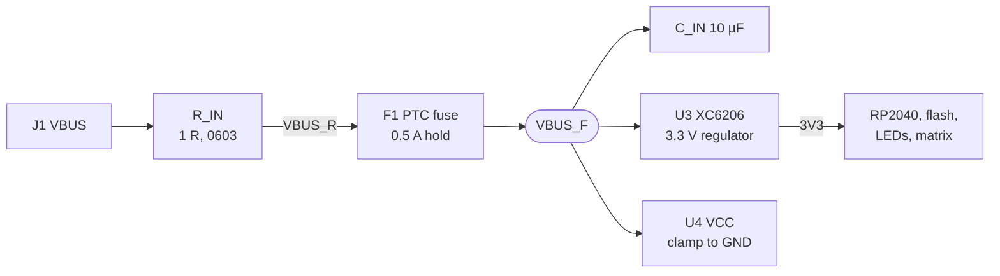
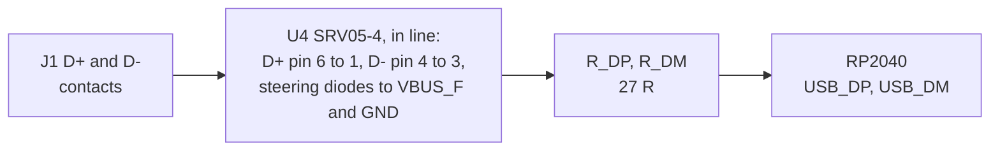

# Electronics

Generated by [pcb/board.py](../../pcb/board.py) ([Generators](generators.md));
[pcb/check.py](../../pcb/check.py) checks the result:

- On the Gerbers: shorts and opens, the solder mask, the paste, the legend and the planes.
- On the design data the Gerbers are written from: the clearances of the outer copper and the holes.
- The files against that data, one for one: the copper Gerbers (every pad, via and trace), the drill files,
  the outline with its cutouts, and a cathode bar at every diode and LED.

The [schematic](avionics-panel-rev1-schematic.pdf) (four A3 sheets: USB-C and power, RP2040, key matrix, knobs
and lights) is drawn from the same netlist by [make_schematic.py](../../pcb/make_schematic.py), which fails if
any pad of the board is missing from it. Renders: [top](../../renders/5-pcb-top.png),
[bottom](../../renders/6-pcb-bottom.png).

RP2040 with W25Q16 flash, 12 MHz crystal, XC6206 regulator and USB-C with an ESD (electrostatic discharge)
array and a fuse ([USB protection](#usb-protection)), all on the bottom of a 4-layer board (signals / GND /
3V3 / signals) with 91 nets and 30 unconnected pins. `check.py` prints what each build reaches, and the
build passes when:

| Check | Passes when |
| --- | --- |
| Shorts, opens, nets with a detour | There are none |
| Copper to copper | At least 0.15 mm |
| Holes on different nets | At least 0.5 mm apart (JLCPCB's minimum) |
| Holes on the same net | At least 0.254 mm apart |
| Vias | None is in or within 0.1 mm of an SMD pad or a paste opening, apart from the GND vias in the RP2040's exposed pad |
| Paste | It is on every assembled pad and nowhere else |
| Smallest drills | At least 0.3 mm plated, 0.5 mm unplated |
| Smallest annular rings | At least 0.075 mm on vias, 0.15 mm on pads |
| JLC's footprints | Every bottom-side part's footprint lands, mirrored, on our pads of the same number ([Assembly data](#assembly-data)) |

## Solder mask

The solder mask is black, with JLCPCB's white legend on it: green would show as a thin line in the gap round
each key cap and through the USB-C opening. Black needs wider mask dams than green (0.13 mm against 0.10 mm
with 1 oz outer copper, JLCPCB's capabilities page), so every opening is its pad plus 0.035 mm per side, not
the usual 0.05: the RP2040's pads, the USB-C contacts and C_X2 to R_X are 0.2 mm apart and keep a 0.13 mm dam
between them. `check.py` measures every dam (64 are exactly 0.13 mm) and checks that each opening clears its
pad by at least 0.025 mm. JLCPCB exposes the mask by LDI, allows openings as small as the pad (1:1), and a
JLCPCB blog gives the alignment on multilayer boards as ±0.02 mm (the capabilities page gives no figure; at
that the mask stays off the pads). JLCPCB removes a dam it cannot hold rather than asking, so the order asks
for the production file to be confirmed and the dams checked there; the fallback is green
([Ordering](../building/ordering.md#review-questions)).

Via covering Tented matches the Gerbers: the mask covers every via on both sides, with two deliberate
exceptions.

- The three 1V1 vias under the RP2040 are probe points, open on the top and tented underneath.
- The four GND vias in the RP2040's exposed pad sit in that pad's mask opening, clear of its paste windows.

JLCPCB keeps both, because the mask Gerber decides for a Gerber order. Should it tent them as well, assembly
is unaffected; only the 1V1 probe points are lost.

The four J1 shell tabs get paste over their pads (pin-in-paste), but the stencil leaves about 0.12 mm³ of
solder for about 0.8 mm³ of slot around each tab: a fillet on the bottom at most. The tabs carry the load of
the plug, so they are soldered from the top as well: by JLCPCB in full assembly (its order remark), by hand
otherwise ([Hand-soldering](../building/assembly.md#hand-soldering)).

## Placement and legend

Before routing, `precheck.py` checks the bodies of the bottom-side parts as well as the fixed copper: every
body at least 0.2 mm from every other body and from every pad of another part, where that part's leads or pins
sit, and both outside the 3.6 mm keep-out round each of the five mounting holes, where the plate's boss and
the body's boss press on the board. The sizes are nominal (`board.BODY`): JLC's package names where they give
them, which match the datasheets, the EIA sizes for the chip parts and the HRO drawing for J1
(8.94 x 7.35 mm). The closest bodies are C_1V0 and C_1V2, 0.30 mm apart. U3's pads reach 1.75 mm from its
centre line (JLC's footprint 1.77 mm, the leads up to 1.5 mm), so each joint gets a toe fillet.

J1's shell is grounded and has only the solder mask between it and the bottom copper, so nothing but J1's own
pads runs under it: the router keeps out of the whole body on the bottom, and `check.py` checks it on the
Gerbers. The ALT/HDG lines cross J1 on the top layer; the top-layer link between the two VBUS contacts turns
between the shell pegs, close to the pad row, to leave them room.

The legend:

- Size: capital letters at least 1.0 mm high, measured on the font (the lowercase text has an x-height of
  0.82 mm), 0.26 mm strokes, lines at least 0.16 mm wide (JLCPCB's minimums: 1.0 mm and 0.153 mm).
- Clearance: `check.py` keeps the legend 0.15 mm clear of every mask opening and hole, and 0.3 mm inside the
  board outline and round the two LED cutouts. JLCPCB gives no figure for the outline (it keeps copper 0.2 mm
  from a milled edge); the legend is closest at 0.65 mm.
- Placement: `make.py` moves a part name or key legend to the nearest free spot if a via lands on it or it
  would come too near the edge, and a diode's cathode bar up to 0.3 mm sideways if a via would cut it short
  (a bar with no free spot within 0.3 mm stays cut; `check.py` wants it alongside at least half of the pad's
  edge).
- LEDs: the bottom has a cathode bar beside each LED's cathode pad, for the placement preview.

## Through-hole parts

The through-hole parts are soldered from the bottom, among the SMD parts: by JLCPCB (by hand or selectively)
in full assembly, by hand otherwise. `check.py` keeps every exposed SMD pad of another net at least 1.0 mm
(copper to copper) from every through-hole pad, room for the iron and a fillet without a bridge; the closest
is 1.24 mm (a key pin to its own diode's cathode pad). The same holds for J1's four shell tabs, filled from
the top, where excess solder comes out on the bottom: the closest is 1.025 mm, J1's own VBUS contact; C_IN
sits between U3 and J1, its VBUS_F pad 1.9 mm from the tab.

`check.py` also fits JLC's footprints of the through-hole parts (saved with their holes by
`footprints/fetch.py`) onto our holes pin by pin, as JLCPCB places them ([Assembly data](#assembly-data)).
Our drills follow the datasheets, and each must be within 0.21 mm of JLC's, the span of JLCPCB's plated-hole
tolerance:

| Hole | Ours | JLC's | Datasheet value |
| --- | --- | --- | --- |
| Key pins (TE 1-1825910-4) | 1.0 mm | 1.2 mm | |
| Encoder pins (Bourns PEC11D) | 1.2 mm | 1.1 mm | 1.2 +0.1/-0 mm |
| Encoder lug slots | 1.5 x 2.6 mm | 1.5 x 2.6 mm | 1.5 x 2.6 mm |
| RANGE control terminals (Alps RKJXT1F42001, RKJXT below) | 1.1 mm | 1.2 mm | 1.0 +0.2/-0 mm |
| RKJXT locating peg (Ø1 -0.1) | 1.3 mm, unplated | 1.3 mm | 1.1 +0.1/-0 mm |

- RKJXT terminals: JLCPCB's plated holes can finish up to 0.08 mm under the drill, so 1.1 mm finishes at 1.02
  to 1.23 mm round the 0.7 x 0.2 mm terminals; the 1.7 mm pads keep a 0.3 mm ring.
- RKJXT peg: JLCPCB holds unplated holes to ±0.2 mm, and at 0.9 mm the peg would not go in, so the hole
  follows JLC's footprint, not Alps. The part then floats up to 0.26 mm on its pins, which the plate allows
  for ([Mechanics](mechanics.md#plate-and-body)).

## Routing

No net takes a detour: `check.py` fails any net whose routed length exceeds 1.5 times its shortest 8-direction
tree plus 15 mm (`geom.py`), and the router rips up and reroutes such a net like a failed one. USB: D+ and D-
run from the USB-C contacts through the ESD array and the 27 R resistors to the RP2040, limited to 50 mm each
and 10 mm of skew; the router treats a pair over those limits like a detour.

The USB series resistors are 27 R (C25190), the value in Raspberry Pi's datasheet and minimal design: with the
RP2040's driver it sets the source impedance the full-speed specification asks for (28 to 44 ohm per line).

## Assembly data

JLCPCB places the bottom-side parts by its own library footprints. [pcb/footprints/](../../pcb/footprints/)
keeps each one: its pads (number, position, size) and the pin names of JLC's symbol, saved from JLC's EasyEDA
library by `footprints/fetch.py`, with source and date in each file. `check.py` fits them onto our pads at the
rotation in the CPL (placement file), offline: every JLC pad must land on our pad with the same number,
centres within 0.15 mm and edges within 0.25 mm. A footprint that is not mirrored cannot be fixed by a
rotation; this fit catches one.

- LEDs: our pads stop 0.2 mm short of the board cutout (JLCPCB's copper-to-routed-edge minimum), where JLC's
  footprints run them to 0.05 mm from a smaller cutout (amber) or 0.33 mm into a 2.3 mm round hole (white). So
  the LEDs get more at the centre and at the pad's inner edge alone: 0.2 and 0.32 mm (amber), 0.25 and 0.5 mm
  (white).
- Polarity: we name the pads of the diodes and the LEDs K and A. `check.py` reads which of JLC's pads is the
  cathode from the stored pin names, not from a fixed pairing.

The CPL follows JLCPCB's convention for the bottom side as KiBot's JLCPCB filter and the kicad-jlcpcb-tools
plugin write it (180 minus KiCad's bottom angle): seen from the bottom, the part is JLC's footprint turned
counter-clockwise by the rotation.

| Parts | CPL rotation |
| --- | --- |
| U1, U3, J1 | 180 |
| U2, U4, Y1, the diodes | 0 |
| Resistors, capacitors, F1 | 180 (horizontal) or 270 (vertical) |
| R_SHIFT | 0 (pad 1, its GPIO end, to the east) |
| R_UNIT | 180 (its GPIO end to the west) |
| LED_SHIFT | 180 (pin 1, the cathode, to the west) |
| LED_UNIT | 0 (the cathode to the east) |

The bottom silkscreen has a pin 1 corner mark at U1, pin 1 dots at U2, U3, U4 and Y1 and the LEDs' cathode
bars (LED_SHIFT's west of its cutout, LED_UNIT's east: each on the side away from the other LED) for the
[placement preview](../building/ordering.md#placement-preview).

In full assembly JLCPCB also places the through-hole parts on the top, from the same CPL (`CPL-full.csv`,
Layer "Top"), in its top-side convention: seen from the top, the part is JLC's footprint turned
counter-clockwise by the rotation, the footprint origin on the CPL position. The keys, encoders and RANGE
control are at 0; the encoders' CPL position is JLC's footprint origin, 1 mm north of the shaft. `check.py`
fits each JLC footprint there onto our holes pin by pin (`TH_PIN`): every JLC hole on the hole of its pin
within 0.15 mm, the unplated RKJXT peg hole on ours, none of ours left over. So an encoder placed the wrong
way round fails the build.

## Crystal

The crystal (Abracon ABM8-272-T3) has the crystal itself on pins 1 and 3, diagonally opposite, and GND on 2
and 4. Seen from the top, the bottom-side part has pin 1 (XO_R, to the 1 k) bottom-right, 2 (GND) bottom-left,
3 (XIN) top-left and 4 (GND) top-right. Its nets are hand-routed: XIN comes straight up from the RP2040
between the two lower pads, XOUT runs east to the 1 k (R_X) just south of the crystal, clear of its body and
pads, XO_R from the crystal round its east side to the 1 k and C_X2; C_X1 sits west of the crystal on XIN. The
top-right GND pad has its own via into the plane, the bottom-left one shares C_X1's GND pad and via.

## Decoupling

Decoupling follows Raspberry Pi's minimal design: one 100 nF at each IOVDD pin, every one but pin 33 on a
trace of its own from the pin. The IOVDD pins sit inside the fan-out, so the capacitors (0402, C1525) go where
no pin of theirs fans out:

- C_IO1 south-west of the corner pin 1, below pin 2's fan-out line (1.5 mm of copper from the pin).
- C_IO22 in the gap above pins 22 and 23 between the fan-outs of pins 21 and 24 (1.3 mm).
- C_IO10 in pin 10's own fan-out lane, which it would use if it had a signal, just past the fan-out vias
  (4.7 mm), where the matrix lanes on the top layer leave that row free.
- C_IO49 below pins 49 and 48 (IOVDD and USB_VDD, 2.1 and 2.0 mm), beside C_1V1, also an 0402 so that the two
  fit between the fan-outs of pins 51 and 47.
- Pin 42 has C_D2 (1 µF, 3V3) in the corner south-east of the RP2040, on a direct trace from pin 42 and the
  shared via of pins 42 to 44 (IOVDD, ADC_AVDD, VREG_VIN): 2.2 to 4.6 mm of copper from those pins. It is 1 µF
  because the datasheet (2.9.3, 2.10.1) wants 1 µF close to VREG_VIN. C_BULK, the same part, is a 1 µF bulk
  capacitor on the 3V3 plane on the matrix side of the chip.
- Pin 33 has no room: east of its fan-out lane is the only way north for the ALT/HDG and FREQ lines (GP18 to
  GP23), between the fan-out vias and the FREQ encoder's pin A, and a capacitor there blocks one of GP20 to
  GP24. It drops into the 3V3 plane through its via under the chip (1.0 mm of copper) and shares the
  capacitors on the plane, C_D1 and C_D3 (100 nF) among them.
- Two 0402 capacitors hang from a short trace off VREG_VOUT (pin 45), C_1V0 (1 µF, 2.0 mm of copper) and C_1V2
  (100 nF), and C_1V1 (100 nF) sits 2.0 mm below DVDD (pin 50).

Every decoupling capacitor has its own GND via at most 1 mm from the pad, and its own 3V3 via on the 3V3 side
unless that side is the trace from its pin; that pin then feeds the plane itself, through its via under the
chip. `check.py` holds the rules:

- A pin that feeds the plane itself has at most 2 mm of copper to the plane (pins 1, 10, 22, 48 and 49: 1.0 to
  1.4 mm).
- A supply pin with a capacitor of its own has at most 6 mm of copper to its nearest capacitor (trace length
  plus the straight via-to-via distance through a plane). That is about 2 nH of trace 0.2 mm over the 3V3
  plane, the order of the capacitor's own ESL and GND via.
- The nearest capacitor of VREG_VIN and of VREG_VOUT has at least 1 µF.
- Every IOVDD pin but 33 reaches a capacitor within 6 mm over the outer layers alone, without the plane, and
  no two reach the same one.
- Exceptions, whose path to a capacitor is reported but not limited: IOVDD pin 33 and RUN (pin 26, tied to
  3V3) must reach the 3V3 plane within 2 mm of copper. DVDD pin 23 on the north side has no room between the
  crystal and the fan-out (C_IO22 takes the gap) and reaches the 1V1 capacitors over the top layer through the
  1V1 vias under the chip (about 10 mm).

## GPIO map

| GPIO | Use |
| --- | --- |
| GP11, GP8, GP5, GP2 | Key matrix rows 0-3 |
| GP0 | Matrix row 4: RANGE A, B, C, D, com (columns 0-4), ALT/HDG push (5), FMS push (6) |
| GP1, GP3, GP4, GP6, GP7, GP9, GP10 | Key matrix columns 0-6 |
| GP18-21 | ALT/HDG encoder (outer, inner) |
| GP24/25, GP22/23 | FREQ encoder (outer, inner) |
| GP26/27, GP16/17 | FMS encoder (outer, inner) |
| GP28/29 | RANGE encoder |
| GP13 | FREQ push (direct to GND) |
| GP12, GP15 | SHIFT light (amber), UNIT light (white) |
| GP14 | Spare: its fan-out stub ends under the solder mask, not connected (boxed in, no room for a pad) |
| SWCLK, SWDIO | Debug points: exposed pads (0.6 / 0.7 mm) on the bottom at the RP2040's north side, for thin wires to an SWD probe; GND on the USB-C shell. RUN stays tied to 3V3, the probe resets over SWD |

35 diodes (1N4148W): one per key, five for the RANGE switches, one each for the ALT/HDG and FMS pushes. The
RANGE control's "Push" pin is common to its five switches; centre push = com without A-D.

Each of the seven columns has a 10 k pull-up to 3V3 (R_PU0 to R_PU6, C25804), on its bus between key rows 1
and 2. `KeyMatrix` drives a row low and reads the columns at once, then drives it high again and waits about
1 µs before the next row. The pressed key's diode then turns off at once, and only the column's pull-ups lift
the column:

- Without the 10 k, with the RP2040's own pull-up alone (50 to 80 k), 20 to 30 pF of copper (90 to 170 mm)
  and five diodes on the column, the time constant would be 1 to 2.4 µs: long enough for a phantom press in
  the same column of the next row.
- With 10 k in parallel it is 0.2 to 0.3 µs, and the column passes the input high threshold well under 1 µs
  later. A pressed key draws about 0.3 mA through its pull-ups.

So reversed diodes cannot be made up for in the firmware:

- A uniform reversal of all 35 could be scanned with the roles swapped (`KeyMatrix(row_pins=COL_PINS,
  column_pins=ROW_PINS, columns_to_anodes=True)`, and `boot.py` driving GP6 and reading GP2 for SHIFT), but
  the read lines would then only have the RP2040's weak internal pull-ups, and the phantom presses come back.
- `columns_to_anodes=False` keeps the roles but reads the columns against internal pull-downs, which R_PU0 to
  R_PU6 overpower (every key would read pressed) until they come off the board.
- A mixed reversal cannot be scanned at all.

The encoders feed the RP2040 directly: CircuitPython's `rotaryio` decodes the quadrature in one PIO state
machine per ring (7 of the 8), with no polling and no external decoder. A quadrature-to-up/down converter such
as the LS7183 would add seven chips for a job the PIO already does. The encoders' metal mounting lugs are
plated slots on GND (through the plane), an ESD path from the shaft.

## USB protection

| Part | Value | Job |
| --- | --- | --- |
| R_CC1, R_CC2 | 5.1 k (C23186, C25905) | Pull-downs on CC1 and CC2 (configuration channel): a USB-C source switches VBUS on only after it sees them |
| U4 | SRV05-4 ESD array, SOT-23-6 (hongjiacheng, C7420376) | Takes discharges on D+, D- and VBUS_F to GND |
| R_IN | 1 R, 0603, 0.1 W (C22936, basic) | Damps VBUS at a hot plug; opens first on a short on VBUS_F |
| F1 | Bourns MF-NSMF050-2 PTC (resettable) fuse, 1206, 13.2 V, 100 A (C75464) | Sustained overloads |
| C_IN | 10 µF, 10 V X5R, 0603 (C19702) | U3's input capacitor |
| U3 | XC6206P332MR regulator, SOT-23 (C5446) | 3.3 V for every load; its current limit covers faults on 3V3 |

U4 has four channels of steering diodes to its VCC pin and a clamp from VCC to GND.

| U4 | Value |
| --- | --- |
| Working voltage | 5.0 V (VBUS may reach 5.25 V, 5.5 V under USB 2.0's VBUS Max Limit ECN and USB-C) |
| Breakdown | At least 6.0 V at 1 mA |
| Capacitance | 1.0 pF per channel to GND |
| ESD | ±30 kV contact discharge (IEC 61000-4-2) |
| Surge (8/20 µs) | 4 A at 13.5 V typical, 15 V maximum |

- In line: D+ and D- each run through two channels, in at one pad and out at the opposite one, so the array
  has no stub and each line sees 2 pF, far less than full speed tolerates.
- Behind the fuse: VCC is on VBUS_F (over the top layer to a via on the line from the fuse to the regulator),
  GND on a via under the body. A clamp that fails short, or U4 placed turned by 180° (its VCC on GND, the
  clamp diode forward across VBUS_F), then sits behind R_IN and the fuse instead of shorting the host's VBUS
  (see below for what gives way).
- Part choice: the SRV05-4 ([Ordering](../building/ordering.md#parts-and-stock)); a USBLC6-2SC6 does the same
  job with the same pinout.
- Checked: `check.py` cuts U4's pads out of the bottom copper and checks that J1's contacts then no longer
  reach the 27 R resistors (no copper runs past the array), and that U4 is at most 5 mm of copper from J1.

| Limit | Value |
| --- | --- |
| F1's hold current | 0.5 A at 23 °C, 0.40 A at 50 °C |
| F1's trip current | 1.0 A at 23 °C |
| Series resistance | F1 0.15 to 0.7 ohm; with R_IN at most 1.7 ohm |
| U3's input | 7.0 V absolute maximum |
| U3's dropout | At most 0.68 V at 100 mA |
| U3's output | 200 mA guaranteed; folds back at about 0.35 to 0.5 A (Torex's curve for the 3.0 V type), about 0.1 A into a short |
| Capacitance on VBUS at attach | 10 µF (USB 2.0, 7.2.4.1), which C_IN alone reaches |

The board draws about 90 mA at most (RP2040 a few tens of mA, flash up to 25 mA writing, LEDs up to 32.5 mA,
0.3 mA per pressed key). From 4.40 V, the lowest VBUS of a USB 2.0 port, R_IN, F1 and U3's dropout still leave
3.3 V out at 100 mA. The capacitors behind U3 add to C_IN while VBUS comes up, which puts the board over the
intent of the attach limit; U3's current limit, behind R_IN and F1, limits that inrush, and on PC ports it is
no practical issue.

What gives way on a fault:

- A short on VBUS_F (a bridge across C_IN, a failed U3, U4 shorted or placed turned): R_IN opens, or drifts or
  scorches, before F1 trips in practically every case. At 1 to 3.5 A, F1 takes about 7 s to 25 ms, and R_IN
  takes 1 to 12 W meanwhile; a port that limits its current at 0.5 to 1 A may never trip F1 and leaves R_IN at
  0.25 to 1 W. The host's port and the cable are protected. Afterwards replace R_IN, perhaps F1, and U4 if it
  was turned or shorted. A 1206 resistor (0.25 W) would overheat as well, and does not fit between the VBUS
  via and F1.
- A sustained overload under about 1 A: F1 (only 1.0 A and more is a guaranteed trip; R_IN already runs over
  its 0.1 W from about 0.32 A).
- A fault on 3V3: U3's current limit. F1 will not reliably trip.

`check.py` checks that each net of the chain holds only its pads (VBUS: J1 and R_IN; VBUS_R: R_IN and F1;
VBUS_F: F1, C_IN, U3 and U4's VCC; `CHAIN_PADS` and `LOADS`) and that no copper runs past or across R_IN or
F1 (the parts in `VBUS_CHAIN`).

Hot plug: a live USB-A port (with an A to C cable) switches VBUS on hard, where a USB-C source ramps it with a
controlled slope. The cable's inductance then rings with C_IN, a ceramic capacitor with next to no loss. R_IN
damps it: with the cable's and F1's resistance, 1 R takes the circuit to critical damping or past it
(2 x √(L / C) is 0.8 to 1.3 ohm up to 1 µH).

A step model of the circuit, not kept in the repository, gives the peaks on VBUS_F. It assumes a 5.25 V step,
no load, no contact bounce, no U4 clamp and C_IN's DC-bias loss (about 3 µF at 5 V and 2.3 to 2.5 µF at 7 V;
a pessimistic curve 1.8 µF at 5 V and 1.4 µF at 7 V). The cable and fuse ranges are in the comment at C_IN in
[board.py](../../pcb/board.py). With 1 R the peak stays within 0.05 V of 5.25 V up to 1 µH of cable. On 2 to
3 µH with little resistance it reaches 5.8 V with the nominal curve and 6.6 V with the pessimistic one, under
U3's 7.0 V maximum; with a 5.5 V step the pessimistic worst case scales to about 6.9 V, still under it.

- Value: without R_IN, a short, low-resistance cable peaks at 9.7 V, above the 7.0 V maximum for about 3 µs;
  0.33 R gives 6.4 V there and 0.5 R 5.7 V. A smaller value would also do; 1 R is the lowest basic one.
- Pulse: R_IN takes the inrush: at most 4.1 A, about 17 W at its peak and above half that current for 5 to
  7 µs, under 0.1 mJ in all. An 0603 thick-film resistor takes about 25 W for a 5 µs single pulse (Vishay's
  CRCW0603 pulse curve, as a stand-in for the Uniroyal part).
- Clamp: a TVS (transient voltage suppressor) diode from VBUS to GND instead of R_IN would not keep U3
  reliably under 7.0 V: an SMF5.0A breaks down at 6.4 to 7.0 V and clamps no lower.

## Lights

The two lights are reverse-mount 1206 LEDs in LiteOn's C230 package, on the bottom with the other SMD parts,
so JLCPCB fits them in both assembly variants.

| | SHIFT light | UNIT light |
| --- | --- | --- |
| LED | LTST-C230KSKT (C125108), which LiteOn lists as yellow: 587 nm, 30 mcd minimum and 60 typical at 20 mA, 130°, 30 mA DC at most | LTW-C230DS (C575513), white: 180 to 450 mcd, 130°, forward voltage 2.8 to 3.6 V at 20 mA in four bins of ±0.1 V, 20 mA DC at most |
| GPIO | GP12 | GP15 |
| Series resistor | 75 R (C4275, basic) | 47 R (C23182, basic) |
| Current at full duty | About 13.5 mA typical, 6.8 to 17.2 mA over the pad and the forward voltage | About 4.9 mA typical; 15.3 mA at most (the lowest forward voltage bin less its 0.1 V, the supply 2 % high, no resistance in the pad); about 1.8 mA with a high forward voltage |
| Firmware duty | 0x4800 (28 %) | 0x5500 (33 %) |
| Position | 5.75 mm below the SHIFT key's centre | Midway between the HOME and SHIFT rows, 5.5 mm east of their column |
| Web to the next key hole | 1.10 mm (0.90 mm at tolerance) | 1.30 mm (1.10 mm at tolerance) |
| Layout | Cathode west, resistor east | Mirrored: cathode east, resistor west (east of the LED lies the bus of the next key column) |

- Cutout: each LED shines up through a cutout in the board, 2.2 x 2.4 mm with R0.5 corners, round the
  1.5 x 1.6 mm lens (LiteOn's land pattern: 2.1 x 2.3 mm, sharp corners). The outline Gerber carries both. The
  lens rises 0.82 mm into the 1.6 mm board, so the light pipe stands on the board over it
  ([Mechanics](mechanics.md#light-pipes)). At tolerance the lens clears the cutout's corners by 0.01 mm
  (`check_fit.py`).
- Pads: 1.15 x 1.6 mm. They stop 0.2 mm short of the cutout, JLCPCB's copper to a routed edge, and reach
  0.3 mm under the terminals on the LED's face (LiteOn's pattern reaches 0.55 mm under them).
- Copper: the generator keeps the outer copper 0.2 mm from the cutouts and pulls the planes back 0.5 mm;
  `check.py` holds both to 0.2 mm and the legend to 0.3 mm.
- Resistors: each lies on the bottom in line with its LED, beyond the anode pad, its anode end 0.3 mm from the
  pad and its GPIO end beyond. Beside, not below: the SHIFT light is 5.25 mm from the board edge, and every
  part body but J1's keeps the 2.5 mm JLCPCB's assembly terms ask for. The cathode pad has its own GND via on
  its far side.
- Drive: `code.py` sets both pads to 12 mA drive strength (the RP2040 then keeps at least 2.62 V at 12 mA,
  under 57 ohm), so the resistor sets the current. Both lights together draw at most about 32.5 mA, within the
  50 mA all of the RP2040's GPIOs may source.
- Brightness: the white LED's forward voltage is close to the 3.3 V supply, so its current differs a lot from
  part to part, and the intensity bins span a factor of two and more. The firmware's duties leave three to
  three and a half times up to full duty, and the level that reads well behind the pipe is set on the first
  board ([Bring-up](../building/bring-up.md#first-board)). A white LED from the highest forward voltage bin
  may stay dim: then bridge R_UNIT's pads or fit a 0 R (C21189).
- Holes in the plate: each light hole (Ø2.3 mm) keeps at least 0.8 mm of aluminium to the next key hole
  (JLCCNC's recommended wall; 0.5 mm is its minimum), and the light pipe's base clears the switch bodies and
  the key holes. Two column lanes of the key matrix pass the UNIT cutout on the top layer, one on each side.
