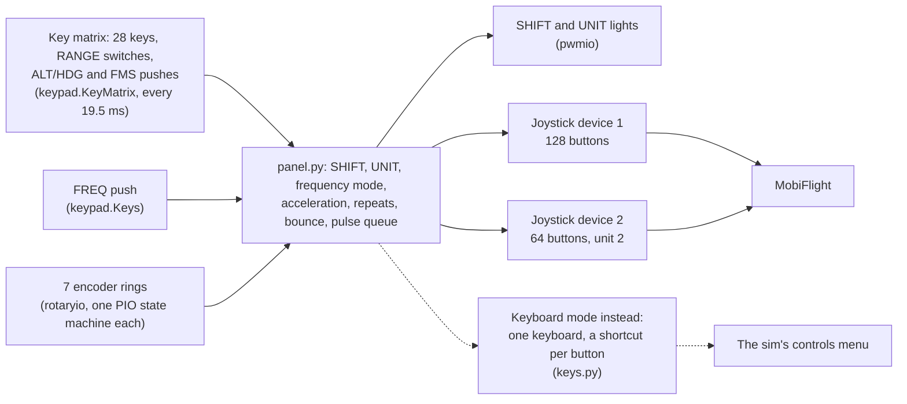
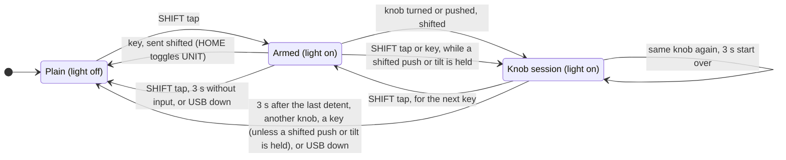

# Firmware

CircuitPython 9.2.9 on the panel's RP2040, in [firmware/](../../firmware/). Installing it is in
[Bring-up](../building/bring-up.md), mapping its buttons in [Mapping](../using/mapping.md).



`code.py` reads the hardware and feeds key events, encoder detents and the time to `panel.py`, which holds all
the logic, has no hardware access and runs on the PC in the tests. `boot.py` sets up the two joysticks, which
share one USB HID (human interface device) interface with two report IDs, and hides the drive and console in
normal use. `buttonmap.py` numbers the buttons, and `make_buttons.py` (PC only) writes
[BUTTONS.md](../../firmware/BUTTONS.md). In the [keyboard mode](#keyboard-mode) `boot.py` sets up a keyboard
instead, and `keys.py` turns the buttons into shortcuts; `make_keys.py` writes
[KEYS.md](../../firmware/KEYS.md).

## State

Every state lives in the firmware and is sent as fixed joystick buttons, so mappings never need variables or
preconditions and cannot get out of sync with the panel:

- SHIFT: one-shot for keys, kept through a knob session ([the rules](#shift) below). Shifted functions are
  their own buttons.
- UNIT: the firmware keeps the state and drives the white light; what moves to device 2 is in
  [Mapping](../using/mapping.md#two-joysticks). Button numbers are frozen; a snapshot test in
  `firmware/test_panel.py` checks it.
- FREQ knob: the push cycles COM, NAV, ADF, and each mode sends its own turn buttons. The mode stays
  until the next push.
- Knob acceleration ([table](../using/controls.md#knobs)), UP / DN auto-repeat and the pan tilt repeat rate
  are done in the firmware.
- Squawk with SHIFT: the outer ring selects the digit (1 to 4; it stops at both ends and sends no button), the
  inner ring steps the selected digit, one step per detent, on that digit's own up and down buttons. A new
  shifted session starts at digit 1; a shifted FREQ push still held keeps its session and the digit.
- RANGE: a tilt closes its direction switch and "com"; on a slow tilt "com" can close well before the
  direction. So the centre push (PTR) is sent on release, and only if no direction closed during the press. A
  tilt repeats, first after 300 ms, then about every 120 ms.

### SHIFT

SHIFT is tapped, never held. For keys it is one-shot; a knob keeps it while in use
([Controls](../using/controls.md#shift) has the short version):



- A knob turned or pushed after SHIFT stays shifted while it is in use, including moving between its outer
  and inner ring (for a whole squawk code), and returns to normal 3 s after the last detent. A push or RANGE
  tilt held keeps it too, so a long shifted pan never outlasts the light: the 3 s start when it is let go.
- The light never goes dark while SHIFT still applies: dark means plain, and lit, even dim, means SHIFT is on,
  for the next key after a tap or for the knob that keeps it. A key pressed while a knob keeps SHIFT is sent
  plain. During SHIFT's last second the light pulses between bright and dim.
- While a knob still keeps SHIFT (light on after a squawk entry, or a shifted push or tilt still held), a tap
  arms SHIFT for the next key instead, so SHIFT, VFR gives IDENT with one tap. A second tap cancels SHIFT,
  except for a shifted control still held.
- A shifted push or tilt that is still held keeps SHIFT and the light until it is let go, whatever is pressed
  meanwhile (SHIFT taps, the key a tap armed, plain keys). Only another knob, turned or pushed, ends it: SHIFT
  belongs to one knob at a time.
- While USB is down (the PC off, asleep or booting, or a host that has suspended the panel) the lights are
  dark and SHIFT does not apply: an armed SHIFT and a knob's session end as the lights go out, a SHIFT tap
  does nothing, and what is pressed or turned goes out plain once the host is back ([USB](#usb)). UNIT stays
  as it is, and the white light shows it again with the host.
- SHIFT is scanned first. A key scan reports its changes in the order of the key numbers, and `code.py` hands
  the keypad SHIFT's row and column first. So when one scan (19.5 ms) reads SHIFT and a key going down, SHIFT
  reaches the panel first, whichever of the two was down first, and the key is shifted. The FREQ push has a
  keypad of its own: `code.py` passes the events of both keypads on in the order of their scans, so a push and
  a SHIFT tap read together after a wait for the host keep the order of their scans; scanned in the same
  millisecond, the matrix comes first.

## Knob steps

Knob detents are button pulses: 56 ms pressed, 56 ms released, so 112 ms per step of one button (about 9
steps per second). Press and gap both have to outlast a MobiFlight poll, or two detents merge into one:

- MobiFlight polls joysticks from a 20 ms timer, which Windows' 15.6 ms clock stretches to about 31 ms, and
  only sees the state at each poll.
- The PC fetches reports every 8 ms (the HID endpoint's interval), and both joysticks share that endpoint.
  With a report still waiting from the previous loop pass and both devices changing in the current one, an
  edge can arrive up to three frames (24 ms) late.

So [panel.py](../../firmware/panel.py) makes press and gap a poll, rounded up to 32 ms, plus three frames:
56 ms.

Everything goes out in the order it came, knob steps, keys and pushes alike, one new press at most every
56 ms. MobiFlight has seen each press before the next one starts, which may be in its gap; a second press of
the same button also waits for its own gap. So COM ⇆ after a quick turn swaps the frequency that was dialled,
and ENT confirms the whole character. A key with nothing ahead of it goes out at once, and two keys pressed
together go out 56 ms apart.

What the queue does:

- At most 8 detents wait, all rings together, and a detent beyond that is dropped. Keys, pushes and the first
  step of UP, DN or a tilt are never dropped (up to 8 owed presses per button). So a key waits for at most
  about 0.9 s.
- A key or push held while it waits goes down at its turn and stays down until it is let go. Let go before
  its turn, it reaches the PC as a 56 ms tap.
- A repeat of a held UP, DN or tilt waits until the last step of its button is through, so a step longer than
  the repeat interval (120 ms tilt, 125 ms UP / DN) slows the repeats down and nothing queues up.
- Acceleration: ALT, HDG, CRS and the ADF inner ring have a fine and a coarse step. A detent takes the coarse
  step within 60 ms of the previous one, and so do two detents read in one loop pass.
- With detents less than 112 ms apart, such a knob also takes the coarse step while a fine step of it still
  waits. The two buttons then share the turn, and the last step goes out within about 0.2 s of the
  hand. A fine step that only waits behind other rings does not count, so a slow turn stays fine.
- A spin faster than its steps go out can lose detents beyond the 8 waiting and runs on for up to about
  0.9 s. That holds for knobs with one step per detent (FMS, COM, NAV, the ADF outer ring, BARO, squawk, the
  dimmers, RANGE), and for the coarse step faster than about 16 detents per second.
- Turning the other way drops the steps of that ring at the end of the queue, so the knob stops at once.
  Steps that a key, a push or another ring followed stay, since what followed builds on them (ENT confirms the
  character they dialled), or changed what the ring does: after a SHIFT tap, UNIT or a FREQ push the step back
  belongs to another function, and the steps of the one before all go out.

The [knob timing check](../using/mapping.md#knob-timing) measures whether MobiFlight counts every detent.

## Keys and switch bounce

Keys and pushes follow the same rule as the knobs: a quick tap stays pressed for at least 56 ms, and a new
press of the same button waits until that button has been released for 56 ms. MobiFlight then sees every tap,
and a fast double tap (CLR twice, a flip-flop) stays two presses. A longer press is sent as long as it is held
(and 30 ms more, see below); right after a quick tap of the same button it starts up to 112 ms late, once the
tap and its gap are over, and it waits its turn behind anything still queued ([Knob steps](#knob-steps)).

The keys are scanned every 19.5 ms (20 ticks of CircuitPython's 1/1024 s clock) and a press is passed on at
the first scan that reads it (no added delay). A key already held when the firmware starts is ignored until it
is pressed again. A switch that bounces for longer than a scan shows up as a release and a new press one scan
later, which the 56 ms minimum press would turn into two presses (AP on and straight off again). So a release
of a key or push waits 30 ms: a new press of it in that time was a bounce, and the press goes on as if never
released. A switch that chatters while held stays one press throughout: UP and a tilt keep repeating (a repeat
due in those 30 ms waits for them, the ones after it keep their time), and a shifted push or tilt keeps SHIFT.

- The 30 ms count from the scans that read the release and the press (`keypad.Event.timestamp`), not from the
  loop pass that picks them up, so a pass that waits for the PC cannot stretch a bounce past them.
  CircuitPython 9.2 scans the keys from its tick interrupt, so the two scans of such a bounce are 19.5 ms
  apart, more when code that runs with interrupts off holds the second one up: the 30 ms are one and a half
  scan intervals, half a scan to spare. A finger lifts and comes back in no less than about 60 ms, so a real
  double tap stays two presses.
- The cost: every release reaches the PC 30 ms late. A held key, UP / DN repeat or tilt stops 30 ms later (no
  extra step), the 3 s of a shifted push or tilt start 30 ms after it is let go, and the RANGE centre push
  sends PTR 30 ms after its release. In those 30 ms the push or tilt still counts as held (the release may
  still turn out a bounce), so a key or a second SHIFT tap does not end its SHIFT session; the light stays on
  and shows it. Presses, the SHIFT one-shot and UNIT act on the press and get no bounce delay.
- Each keypad's queue holds 320 events. It goes unread for a little over 5 s at most: the other joystick's
  send may take 24 ms, then a send that meets a suspend waits 2 s and 0.5 s more for the host
  ([USB](#usb)), and should the host come back at the end of them and suspend the bus again at once, the next
  loop pass asks it to resume, which takes 2.5 s more if it refuses, before it reads the keys. In that time a
  switch that changes with every scan makes about 260 events, so the queue covers it with more than a second
  to spare, and fingers make far fewer. Should a queue overflow all the same, `code.py` drops what it
  holds, lets go of every key of that keypad at once, without the wait, and resets it. The keys still held
  then come in again as new presses, so the PC sees them released and pressed again.

## Errors

If `code.py` raises, in its main loop or while it starts (a missing file, `boot.py`'s devices missing, a pin),
it releases every button or key (the PC keeps the last report otherwise, so a key could stay held), prints the
traceback, waits 2 s and restarts itself, also when printing fails (a `MemoryError` may leave no room to
format it). The restart is a reload: USB stays up and `boot.py` does not run again. The pause lets Ctrl-C on
the serial console stop even a crash loop at the REPL (CircuitPython's interactive prompt). There is no
watchdog: every wait in the loop is bounded, and a watchdog reset would drop the joysticks off USB and run
`boot.py` again, which would also hide the drive in the middle of an update.

Ctrl-C itself, and the reload CircuitPython makes when a file on CIRCUITPY was saved (update mode), end
`code.py` with exceptions that are no errors (`KeyboardInterrupt`, `ReloadException`). `code.py` releases
everything for them too and lets them pass. With USB down nothing is released: a send would only wait, and
the next run of `code.py` sends its state as soon as a host is there.

`code.py` takes its mode from the devices `boot.py` made: two joysticks, or one keyboard and nothing else
([Keyboard mode](#keyboard-mode)). Before `boot.py` has run (a fresh install, until the first replug)
CircuitPython has a keyboard, a mouse and consumer control of its own. `code.py` then stops with "joysticks
missing: copy boot.py and replug the panel", again every 2 s, and sends nothing. So "Avionics Panel rev 1
ready" on the console means `boot.py` has run.

## USB

Reports are only sent while the host has the panel mounted and not suspended. A host that enumerates the panel
but never reads it (Linux, while no program has the joystick open) makes each send wait 2 s and fail. Both
joysticks share one USB interface, so they fail alike and share one back-off: after a failed send neither
device tries for 1 s, then 2, 4 and up to 8 s, and in the end the loop stalls for 2 s of every 10.

A report that goes out more than three frames (24 ms) after the loop pass worked it out, because its send or
the one before it waited for the host, is later than the 56 ms of a press and of a gap allow for. The presses
and gaps the PC is being shown then start anew, so one that begins with the late report or after it still
outlasts a MobiFlight poll for the PC. A request to resume (below) stalls the panel by its wait as well, also
one that finds no host; a send of a report that fails does not. After one such wait a held UP, DN or tilt
repeats first 400 or 300 ms after the press the PC got (a host whose reports come late time and again
stretches that delay by each of them), and SHIFT ends that much later: the light stayed as it was during the
wait, so a key pressed then goes out as the light showed, unless the host is still away after the wait (the
lights then go dark and SHIFT ends, [SHIFT](#shift)). A press or gap whose report goes into a free endpoint
just before the host stops polling for a while is not covered: that send returns at once, the host takes the
report after its pause and the next one a frame later, so the press or gap can come out shorter than a poll.

After a late report the other joystick's report goes out again, in the next pass: the host may have
re-enumerated during the wait, with no loop pass to see USB down. If that second report is late as well and
holds no change, nothing follows it: a host that takes every report late would otherwise get reports without
end. Only a host that re-enumerates during that second send is not covered: it takes the first joystick's held
buttons for released until that report changes. A host that comes back after a request to resume (below)
gets both reports again as well. So the sends of one loop pass wait for the host once, 2.5 s at most, and the
longest pass takes 5 s: a request to resume whose host comes back at the end of its 0.5 s, and then a send
that meets a new suspend and waits as long again.

While USB is down (no host, or a host that has suspended the panel) the lights are dark, SHIFT does not apply
([SHIFT](#shift)) and nothing is sent. A held UP, DN or tilt does not repeat then, so it does not wake a
sleeping PC; the repeat missed comes once the host is back. Every report then counts as unsent, and a failed
send's back-off ends: a host that comes back gets the panel's state at once.

While the host has suspended the panel (a host that autosuspends idle HID devices, such as Linux with
`power/control` at `auto`), the panel asks it to resume when input waits, and when the host has something
other than what the panel shows: a press, a release or a knob step that plays out after the suspend, a press
still queued, in keyboard mode a shortcut whose modifiers went out without its key.
CircuitPython has no call for that: a report sent while suspended waits 2 s, then sends the request, and the
panel waits up to 0.5 s more for the host to come back. It then stalls by the whole wait, as after a late
report, so the first input reaches the PC about 2 s late, still held for its full 56 ms (in keyboard mode, as
every short press there, a frame less), and a step the host missed reaches it in full.

- The request is the report the last loop pass worked out for joystick 1, in keyboard mode a report with
  every key up. A host that is back within those 2 s gets it.
- Knob turns from before the request go to the PC first. What is pressed and turned during the wait is read in
  one go after it, the keys before the turns, since an encoder's count carries no time: a turn and then a key
  made during the wait reach the PC the other way round. The turns of a ring during the wait add up, and a
  step back among them does not take back a step from before the request.
- While USB is down and no back-off runs, a loop pass reads input only if it asks first. So no input is read,
  and lost, without a request.
- A press the host has when it suspends the panel stays down for the PC until the host is back: the panel's
  release asks, and reaches the PC about 2 s later. That takes a PC put to sleep in the middle of input:
  Linux's autosuspend does not suspend the panel while a button is down, nor before its delay (2 s by
  default) has passed since the last report.
- A send that is under way when the host suspends the panel waits out its 2 s, asks the host to resume and
  sends nothing. `code.py` tells it from a send that went out by the time that send itself has waited: one
  that frees its endpoint in the last millisecond of its 2 s and meets a suspend in the same moment is taken
  for the request too. That is the request: the panel waits for the host as above and sends the report again
  once it is back. So a PC put to sleep in the instant a report changes can be woken by it. A report that went
  into the endpoint just before the suspend may not have reached the host either: it counts as not sent, and
  the next pass asks.
- A host that refuses stalls the loop for about 2.5 s per request. With no host at all the send fails after
  its 2 s, nothing was asked, and the loop goes on at once. Both back off like a failed send; the back-off
  ends when the host comes back by itself. Input during a back-off is read as it comes, without a request.
  After a refused request, only input asks again, once the back-off is over, until the host has been back.
- Whether a sleeping PC wakes is the PC's setting ("Allow this device to wake the computer" in Windows' Device
  Manager, `power/wakeup` on Linux).

In update mode (SHIFT held at plug-in) the panel is a composite device with the drive and the console, and the
joysticks move to another interface number: Windows may then see them as new controllers
([Mapping](../using/mapping.md#update-mode-and-guids)).

## Keyboard mode

[keys.py](../../firmware/keys.py) holds what the [keyboard mode](../using/keyboard.md) adds: the stored mode,
the keyboard's descriptor, the shortcut of every button and the report. `panel.py` is the same in both modes,
but for one rule.

- The mode is one byte of `microcontroller.nvm`, the 4 KB of flash that CircuitPython's RP2040 builds keep
  between the firmware and CIRCUITPY (`CIRCUITPY_INTERNAL_NVM_SIZE`), so it survives power cycles, new files
  and a new UF2; `flash_nuke.uf2` erases it. 0x4B is the keyboard, any other value (a blank flash reads 0xFF)
  the joysticks. `boot.py` reads HOME (amber legend UNIT; row GP5, in SHIFT's column GP6) the way it reads
  SHIFT, and while it is held stores the other mode: switching to the keyboard writes one byte, switching back
  erases and rewrites the 4 KB sector. `code.py` does not read the byte: it takes the mode from the devices
  `boot.py` made ([Errors](#errors)), and imports `keys.py` only in keyboard mode, so the joysticks keep its
  RAM.
- USB: one keyboard and no joysticks, under the same names: HID 1.11's boot keyboard (appendix E.6), without
  report ID, 8 bytes (the modifiers, a reserved byte, six keys of which the panel uses one), keys 0 to 101.
  The interface declares the boot protocol (`usb_hid.enable(boot_device=1)`), for hosts that take only a boot
  keyboard. A host that switches to the boot protocol, if it does so before `code.py` starts, gets
  CircuitPython's own boot keyboard in `usb_hid.devices`, with the same 8 bytes, so `code.py` sends the same
  reports. In update mode the console and the drive come first, and CircuitPython takes a boot device only on
  USB interface 0 (it starts in safe mode otherwise), so there the keyboard declares no boot protocol.
- The shortcuts: F1 to F12, Insert, Home, Page Up, Page Down and the arrows, with left Ctrl, Shift and Alt and
  right Ctrl and Shift. `keys.GROUPS` lists them with what each group leaves out and why; `keys.FIRST` names
  the functions the sim may have no action for, which get the navigation keys and arrows: their parts (the
  key alone, or with fewer modifiers) carry fewer of the sim's defaults than those of the F-keys. With SHIFT,
  a key without an amber legend sends its plain shortcut, and in unit 2 only COM and NAV have their own (not
  COM 121.5). 114 shortcuts, with a snapshot in `firmware/test_keys.py`: the table may still change until it
  has been tested on hardware, and is frozen from then on. `keys.UNIT2` leaves 8 free for new functions of
  device 1, and 2 more are free after unit 2's.
- One shortcut at a time: `Panel(solo=True)` presses a button only while no other one is down, so a held key
  holds back what follows. The queue, its order, its spacing and the acceleration stay the same
  ([Knob steps](#knob-steps)). A shortcut is a combination of keys: two at once would be another one.
- The report: `keys.Keyboard` turns the pressed button into its shortcut, a step per report. The modifiers
  go down alone, then the key; on release the key goes up first, then the modifiers. So the host never sees a
  key with modifiers other than its own, and a shortcut that follows at once swaps the modifiers in a report
  of its own. Each step is worked out from the report the host has, so a report that did not go out (a host
  that does not poll) is worked out again and no two steps merge. `send_report` waits until the host has taken
  the report before, so each step reaches it, a frame apart: the key goes down a frame after its modifiers
  and is down about one frame less than `PRESS_MS`.
- After USB was down the host is taken to have every key up. A shortcut still held then goes down again, its
  modifiers first; a host that had only suspended the bus sees that key released and pressed once more, and a
  tap still under way when such a host comes back by itself can be typed twice, when its key reached the host
  before the suspend; a doubled toggle such as AP cancels itself. A host that comes back on the panel's
  request to resume had suspended the bus and kept its keys: a shortcut still held goes on from the report it
  has, and is not pressed again. Two cases are not covered: a send that waits while the host re-enumerates
  goes out to the new host as it stands, so if it holds a key, that host gets the key and its modifiers in one
  report; and a host that re-enumerates right after it resumed on a request is taken to have kept its keys, so
  it can get the same report, or a modifier pressed and let go alone.
- Each time it starts, before its loop, `code.py` lights SHIFT and UNIT by turns, 150 ms each, three times,
  also while USB is down (at plug-in the host may not have mounted the panel yet), so the mode shows on a
  charger too. Then the loop sets both lights, dark while USB is down ([Lights](#lights)). Keys and knobs used
  meanwhile go out after it.

## Lights

`code.py` drives the SHIFT and UNIT lights with PWM at 1 kHz, at `LED_DUTY` = 0x4800 and 0x5500 (about 28 and
33 % of full), the amber one dimmed to a quarter for its pulse in SHIFT's last second. Both stay dark while
USB is not connected (the PC asleep, booting or off, a charger, a host that has suspended the panel); the
panel runs on, without SHIFT ([SHIFT](#shift)). In keyboard mode they first take turns at each start
([Keyboard mode](#keyboard-mode)). It sets the drive strength of the SHIFT light's pad (GP12) to 12 mA, which
that light's series resistor needs, by writing the RP2040's pad register through `memorymap` (CircuitPython
has no call for it); should that fail, it prints "LED drive strength not set" and the SHIFT light stays
dimmer at the 4 mA default. GP15 only switches the UNIT light's transistor
([Electronics](electronics.md#lights)) and keeps that default.

## Pins

Seven `rotaryio` encoders use 7 of the RP2040's 8 PIO state machines; the Pico bench creates all seven too.
The pins are in `code.py` and the [GPIO map](electronics.md#gpio-map).

- Detents: both encoder types have 30 detents and 15 pulses per turn, with a detent where the A and B
  contacts read alike, so `rotaryio` counts a detent every two quadrature edges (`divisor=2`), from the state
  it starts in. Started between two detents it would count halfway between them and lose the first detent
  after every reversal. So `code.py` reads each ring's two pins first and makes its encoder while they read
  alike. A ring that is being turned as `code.py` starts gets up to 0.5 s, for all rings together, to reach a
  detent; one still between two detents then is named on the console and loses those detents until the next
  start.
- GP25, the FREQ outer encoder's B line, is the Pico CircuitPython build's status LED, driven high at 12 mA
  in blinks in the first second after power-up, after `code.py` stops with an error and in safe mode. A 1 k
  resistor in series on the board (R_GP25) limits the current into a closed contact to 3.3 mA, `boot.py` sets
  the LED's brightness to 0 so that later blinks drive the pin low, and while `code.py` runs the pin belongs
  to `rotaryio`. To check on the first board: the FREQ outer ring counts normally once `code.py` runs, its B
  line coming through R_GP25.

## Loop pass time

The firmware times every pulse in passes of its main loop, so each pass adds to the 56 ms of a press and of a
gap. A pass that only keeps time leaves nothing on the heap: the clock is a small integer counted on from
`supervisor.ticks_ms()` across its wrap (`time.monotonic_ns()` would make a long integer in every pass), and
the reports and their copies are made at the start. A key, a knob detent and a repeat step do leave something,
so CircuitPython collects the heap now and then, in the middle of a pass; not the keypad's event, which
`get_into` reads into one `keypad.Event` per keypad. The clock stays a small integer for 2^30 ms, 12.4 days
after `code.py` started; from then on it is a long integer, and every pass leaves something on the heap until
`code.py` starts again. A panel on a PC that sleeps with USB power on can run that long. How long the longest
pass takes shows only on a board. To measure it, add this to `code.py` temporarily: right before the line that
prints "Avionics Panel rev 1 ready", indented like it, the line `n_pass = t_mark = t_prev = worst = 0`, and
right after the first line in the loop, which sets `t`:

```python
        if t_prev:
            worst = max(worst, t - t_prev)
        t_prev = t
        n_pass += 1
        if t - t_mark >= 1000:
            print(n_pass, "passes, longest", worst, "ms")
            n_pass, t_mark, worst = 0, t, 0
```

Read it on the console ([update mode](../building/bring-up.md#normal-and-update-mode)) idle, while a knob
spins and while a tilt is held, with a program reading the joysticks (on Linux keep `evtest` open, or every
send stalls). The longest pass counts: up to about 4 ms a held tilt keeps its 120 ms repeat, beyond that it
slows down. Copy the repository's `code.py` back afterwards.

## Code and tests

`pytest` from the repository root runs every host test, in `firmware/` and `tests/`; each file's docstring
says what it checks. They cover every line and branch of the files that go on the board, and a run that
leaves one out fails ([.coveragerc](../../.coveragerc)).

The tests run the unchanged `boot.py` and `code.py` on stand-ins for CircuitPython's hardware modules, on
virtual time. [sim/hardware.py](../../sim/hardware.py) says what they model after CircuitPython 9.2.9's source
and where they differ from it. They do not reproduce CircuitPython's speed, memory or USB stack, and nothing
on the PC checks the names and arguments of its API: those show on the bench. `tests/test_pins.py` compares
their wiring with the nets in `pcb/board.py`, `tests/test_workflows.py` uses the panel as a pilot would, in
both modes, and CircuitPython 9.2's own `mpy-cross` checks the syntax of every file that goes on the board
(`tests/test_mpy_cross.py`).

### The simulator in real time

[sim/live.py](../../sim/live.py) runs `code.py` on the same stand-ins, paced to the wall clock: actions go in
by the firmware's input names, a switch changes no sooner than 50 ms after its last change, as with a finger,
every report the PC takes goes to an output as the device and its bytes, and an error in the loop releases
every button and reloads `code.py`, as on the board.
[sim/page.py](../../sim/page.py) serves it as the playable panel page, [sim/uhid.py](../../sim/uhid.py) makes
it a HID device on Linux, [sim/vjoy.py](../../sim/vjoy.py) feeds vJoy and
[sim/sendinput.py](../../sim/sendinput.py) types the keyboard mode's shortcuts on Windows, and
[windows/make_zip.py](../../windows/make_zip.py) builds the zip for Windows. Each module's docstring describes
it; [Simulator](../using/simulator.md) says how to use it.
