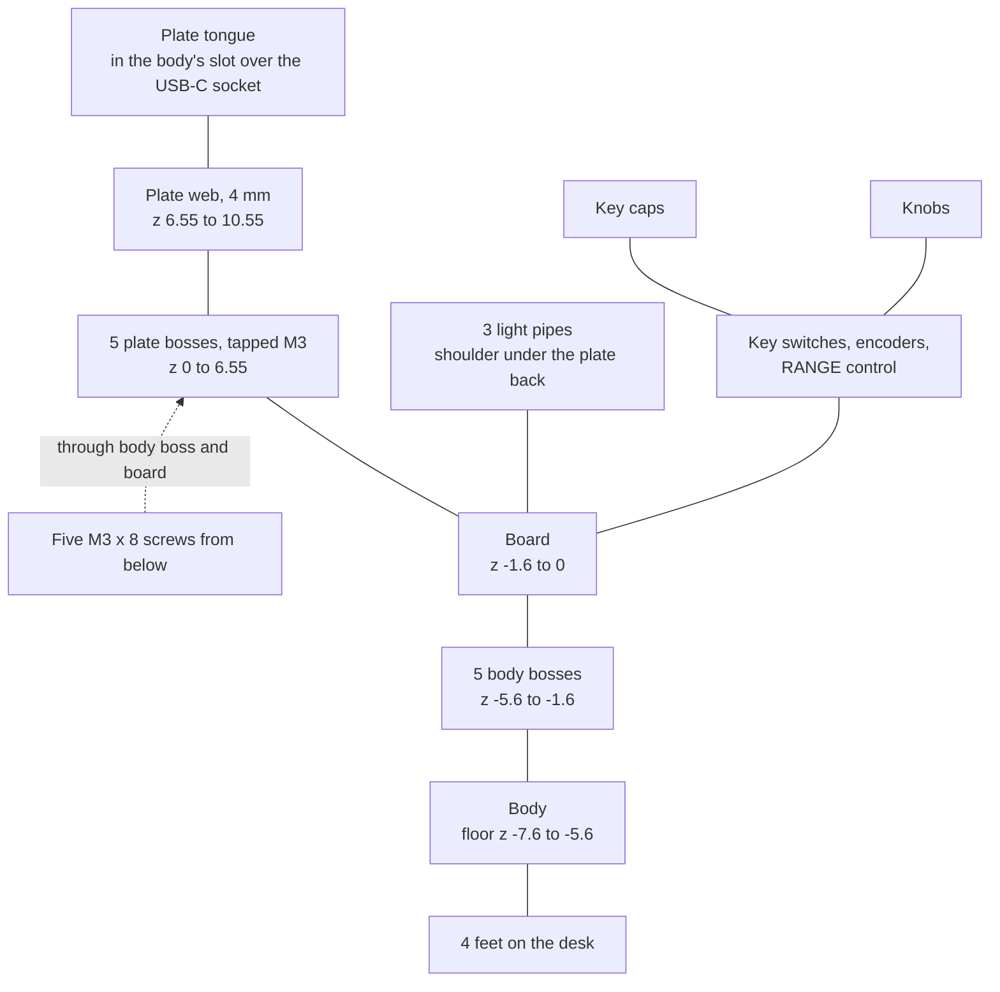

# Mechanics

How the body, the front plate, the key caps, the light pipes and the knobs stack and fasten, what each fit is
and how much margin it has. The steps at home are in [Assembly](../building/assembly.md).

| Numbers | Where they live |
| --- | --- |
| Every height, tolerance and datasheet dimension, with the reason beside it | [mech/stack.py](../../mech/stack.py) |
| The body's own sizes: walls, cavity, counterbores, middle column, post, ribs, USB-C opening, feet | [mech/make_mech.py](../../mech/make_mech.py) |
| The knob and light pipe solids | [mech/make_knobs.py](../../mech/make_knobs.py) |
| The legend texts of the keys and the knobs (`KEY_LEGENDS`, `KNOB_LEGENDS`) | [mech/stack.py](../../mech/stack.py) |
| The key cap solids, and how their legends are drawn | [mech/make_caps.py](../../mech/make_caps.py) |
| Where the plate's legends go, and the DXF layers | [mech/make_plate_art.py](../../mech/make_plate_art.py) |
| The notes and tolerances on the plate drawing | [mech/make_plate_step.py](../../mech/make_plate_step.py) |
| The mounts, the key grid, the knob and light positions | [pcb/board.py](../../pcb/board.py) |
| Every fit with its margin | [mech/check_fit.py](../../mech/check_fit.py): one printed row per fit, and a failed build when a margin reaches zero; it also draws the [sections](../../renders/8-fit-check.png) and writes the table under [Fits](#fits) |

To change a dimension, change it there and run `./build.sh` ([Generators](generators.md#build)): the fit
rows show what the change costs.

## Stack

Five screws from below clamp the board between the body's bosses and the plate's bosses. Everything else
stands on the board or hangs from the plate.

Heights as drawn, z = 0 at the top of the board. Anodising raises the plate's face by up to 0.05 mm
(`stack.ANODISE`).

| z (mm) | Part |
| --- | --- |
| -7.6 to -5.6 | Body floor, 2 mm. Below it the 6° wedge is hollow down to the desk plane (-7.2 at the front, about -14 at the back), with 2 mm ribs and a solid band along the front |
| -5.6 to -1.6 | 5 body bosses (Ø8 on the board) carry the board: four joined to the corner walls, one on a bar-shaped column in the middle of the key field. One post (Ø4.0) ends 0.3 mm under the board |
| -3.2 | Counterbore seats (Ø8.4), 1.6 mm of PA12 under the board: the screw heads stay recessed |
| -1.6 to 0 | Board. The three LEDs on its bottom shine up through 2.2 x 2.6 mm cutouts |
| 0 to 6.55 | The plate's 5 bosses (Ø5.5, tapped M3). Beside them: key switch bodies (3.6 mm high), encoder bodies (8.0), the RANGE control's body (8.6), the light pipes' bases (5.65). The body walls end at 5.6, the plate's tongue at 1.05 |
| 6.55 to 10.55 | Plate web, 4 mm. Pockets from the back for the encoders (2.35 mm deep) and the RANGE control (3.05) |
| 6.8 to 12.5 | Key caps, their socket ceiling on the plunger top (9.5): 1.95 mm over the plate |
| 11.73 to 18.0 | Outer knob ring, its key on the floor of the shaft slot |
| 13.4 to 21.6 | RANGE knob, its bore end on the lever tip |
| 19.5 to 29.9 | Inner knob, its bore end on the 28 mm shaft tip: 19.35 mm over the plate |

## Fastening

- Screws: five M3 x 8 flanged button head screws (ISO 7380-2, 2 mm hex key), all alike, go from below through
  a body boss and the board into a plate boss. The flange bears on the floor of the body's counterbore (Ø8.4
  round a Ø4.2 hole). The length is not free: an M3 x 6 would engage under 1 mm, an M3 x 10 would reach the
  drill point.
- Plate height: the plate's five bosses (Ø5.5, 6.55 ±0.05 mm high, milled with the plate from 12 mm stock)
  alone set it. That height sits between the fits that want the plate low and those that want it high: the
  first two groups of the [fits](#fits) table. With its bosses the plate is 10.55 mm high, up to 10.7.
- Body walls: they end 0.95 mm under the plate back and must never reach it. A wall that touched the plate
  would take the screws' clamp off the board.
- Threads: M3-6H from each boss's end face, full thread at least 6.0 mm deep, the tap drill 7.5 mm plus its
  point, which leaves at least 2.15 mm of metal in front of it. An anodised thread does not gauge, so the
  drawing asks for the threads plugged through bead blasting and anodising. The boss end faces may be bare or
  anodised, all alike (`stack.ANODISE`).
- What locates what: the plate's bosses locate the screws. The key caps centre the board in the key holes
  while it is lowered into the plate, and its 3.8 mm holes let it stay there. A cap turned on its round
  plunger has less room in its hole, so each row of caps is squared on a steel rule first (step 1 of
  [Putting it together](../building/assembly.md#putting-it-together)); the fit rows take 1° of turn, and
  2.5° that a cap may creep in use. Nothing centres the board once it is in: face down it rests where the last
  cap stopped it, so that cap may touch its hole until the board is nudged. The rows for the caps' play take
  the board centred, and the other rows take it as far off the plate as a cap set printed small lets it sit
  (0.60 mm). The body locates nothing: its 4.2 mm holes pass the screws wherever the plate puts them, with up
  to 0.82 mm of play, so it is centred by eye for the tongue's gaps.
- Middle mount: the fifth boss and screw, at board (72.25, 30.75), hold the board and the plate together in
  the middle of the key field. The body's column there is a bar along board y, 4.0 mm wide and 12.2 mm long,
  because the leads of the four keys round it stand 5.3 mm off its axis. The counterbore is wider than the
  bar, so it is open to the room under the board on the bar's two long sides.
- Board support: with the middle mount a firm key press (10 N, about six times the switch force) is taken to
  dip the board by 0.25 mm and to slope it by 8 mrad at most (`stack.PRESS_DIP`, `PRESS_SLOPE`). A knob
  takes as firm a push: past the switch's click or the end of its stroke the rest goes into the board, which
  dips at the control by 0.06 mm under an encoder's outer ring and 0.055 mm under the RANGE skirt, close to
  the corner mounts (`stack.KNOB_PUSH_DIP`). The post at board (98.3, 30.75) is a backstop that never lifts
  the board.

## Plate and body

- Pockets: 16.2 x 20 mm over each encoder body and Ø19.6 over the RANGE control's body, depth +0/-0.1 mm,
  floor corner R0.3 at most. They leave 1.65 and 0.95 mm of plate, 1.55 and 0.85 mm on a thin plate, over the
  0.8 mm JLCCNC recommends; the encoder pockets' floors are also over the 1.5 mm it asks for on a bead-blasted
  part, by 0.05 mm on a thin plate (a fit row each). Their width has only ISO 2768-m (±0.2 mm) on the
  drawing, so they are wide enough for it: a lug that touched the pocket wall would hold the plate off its
  bosses.
- Holes for the controls: the Ø9.5 encoder holes and the Ø11.1 RANGE hole take the board wherever the caps
  centre it and stay hidden under the knobs. The RANGE hole is +0.1/-0 before anodising on the drawing, for the
  hub's room at full tilt and the skirt's cover.
- RANGE control (Alps RKJXT1F42001, RKJXT below): it can sit up to 0.26 mm off on its pins before soldering,
  because its locating peg goes into the 1.3 mm hole of JLC's footprint
  ([Electronics](electronics.md#through-hole-parts)). The pocket and the hole give it that room. Should the
  lever reach 9° on both axes at once, the hole's edge rather than the lever's stop may end a diagonal tilt at
  the worst offsets, by up to about 0.15 mm; the hub is plastic and the hole anodised.
- Key and light holes: key holes 10.4 x 7.2 mm +0.1/-0 after anodising, 0.4 mm per side round the caps,
  corners R1.6 (R1.7 at most), their back edges broken 0.3 to 0.5 mm as a lead-in for the caps. Light holes
  Ø2.3 +0.1/-0 before anodising, their back edges sharp, because the light pipes' shoulders bear there. The
  face-down assembly blocks reach at most 6 mm under the plate's long edges: the SHIFT light hole starts
  6.6 mm in (6.45 mm at the ends of its tolerances), and a block over it would hold the pipe, and the board
  on it, off the bosses. The laser-marked line between the AUDIO and RADIO keys passes 0.575 mm from the key
  holes beside it (0.525 mm with a hole 0.1 mm large). Where a frame line meets a hole's edge break it is
  only cosmetic, so the fit check holds only the shift legends to the holes. The FREQ light's hole keeps
  0.85 mm to the FMS box's frame line and 1.93 mm to the ADF ⇆ shift legend as drawn (0.7 and 1.78 mm with
  the hole 0.1 mm large and 0.1 mm off); the fit check does not hold the light holes to the frame lines, the
  knobs or the encoder pockets.
- Marking: laser only, in the one light grey the laser leaves on the black anodising, with no UV print. The
  shift legends are told apart from the plain ones by where they sit, as the same grey: under each key on the
  plate, where the plain legend is on the cap, and on each knob's outer arc, 2.2 mm outside its plain arc and
  in the same size. The SHIFT cap's own legend stays amber, printed with the cap.
- USB-C: the USB-C socket (J1) stands 0.52 mm past the board edge, level with the cavity wall, so the plug
  opening in the back wall (16.8 x 8.7 mm) runs on up through the wall top as a slot of the same width, and
  the socket passes the wall when the body goes on. A tongue on the plate's back edge (15.0 mm wide, 2.0 mm
  thick, 5.5 mm long) fills the slot from above; its end is the top edge of the plug opening, 1.05 mm over the
  board. The opening takes a straight plug whose overmould is at most 12.85 x 7.0 mm, USB Type-C's maximum
  (R2.5, Figure 3-3); a larger or angled one does not pass the 2 mm wall far enough to seat. The gaps beside
  and under the tongue are cosmetic (the dark cavity shows through them); the fit check keeps them under
  1.6 mm (`stack.USB_GAP_MAX`).
- Body: PA12 printed by MJF (JLC3DP's nylon print), with 2.0 mm walls and ribs (JLC3DP's wall for parts over
  100 mm). The cavity leaves 0.5 mm per side round the board and 4.0 mm under it for the SMD (surface-mount)
  parts, the socket and the untrimmed leads (2.7 mm at most). The milled outline fits as delivered, and so
  does the V-cut (scored and snapped) rail edge (±0.4 mm); V-cut short edges would have to be sanded
  ([On arrival](../building/bring-up.md#on-arrival)).
- Bottom: a 6.1 mm hole in the floor over the two BOOT pads, for recovery (CircuitPython 9.2.9's UF2 again, or
  `flash_nuke.uf2`) with the tip of the 2 mm hex key
  ([Bring-up](../building/bring-up.md#updates-and-recovery)), and four flat 12 mm pads under the corners for
  self-adhesive feet up to 10 mm across.

## Caps, light pipes, knobs

### Key caps

- Seat: the cap's socket is a 3.8 mm bore with four rigid ribs that follow the cone of the switch plunger
  (TE's STEP model of the 1-1825910-4), so a cap that grips cannot rock. The ribs stop 0.35 mm under the
  socket ceiling, and the flat ceiling sits on the flat plunger top: the plunger, not the fit, sets the cap
  height.
- Sets: a rigid friction fit holds from 0.02 to 0.15 mm of interference, but JLC3DP's full-colour resin
  prints holes within ±0.2 mm. So there are four sets that differ only in their rib circle: 3.05 (D),
  3.15 (A), 3.25 (B) and 3.35 mm (C) at the socket mouth, where the plunger is 3.29 mm. Together they cover a
  print 0.2 mm small to 0.2 mm large. One to four dimples on the bottom name the set (A to D). The order has
  all four sets (`stack.CAP_ORDER`): JLC3DP prices a set as one part, about what a single cap costs. The bench
  tries B first. On a print without error it grips with 0.018 mm to the edge of the window, only 0.005 more
  than A, so over an even spread of print errors A and B do as well. What decides it: JLC3DP's design guide
  says holes print small, and a rib circle printed small wants B or C, never A.
  [Bring-up](../building/bring-up.md#choosing-the-cap-set) says how to find the set; a plunger lot near the
  edge of TE's ±0.30 mm needs the sets moved (`stack.CAP_SETS_MOVE`). A reorder after such a move takes only
  the set at that end, C after a raise or D after a lowering, and `stack.CAP_ORDER` names it then; the fit
  row checks that.
- Turn: only friction on the round plunger holds a cap square, so it may creep round in use. Up to 2.5° it
  keeps its room in the key hole (in a set printed 0.2 mm large, up to about 1.5°); one that rubs is turned
  back square in place ([Care](../using/controls.md#care)).
- Height: a cap stands 1.95 mm over the plate face, and 0.83 mm at least when fully pressed at the worst
  stack; a fit row holds it to 0.5 mm.
- Firm press: the board bends, and the cap can dip up to 0.89 mm under the plate back and tilt 0.46° with its
  plunger. It may then rub the face edge of its hole on one side. It cannot wedge across the hole, and the
  edge break on the hole's back edge leads it back in; `check_fit.py` has a row for each.
- Legends: Barlow Semi Condensed Bold, grown by 0.055 mm all round, so every coloured stroke prints at least
  0.4 mm wide (JLC3DP's minimum for full-colour lines).
- Tactile bars on SHIFT, UP and DN: 1.0 mm wide and 0.5 mm proud. A taller front bar would hide the bottom of
  the SHIFT and DN legends from the seat (a fit row checks the sightline at 45°).

### Light pipes

- Shape: a stepped rod of translucent resin, held by its shape alone. The Ø2.8 mm base stands on the board
  over the LED's cutout, up to a shoulder 5.65 mm up; the Ø2.0 mm rod, 4.45 mm long, goes through the
  Ø2.3 mm light hole. Lifted, the shoulder stops on the plate back, so the pipe is captive.
- Height: in use the pipe rests on the board. Its top is 0.50 mm under the anodised face in the nominal stack
  (0.45 mm under the face as drawn), and between 0.40 mm over it (a long pipe grown in its first week) and
  1.25 mm under it (a short one, shrunk in its first week) at the ends of the tolerances. Lifted onto its
  shoulder it can stand 0.95 mm over the face of a thin plate. Between the two it has 0.9 mm of play, so it
  may tick when the panel is moved.
- Never clamped: the longest base, grown by the 0.2 mm that resin may change by in its first week and with
  0.1 mm of a sanded support nub left on, stays under the smallest gap between the board and the plate back.
  A clamp would load the pipe with newtons (the board is 13 to 17 N/mm stiff at the SHIFT and UNIT lights).
  This row limits the plate's flatness: the drawing asks for 0.1 mm, and the row fails just above 0.22 mm.
  With the bosses at ±0.1 mm it still limits it first, just above 0.17 mm. The rod's 0.05 mm in its hole
  cannot take that growth: a rod that grows tight is sanded
  ([Putting it together](../building/assembly.md#putting-it-together)).
- Visibility from the seat (45°): 81 % of each top in the nominal stack, 70 % with the rod against the near
  side of its hole, 21 % at the worst depth. The UNIT light sits 5.5 mm east of the HOME and SHIFT column,
  and the FREQ light midway between the RADIO box's two columns, each in the gap between two cap columns, so
  no cap stands in front of it. The FREQ light sits about 1.2 mm below the middle of the RADIO legends
  beside it; how it reads from the seat beyond the 45° figure is still to be seen on the first panel.
- Print: each pipe is a part of its own, 2.8 x 2.8 x 10.1 mm, over the 10 x 2 x 2 mm that JLC3DP prints resin
  parts from; one file, ordered six times (three spare). It prints upright with its supports on the base's
  bottom face only, so the visible top stays as printed, and the support nubs are sanded flush.
- Fallback: the 4.45 mm rod is over JLC3DP's pillar guideline (Ø2.0 up to 4 mm). With `top_len` in
  `stack.PIPE` at 4.0 the fits still pass: the top is then 0.95 mm under the anodised face and 52 % of it
  shows. But the pipe is then 9.65 mm long, under JLC3DP's least part, so `stack.PIPE_ON_BAR` puts the three on
  one 2.2 x 2.0 mm bar under their bases, on Ø1.0 mm necks that snap off by hand (`stack.PIPE_BAR`); the
  fit check fails a single pipe under the least part. The necks are under the 1.5 mm that JLC3DP's guideline
  for connected parts asks for.
- Board bow: the rows above take the board's 0.1 mm (`stack.PCB_BOW`), and the never-clamped row still
  passes at about 0.2 mm. [Putting it together](../building/assembly.md#putting-it-together) checks the
  board against a folded sheet of paper before the pipes go in.
- The LEDs under the pipes are in [Electronics](electronics.md#lights).

### Knobs

- Fit: friction only. Each knob (outer ring, FMS ring, inner knob, RANGE knob) comes with six bores, 0.1 mm
  apart, from 0.2 mm under the shaft's largest size (bore 1) to 0.3 mm over it (bore 6)
  (`stack.FIT_VARIANTS`), and each is ordered in the panel's quantity. A rigid fit grips over a window of
  interference, taken from the caps: 0.02 to 0.15 mm (`stack.KNOB_GRIP`, an assumption, see below). It is
  wider than the step from one bore to the next, so one of the six grips whenever the bores print from
  0.45 mm small to 0.08 mm large; JLC3DP gives resin holes ±0.3 mm. The knob to keep goes on by hand and
  holds. For a print outside that range, `stack.FIT` moves all six bores by 0.5 mm for a second order
  ([Assembly](../building/assembly.md#fitting-the-knobs)): at -0.5 they grip prints 0.05 to 0.58 mm large,
  at +0.5 prints 0.42 to 0.95 mm small. The second order repeats the bore just found not to fit (its bore 1 is
  the old bore 6, or the other way round), so one of its six is wasted; a step of 0.6 mm would not, but leaves
  too little resin round the dimples at the largest bore.
- RANGE bore: one groove, 1.2 mm wide and 0.25 mm deep, is cut into the round wall opposite the flat and
  leaves a rib each side, from the flat's edge round to the groove (`stack.RANGE_RIBS`). It only relieves the
  back of the bore and keeps the flat face whole, which bears on the lever's flat over its full width, so the
  knob turns the lever. It does not grip as a cap's ribs do: the bore keeps 81 to 85 % of a plain D bore's
  contact, so the strain on the Ø2.5 mm lever stays about a plain bore's. The bore runs 3.7 mm on the lever,
  all on its 5 mm flat (the lever has no key). The groove and the ribs across their tips stay at least
  0.8 mm wide, the resin detail the flutes keep, on every bore at every `FIT` (the ribs 0.91 mm at least, on
  bore 1 at -0.5), and the groove stays inside the Ø4.0 mm relief bore under it. Its 0.25 mm depth is under
  JLC3DP's 0.8 mm for an engraved detail, on purpose: a deeper groove needs a wider relief bore and hub. A
  groove that prints shallow or closed leaves a plain D bore, as the inner knob's, with more contact (a firmer
  push-on) at the same interference. Open, it lets the lever move a little further towards it, which the fit
  rows count. The knob takes the caps' grip window as an assumption, as every knob does
  ([Assumptions](#assumptions)). Should the real window be narrower, the lever can fall between two bores, one
  loose and the next too tight to go on by hand: keep the looser if it holds, or order the knob again, and
  never force the tight one onto the lever.
- Marks: as many dimples as the bore's number (1 the tightest), Ø1.0 mm (JLC3DP's least SLA hole) and 0.9 mm
  deep, on one arc with a gap after the third, where they do not show: in the bottom face of the outer rings,
  each under a flute's crest, in the ceiling of the inner knob's recess and in the dished underside of the
  RANGE knob (`stack.KNOB_MARK`). At the worst print at least 0.83 mm of resin stays round each, also with the
  largest bore `stack.FIT` allows. The inner knob's dimples lie as far out as that needs, 0.02 mm inside the
  edge of its Ø8.6 mm recess as drawn; with the dimples printed 0.3 mm large and the recess 0.3 mm small they
  notch the recess's corner by up to 0.28 mm, which does no harm (their centres stay on the ceiling).
- Heights: the uncut shafts of the Bourns PEC11D encoders set them. The outer ring rests with its key (1.4 mm
  wide) on the floor of the shaft slot, its counterbore 1.05 mm over the bushing. In the 2.0 mm slot the key
  has 12.0° of play in all (22.4° at the ends of the tolerances), against 12° a detent: only the bore's grip
  takes it out. The inner knob rests with its bore end on the shaft tip; its D bore ends 0.7 mm short of the
  shaft's D flat, so the bore end, not a short flat, sets the height.
- Proportions: outer rings Ø17, inner knobs Ø12, so 2.5 mm of ring shows on each side. The FMS ring has 14
  flutes 0.9 mm deep where the other rings have 24 at 0.45 mm: FREQ and FMS, the same size one above the
  other, are told apart by feel.
- RANGE knob: Ø13.6 with a Ø17.3 skirt that hides the plate hole at full tilt, 3.7 mm of its D bore on the
  lever. Its bottom is dished: flat over the hub, then a cone that rises 1.4 mm to the rim, steeper than the
  tilt's 9°. At full tilt the knob also cocks on the lever by its play (2.5° for the 0.15 mm a kept knob may
  have, `stack.RANGE_PLAY`, which the open groove makes 0.16 mm from the flat to the groove), and the lever
  may be pushed in, which takes the rim down further than the hub's corner, with the board dipped by the
  push. With the dish that deep the hub's corner ends lowest, so the flat is only Ø5.6, the relief bore and a
  0.8 mm ring round it. A looser knob cocks until its skirt touches the plate. Every RANGE row assumes the
  tilt fulcrum (4.65 mm off the axis) on whichever side is worse. The four pan arrows start 10.15 mm from the
  hole's centre, outside the skirt.

## Fits

The main margins, written into this table by `check_fit.py` on every build; the script prints more rows. Each
margin is what is left at the worst end of every tolerance in its row, and "over 0.8 mm" names the minimum it
is counted from. A margin of zero fails the build. RSS: independent errors added as a root sum square; a row
marked (RSS) passes or fails on that margin, and its last column gives the bounded worst case, the same row
with those errors added linearly ([RSS rows](#rss-rows)). "Plate low" and "Plate high" are the two groups the
boss height sits between. Margins of 0.05 mm or less are bold; a margin in percent is a share.

The rows measure the files that are ordered: the knob, light pipe and body STEP files, the body's STL (which
must be a mesh of its STEP, vertex for vertex and as many triangles) and the cap zips (every set with the same
texture, every legend in its cell, and each single-cap zip its set's cap, UVs, material and cell). The plate
and its marking are measured as `make_plate_step.py` and `make_plate_art.py` build them, and each of those
reads its file back and fails unless it holds the same: the STEP face for face, the DXF vertex for vertex.
`tests/test_production.py` compares the files in `production/` with each other, with readers of its own: the
mounting holes, the keys, the encoders, RANGE and the lights across the drill files, the CPL, Edge_Cuts, the
plate STEP and DXF and the body STEP.

<!-- fits: written by mech/check_fit.py -->
| Group | Fit | Margin (mm) | Bounded worst case (mm), RSS rows |
| --- | --- | --- | --- |
| Plate low | Outer knob ring over the plate face, its encoder pushed | 0.094 (RSS) | **-0.52** |
| Plate low | RANGE knob's underside over the plate at full tilt, cocked on the lever by its play and pushed | 0.094 | |
| Plate high | Encoder pocket over the encoder body | 0.335 | |
| Plate high | RANGE pocket over the RKJXT body | 0.435 | |
| Plate high | Cap socket ceiling under the plate face, on a plunger at TE's +0.3 mm | 0.514 | |
| Plate high | Tongue's end over the plug overmould | 0.291 | |
| Plate high | Body wall tops under the plate back | 0.329 | |
| Plate high | Light pipe base under the plate back, grown 0.2 mm in its first week (never clamped) | 0.125 | |
| Light pipes | Rod in its hole, on the diameter | **0.05** | |
| Light pipes | Top over the face of a thin plate, lifted and grown in its first week, under the 1.0 mm allowed | **0.05** | |
| Light pipes | LED lens in its board cutout, the LED placed 0.1 mm off and turned 2° | **0.049** | |
| Light pipes | Share of the LED's die under the pipe base at the worst offsets, over 80 % (each) | 11 % | |
| Light pipes | Base clear of the switch bodies (SHIFT, UNIT, FREQ) | **0.025**, 0.748, 1.699 | |
| Light pipes | Base out from under the key holes (SHIFT, UNIT, FREQ) | 0.20, 0.432, 1.427 | |
| Light pipes | Light hole web to the next key hole at tolerance, over JLCCNC's 0.5 mm minimum (SHIFT, UNIT, FREQ) | 0.30, 0.532, 1.527 | |
| Caps | Shift legends beyond the largest key hole's edge break, for the laser marking's register | 0.50 | |
| Caps | Wall round the socket at the worst print, over 1.0 mm | 0.10 | |
| Caps | Cap sets' coverage beyond a rib circle printed 0.2 mm small or 0.2 mm large | **0.012** | |
| Caps | Cap set tried first (B): its lead over the next set on a rib circle printed true | **0.005** | |
| Caps | Firmly pressed cap lands on the back edge break | 0.293 | |
| Caps | Cap top over the plate face when fully pressed, over 0.5 mm | 0.328 | |
| Caps | Cap's play in its key hole beyond the per-key position errors (RSS), the board centred in the key holes and the cap crept round to 2.5° in use | **0.02** (RSS) | **-0.23** |
| Caps | The same for a whole set printed 0.2 mm large (WJP's outline error as a bias), turned 1° | **0.024** (RSS) | **-0.15** |
| Screws | M3 through the narrowest board hole, the board where the caps centre it | **0.045** | |
| Screws | Plate boss end covers the widest board hole all round | 0.10 | |
| Screws | Plate boss inside the board's 3.6 mm copper keep-out | 0.20 | |
| Screws | Body screw hole round the M3 where the plate puts it | **0.02** | |
| Screws | Flange covers the widest body hole all round | 0.09 | |
| Screws | Full thread engaged, over 2.0 mm | 0.75 | |
| Screws | Tip short of the end of the full thread | 0.45 | |
| Body | Plate corner bosses clear of the cavity walls at the end of the body's screw play | 0.08 | |
| Body | Board in the cavity, per side: across (V-cut rail edge), along | 0.15, 0.078 | |
| Body | Untrimmed leads over the body floor | 1.00 | |
| Body | Post, corner bosses and middle column clear of leads, solder fillets and bottom parts, over 0.3 mm | 0.105, **0.025**, 0.157 | |
| Body | Column bar and corner boss walls round the counterbore, over JLC3DP's 1.5 mm | 0.10, 0.098 | |
| USB-C | Plug overmould (12.85 x 7.0 mm) in the opening | 0.315 | |
| USB-C | Tongue's smallest side gap in the body's slot, the body centred (largest gap 1.50 mm, limit 1.6) | 0.30 | |
| USB-C | Tongue covers the plug overmould across | 0.15 | |
| USB-C | Tongue's inner face short of the J1 shell tabs | 0.625 | |
| Controls | Encoder bushing in its Ø9.5 hole, radial | 0.20 | |
| Controls | Encoder lugs in their pocket, per side | 0.25 | |
| Controls | RKJXT body in its Ø19.6 pocket, radial | 0.29 | |
| Controls | RKJXT hub at full tilt in its Ø11.1 hole, radial | 0.181 | |
| Controls | Plate left over the encoder pockets on a thin plate, over 1.5 mm (bead blasted) | **0.05** | |
| Controls | Plate left over the RANGE pocket on a thin plate, over 0.8 mm | **0.05** | |
| Knobs | Outer knob's key in the narrowest shaft slot | 0.10 | |
| Knobs | Outer ring's lash in the shaft slot, should its bore not grip, within a detent (12°), nominal | 0.044° | |
| Knobs | Outer knob's key face clear of the inner shaft in the slot | 0.275 | |
| Knobs | Outer knob's counterbore over the bushing | 0.082 (RSS) | **-0.45** |
| Knobs | Inner knob over the outer ring, pushed | 0.131 (RSS) | **-0.75** |
| Knobs | Resin round the knobs' dimples at the worst print, with the largest bore `stack.FIT` allows, over JLC3DP's least wall for a part of the knob's size (0.81 to 0.84 mm) | **0.02** | |
| Knobs | Outer ring covers its encoder hole, seen from above | 1.225 | |
| Knobs | RANGE skirt covers its hole at full tilt, cocked and pushed or not | 0.099 | |
| Knobs | Pan arrows outside the RANGE skirt, seen square on | 0.279 | |
| Knobs | RANGE knob's underside over the plate, should the lever reach 9° on both axes at once (12.6°): nominal, pushed 0.3 mm (0.61 not pushed) | 0.318 | |
| Knobs | Overlap of the grip windows of two neighbouring bores (outer ring, FMS ring, inner knob, RANGE knob), with `stack.FIT` at +0.0 | **0.03**, **0.03**, **0.029**, **0.029** | |
<!-- /fits -->

### RSS rows

Seven rows add independent errors as a root sum square: the encoders' height spreads (Bourns' ±0.3 and
±0.5 mm on each of the body, the shafts and the slot), the per-key position errors of a cap and the offsets
of the body and the board at the BOOT hole. RSS holds for nearly every build, as the errors rarely all sit at
their worst ends at once, but not for every combination within the tolerances. `check_fit.py` prints each
such row's bounded worst case beside its margin, with the errors added linearly; the build passes on the RSS
margin. Where the bounded case goes negative, a part can need fitting on the bench, so the first build should
budget time for it; the sandpaper, the four cap sets and the six knob bores are already in the order:

- Outer knob ring over the plate face (bounded -0.52 mm): a ring that rubs the plate when turned is sanded on
  its bottom face, on the fine sandpaper laid on the table, a few strokes at a time until it clears, up to
  0.52 mm ([Fitting the knobs](../building/assembly.md#fitting-the-knobs)).
- Outer knob's counterbore over the bushing (bounded -0.45 mm): a ring whose counterbore meets the bushing
  top before its key reaches the slot floor stops up to 0.45 mm high. Push it on only until it stops; its bore
  holds it there. Then check that it turns freely and that the inner knob still clicks clear of it.
- Inner knob over the outer ring, pushed (bounded -0.75 mm): an inner knob that touches its ring when pushed
  is sanded on the rim of its underside the same way, up to 0.75 mm; its recess is 1.3 mm deep, so it keeps
  clearing the shaft top.
- Inner recess over the outer shaft top (bounded +1.30 mm): no fitting.
- A cap's play in its key hole (bounded -0.23 mm) and a whole cap set printed large (bounded -0.15 mm): a cap
  that rubs its hole after the board is nudged
  ([Putting it together](../building/assembly.md#putting-it-together)) is sanded lightly on the side that
  touches, a few strokes on the fine sandpaper, up to 0.23 mm, or the same legend is taken from the next set
  ([Choosing the cap set](../building/bring-up.md#choosing-the-cap-set)); a whole set that rubs is reprinted,
  as for `CAP_SETS_MOVE`.
- The hex key through the BOOT hole (bounded +0.025 mm): no fitting. The bounded case passes too, so its tip
  reaches both pads at the ends of every tolerance.

## Assumptions

Values that no datasheet or vendor states; the fit rows take them as given.

- RKJXT: body tolerance ±0.3 mm; the tilt fulcrum on either side (the RANGE rows take the worse); the centre
  push may still go down at full tilt; between two directions the lever reaches at most 9° on each axis
  (Alps gives 9° as the most in each of the four directions).
- PEC11D: the inner shaft at most 0.05 mm off the outer one (`stack.SHAFT_ECC`).
- Friction fits: a rigid fit holds from 0.02 mm of interference and still goes on by hand at 0.15 mm
  (`stack.CAP_GRIP`), set for the caps on their ribs. Every knob takes the same window (`stack.KNOB_GRIP`),
  though nobody has measured it on a resin knob, on the outer rings' round bores, the inner knob's plain D
  bore or the RANGE knob's D bore with its back groove.
- Knobs: a kept knob has at most 0.15 mm of play on its shaft (`stack.KNOB_PLAY`, `stack.RANGE_PLAY`). The
  tightest bore grips a shaft at its low limit when the holes print no more than 0.08 mm large. The RKJXT's
  lever is +0/-0.1 mm across, as the PEC11D's shafts (`stack.LEVER_D_TOL`; Alps gives no tolerance). A
  support mark stands at most 0.05 mm proud of a knob's bottom face once it is sanded flush: by JLC3DP's
  General Sanding, as the remark asks, or by the builder for knobs ordered unsanded (`stack.SUPPORT_MARK`,
  [Fitting the knobs](../building/assembly.md#fitting-the-knobs)); one that is left higher can make an outer
  ring rub the plate.
- Knob prints: one print error for all six bores of a knob, and the same error again on a reprint. The grip
  windows of neighbouring bores overlap by only 0.03 mm, so a set whose bores come out unevenly, or a second
  order that prints differently, can leave a shaft with no bore that grips.
- Key switch: TE's plunger lot is close enough to its STEP model for the four cap sets; the plunger's own
  sideways play in the switch is left out.
- Key caps: they creep round on their plungers by at most 2.5° in use (`stack.CAP_CREEP`).
- Firm press: 10 N on a key dips the board by 0.25 mm and slopes it by 8 mrad at most (`stack.PRESS_DIP`,
  `PRESS_SLOPE`); a plate model of the bare board gives 0.2 mm and 6.8 mrad. The same 10 N on a knob dips the
  board under the rim of an encoder's outer ring by 0.06 mm and under the RANGE skirt by 0.055 mm at most
  (`stack.KNOB_PUSH_DIP`); the model gives 0.046 and 0.041 mm.
- Board: bowed by 0.1 mm at most at its middle (`stack.PCB_BOW`); JLCPCB allows 0.75 %, 1.2 mm over this
  board.
- Resin: a light pipe's lengths change by 0.2 mm at most in the first week, either way (`stack.RESIN_DRIFT`;
  JLC3DP gives 0.2 mm or 0.2 %).
- MJF: rounds a counterbore's floor corner by 0.2 mm at most (`stack.CB_FLOOR_R`); the body does not warp
  beyond JLC3DP's tolerances, which leave warp out. The wall tops have 0.33 mm to the plate for it
  ([Assembly](../building/assembly.md)).
- JLCCNC's laser marking: registers within 0.5 mm.
- JLCPCB's drill positions: ±0.075 mm (`stack.POS_TOL`).
- JLCPCB's routed LED cutouts: ±0.1 mm per side (`stack.PCB_CUTOUT_TOL`).
- JLCPCB's placement of the LEDs: within 0.1 mm and 2° (`stack.LED_LENS`).

## Dimensions

| Item | Value |
| --- | --- |
| Board | 160 x 60 mm, 4 layers, every SMD part on the bottom (`pcb/board.py`) |
| Panel | 165 x 65 mm, 17.75 mm high at the front and about 24.6 mm at the back (6° wedge, for a flat desk in front of the pilot) |
| Plate | 4 mm web, 10.55 mm high with its bosses, 32 cm³, 86 g |
| Body | 39 cm³, about 40 g |
| Key pitch | 11.85 mm horizontal (17.1 mm between AUTOPILOT and AUDIO), 11 mm vertical, 14.5 mm between the FD and UP rows for the FMS line. The rows stay aligned across the panel, so the autopilot block shares that gap |
| Caps | 9.6 x 6.4 mm, 1.95 mm over the plate, one legend size (capitals about 2.0 mm high, strokes at least 0.4 mm). The flip-flop icon is narrow, so COM ⇆ does not shrink every legend |
| Dual knob centres | x 15 and 145, y 15 and 45 (30 mm apart). Between the knobs: 12.85 mm on the left (ALT/HDG ring to RANGE skirt), 13 mm on the right |
| Knobs | Matte black resin, vertical flutes, slight taper, chamfered flat top. Outer ring Ø17 x 6.3 mm on all three, inner knob Ø12 x 10.4 mm above it. RANGE knob Ø13.6 x 8.2 mm with a Ø17.3 skirt |
| Amber | #d9a441 (RGB 217, 164, 65): the SHIFT cap legend and, in the 3D view, that cap and the SHIFT light (`stack.AMBER`); the plate has no amber |
