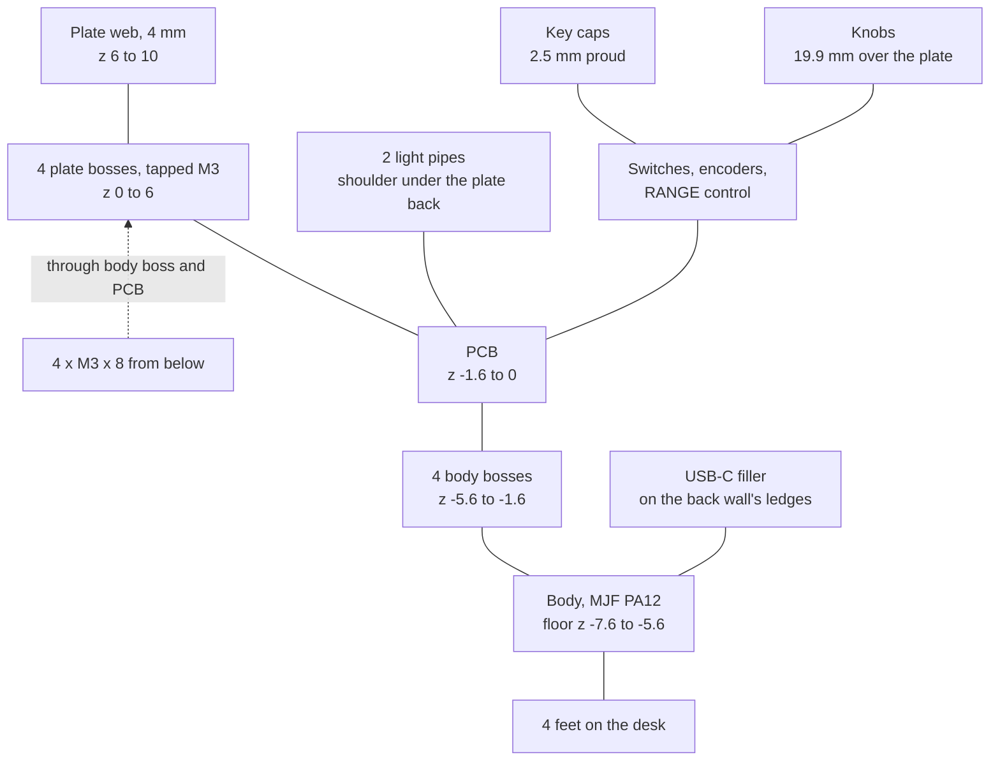

# Mechanics

Body, front plate, knobs, light pipes and key caps: how they fit and why. Every height and fit is in
[mech/stack.py](../../mech/stack.py); [mech/check_fit.py](../../mech/check_fit.py) checks the clearances. The
steps at home are in [Assembly](../building/assembly.md).

## Stack

Four screws from below clamp the board between the body's bosses and the plate's bosses; everything else rests
on or hangs from that stack:

Stack (z = 0 is the PCB top). The plate's bosses set its back 6.0 to 6.1 mm over the PCB, 6.05 nominal; the
stack is drawn with the back at 6.0 and the face at 10.0, and `check_fit.py` takes the bosses' +0.1 in every
row:

| z (mm) | Part |
| --- | --- |
| -7.6 to -5.6 | body floor, 2 mm (1.6 at the front edge); below it the 6° wedge is hollow down to the desk plane (-7.2 at the front, about -14 at the back), with 2 mm ribs, a solid band along the front, four foot pads and a recess for an optional steel plate |
| -5.6 to -1.6 | 4 bosses (Ø8 on the PCB, joined to the corner walls) carry the PCB corners; 2 posts under the middle (between the key blocks) end 0.25 mm under the PCB |
| -3.2 | counterbore seats (Ø8.4, 1.9 mm wall), 1.6 mm of PA12 up to the PCB: the flanged button heads below them stay recessed |
| -1.6 to 0 | PCB; the two LEDs on its underside shine up through 2.2 x 2.4 mm cutouts in it |
| 0 to 6 | the plate's 4 bosses (Ø5.5, tapped M3) stand on the PCB: they alone set the plate height, 6.05 ±0.05 mm over the PCB to the plate back (anodising: see [Fastening](#fastening)); the body walls end at 5.35. The two light pipes stand on the board, their shoulders under the plate back. Encoder bodies 8 mm (±0.3), RANGE body 8.6 mm, key switch bodies 3.6 mm |
| 1.0 to 4.85 | USB-C filler in the back wall's notch, on the two ledges beside the plug opening (face up) |
| 6 to 10 | 4 mm (±0.1 before anodising) aluminium web of the plate, milled with its bosses from 12 mm stock; pockets 2.8 mm (encoders, at least 1.1 mm left) and 3.25 mm (RANGE, at least 0.65 mm left) deep from below, +0/-0.1 |
| 6.8 to 12.5 | key caps, socket ceiling on the plunger top (9.5), 2.5 mm proud |
| 11.09 to 18 | outer knob ring |
| 19.5 to 29.9 | inner knob, sitting on the 28 mm tip of the inner shaft |

## Fastening

- Four M3 x 8 flanged button-head screws (ISO 7380-2, 2 mm hex key; flange 6.32 to 7.0 mm across, head
  1.65 mm high) come from below and hold everything: body boss, PCB, plate boss. No washers; nothing shows
  on the front. The flange bears on the floor of the 8.4 mm counterbore
  round the 4.2 mm body hole: with the screw against the hole wall (0.82 mm off) the smallest flange still
  covers the hole all round by 0.09 mm. The counterbore wall stops the largest flange 0.55 mm off centre,
  before the shank reaches the hole wall, so the floor corner of the counterbore stays sharp (MJF's own
  rounding, 0.2 mm or less assumed): the flange rim (at least 0.55 mm high) then meets the foot of the wall,
  not a slope under the flange.
- The plate is milled from 12 mm 6061 stock: the 4 mm web and four Ø5.5 mm bosses on its back at the corner
  mounts, 6.05 ±0.05 mm high, each tapped M3-6H from its end face (full thread at least 6.0 mm deep, drilled
  7.5 mm plus the drill point). The screw pulls the plate boss against the PCB and the PCB against the body
  boss: the bosses alone set the plate height, and the threads take the screws' preload, about a tenth of
  what 2.75 mm of thread in 6061 holds.
- Screw length: from the counterbore seat to the PCB top is 3.2 mm (±0.3 MJF, ±0.16 PCB), so the tip of an
  M3 x 8 (±0.29) ends 4.05 to 5.55 mm into the boss. Less the incomplete end of the screw (2 pitches) and the
  0.3 mm countersink at the mouth, at least 2.75 mm (5.5 turns) of full thread engage, and the tip stays
  0.45 mm short of the end of the full thread. An M3 x 6 would engage under 1 mm, an M3 x 10 would reach the
  drill point. The drill point stays at least 1.65 mm behind the front face (thin plate, low boss).
- Anodising grows every surface by up to about 0.025 mm, which would take about 0.1 mm off a thread's pitch
  diameter, more than the 6H band: the drawing asks for the threads masked while anodising or cut again
  afterwards. It lets the boss end faces be anodised or bare (masking may leave them bare), all four alike.
  Over bare ends the back face sits up to 0.025 mm lower; on anodised ends the whole plate stands 0.025 mm
  higher and its front face grows as much, so the highest front face is 6.1 + 4.1 + 0.05 = 10.25 mm over the
  PCB (4.0 ±0.1 mm before anodising). `check_fit.py` takes the worse case in every row.
- The boss height centres the plate: 6.0 to 6.1 mm puts it 0.05 mm higher than the 6.0 the stack is drawn at,
  between the rows that want it low (the outer knobs keep 0.12 mm over the face, the RANGE skirt 0.22 mm) and
  those that want it high (0.10 mm over the RKJXT and at the RANGE pocket's floor corner, the cap sockets 0.01
  mm under the face on a plunger 0.3 mm high, the encoder pockets 0.26 mm over the bodies, the USB-C filler
  0.16 mm, the body walls 0.08 mm). At JLCCNC's default ±0.1 mm instead every one still passes with 0.05 mm
  less on one side (the walls with 0.03 mm), bar the cap socket ceiling: on a plunger 0.3 mm high (TE's
  tolerance) it may stand up to 0.04 mm above the face, cosmetic only, so the drawing and the JLCCNC remark
  ask for ±0.05 (if they can only hold ±0.1, accept: cosmetic only). The pocket rows also take the board bowed
  0.1 mm towards the plate in the middle (`stack.PCB_BOW`, JLCPCB allows more, a 4-layer board is usually far
  flatter), about 0.045 mm at the knobs. The drawing asks for flatness 0.1 mm; every row still passes up to
  about 0.17 mm (the light pipes' room over their bases goes first, then the body walls), bar the cosmetic cap
  socket ceiling (up to 0.05 mm above the face there); not both at once: with the bosses at ±0.1, flatness up
  to about 0.12 mm.
- Positions: the key caps centre the board in the 10.2 x 7.0 mm key holes (+0.1/-0 after anodising, so at
  least 0.3 mm per side, against about 0.23 mm of per-key errors, RSS), and in holes at +0.1 it can still
  sit up to about 0.44 mm off. A cap can turn on its round plunger, and a turned cap has less room: at 1°
  about 0.24 mm, just over the per-key errors, and past about 5° it no longer goes into its hole at all. So
  each row of caps is squared against a steel rule before the plate goes on
  ([assembly](../building/assembly.md#putting-it-together) step 1);
  `check_fit.py` takes the room at 1°. The plate's bosses fix the screws, and the board floats on them: its
  3.8 mm holes (3.6 to 4.0 with JLCPCB's ±0.2) pass the M3 wherever the caps put the board (that takes 0.255
  mm: the bosses and key holes on the plate, the board's holes, centring, the thread's play; the holes leave
  0.30 mm), the boss end (Ø5.5 ±0.1) still covers the widest hole all round by 0.10 mm with the board 0.6 mm
  off a screw, and it stays 0.2 mm inside the 3.6 mm copper keep-out ([pcb/check.py](../../pcb/check.py)
  checks the copper on the Gerbers).
- The same board offset (plus the plate, PCB and pin tolerances, about 0.77 mm radially) moves the controls in
  their plate openings. Every opening here is at ISO 2768-m (±0.2) and loses about 0.05 mm to the anodising,
  which `check_fit.py` counts. It also takes the encoders and the RKJXT seated as far as their checks allow
  ([Seating](#seating)): an encoder 0.05 mm proud (`stack.SEAT_GAP`), which lifts its lugs 0.05 mm,
  or tilted by that over the body, which moves its bushing up to 0.04 mm sideways at the plate face; the RKJXT
  with no gauge spot under its base frame 0.05 mm higher than on a seated part (`stack.RKJXT_SEAT`), which
  tilts it by up to 0.05 mm over 11.8 mm and lifts the corners of its octagon up to 0.064 mm
  ([Seating](#seating)). And it takes the plate bowed towards the board as far as
  the drawing's flatness 0.1 mm allows, up to about half of that near the knobs on a plate bowed across its
  width. The Ø9.3 encoder holes still leave 0.06 mm round the bushings (7.0 +0.3; 0.11 mm with the encoder
  flat), and the 15.6 x 20 encoder pockets 0.07 mm beside the side lugs (13.1 ±0.5 across, the PEC11D
  drawing) and 0.26 mm over the bodies. The RKJXT floats more on its pins (0.26 mm instead of 0.15,
  [Seating](#seating)), 0.88 mm in all: the Ø19.6 RANGE pocket still leaves 0.41 mm round its
  body (16.4 mm across corners above z 4 in Alps' STEP model, +0.3 assumed; it stands on a Ø13.5 foot, and
  the 17.2 mm base frame, 0.40 to 2.55 mm over the board, stays under the plate) and 0.10 mm over it. So the
  floor corners of all four body pockets stay small (R0.3 at most, on the plate drawing; the encoder lugs
  and the RKJXT's corner then clear it by 0.07 and 0.10 mm), and the Ø11.1 RANGE hole clears its Ø7.2 hub
  (Alps' STEP model) at full tilt by 0.20 mm (the tilt fulcrum sits 4.65 mm off the axis, which moves the hub
  0.06 mm further out). The holes stay hidden under the knobs: seen from above, an outer ring covers its
  encoder hole by 1.2 mm even at its tapered top, printed small and off the hole by all of the above.
- The body holes (4.2 mm, counterbores 8.4 mm) pass the screws where the plate's bosses put them, with the MJF
  body up to 0.33 mm off over its length and the bosses 0.1 mm (0.02 mm to spare); at least 1.6 mm of wall
  stays outside each counterbore and 1.9 mm round it inside, 1.6 mm with the counterbore and the boss both
  printed 0.3 mm off (JLC3DP asks for more than 1.5 mm on fastener features). The cavity leaves 0.5 mm per
  side round the PCB, so the board fits even with the body 0.4 % small: the milled outline (±0.2 mm) as
  delivered, 0.15 mm per side across the width with full assembly's V-cut rail edge (±0.4 mm), and V-cut
  short edges, should JLCPCB add rails there anyway, once they are sanded until the board drops into the body,
  160.2 mm or shorter fitting the smallest one; the walls and the ribs under the floor are 2.0 mm (JLC3DP's
  MJF wall for parts over 100 mm).
- The body walls end 0.65 mm under the plate back, the smallest gap that never closes: MJF ±0.3 mm on the
  wall height over the boss tops under the PCB, a board 0.16 mm thin, the plate back 0.025 mm low over bare
  boss ends and bowed 0.086 mm down at the middle of a long wall, and the bosses at their lowest leave 0.08
  mm at the drawing's ±0.05 and 0.03 mm at JLCCNC's default ±0.1. Walls that reached the plate would take the
  screws' clamp off the board.
- The USB-C opening in the back wall is 15.8 x 8.4 mm (R0.5 at the bottom, square at the top) and runs on up
  through the top of the wall as a notch 20.8 mm wide: JLC's socket (C165948) sticks out 0.52 mm past the
  board edge, level with the cavity wall, so a closed wall above the opening would catch it while the board
  goes in. Round a plug overmould of the USB-C maximum (12.35 x 6.5 mm, even with square corners), its top
  being the filler below, it leaves 0.06 mm with the board anywhere in the cavity
  (0.5 mm gap, and one short edge taken as V-cut, up to 0.4 mm short, although both variants mill it), the
  opening where MJF puts it over the 127.5 mm from the side wall (±0.51 mm, which also covers a body printed
  large), J1 placed 0.1 mm off, the opening's bottom ±0.3 mm against the bosses under the PCB and the
  opening printed 0.15 mm small. Under the opening the body is solid down to the desk, 0.8 mm wider than it
  on each side.
- Once the body is on, a filler block (`usb-filler.step`, printed with the body, 19.7 x 2.0 x 3.85 mm)
  closes the notch above the opening from the back, flush with the wall, so only the plug opening shows.
  The notch is 2.5 mm wider than the opening on each side, and the wall under it ends in two flat ledges
  level with the opening's top. With the panel face up the filler rests on them: its bottom is the
  opening's top edge, 1.0 mm over the PCB and held by the body like the rest of the opening (the overmould
  above), and as it spans the opening it cannot drop into the plug's path. Pushed against one side of the
  notch it still rests 0.8 mm on the far ledge. Its top stays 0.5 mm under the wall top, and under the plate
  back even on the highest ledges (body printed high, thin board, plate back at its lowest and bowed
  0.05 mm down there). Face down it may slide onto the plate back, up to about 2.3 mm higher, which only
  opens the plug's path further. Nothing in the wall can stop it moving inward: a lip wider than the notch
  does not go in from outside, and a step in the notch would leave body walls under JLC3DP's 2.0 mm. On
  the desk the 6° tilt pulls it inward with about a tenth of its weight, which friction on the ledges
  holds (PA12 on PA12, 0.2 or more assumed), and a dab of removable adhesive putty (Blu Tack) on each side
  face holds it on top of that: the notch leaves 0.25 to 0.85 mm per side round it (both parts ±0.3 mm),
  room for the putty either way. Not glue: lifting the body may take the filler with it, and it has to
  come out of the notch before the body goes back on the board, where it would stop the socket on the way
  in; and press-fit ribs cannot hold over MJF's ±0.3 mm on both the notch and the filler. Pushed flush, it
  reaches at most 0.6 mm past the cavity wall, over the board edge but at least 0.39 mm above it, and
  stays short of J1's shell tabs (their pads start 1.2 mm in from the board edge; their tips and solder
  fillets may stand higher than the filler's bottom, so only that distance keeps them apart).
- The plate's bosses stand 4.0 mm from the cavity walls. On its screw the body stays within 0.82 mm of each
  boss's axis (4.2 mm hole, its radius up to 0.15 mm large, the M3 at its smallest), and MJF puts the hole
  within 0.3 mm of its 4.0 mm from the walls, so a boss (Ø5.5 +0.1) still clears the wall by 0.08 mm at the
  end of that play, and the four fit between the walls at once with 0.78 mm per side.
- Held only at the corners (153 mm apart), the PCB sags about 0.1 mm under a normal key press (about 1.6 N)
  in the middle, and 0.3 to 0.5 mm, as much as the switch travel, under about 5 N (a plate model of the bare
  board clamped between the plate's and the body's bosses, see `stack.PRESS_FIRM`). Two posts at board
  positions (72.3, 30.8) and (98.6, 30.8), free of bottom parts and pins, end 0.25 mm under its underside: a
  firm press near them bends the board onto them, and a post printed 0.3 mm high (MJF) lifts the board by
  0.05 mm at most, which the light-pipe rows in check_fit.py count.

## Seating

Every through-hole part sits flat on the board. The plate leaves little room: with the parts flat, the encoder
pockets clear the encoder bodies by 0.31 mm and the RANGE pocket the RKJXT by 0.16 mm at worst (the plate
bowed towards them as far as the drawing allows), less at the pocket floor corners. So an encoder may stand at
most 0.05 mm proud (`stack.SEAT_GAP`), and no gauge spot of the RKJXT more than 0.05 mm prouder than on a part
pressed fully down (`stack.RKJXT_SEAT`). The [checks](../building/bring-up.md#on-arrival) hold the RKJXT to
0.03 mm against its own reading (hand-soldered) or a loose part's (full assembly); the rows pass with an
encoder up to 0.12 mm proud and the RKJXT's gauge spots up to about 0.06 mm.

- In Alps' STEP model the RKJXT stands on a round Ø13.5 mm foot, and its terminals come down inside the 17.2
  mm base frame, so a feeler gauge slid in from a side stops at them, short of the foot. The frame stands on
  moulded flanges, 0.40 mm over the board in Alps' model, but Alps gives no tolerance on that, so the check
  compares the gap under the frame with the part pressed fully down, at four [gauge
  spots](../building/assembly.md#gauge-spots).
- The worst tilt that passes rests the part on the far edge of its foot, 0.05 mm over 11.8 mm (the foot's
  radius plus the nearest point of the highest spot), and lifts the octagon's corners by up to 0.064 mm;
  `check_fit.py` counts both.
- Before soldering the RKJXT can move up to 0.26 mm on its pins: its plated holes follow Alps (1.1 mm drills
  for 1.0 +0.2/-0), but its locating peg goes into the 1.3 mm unplated hole of JLC's footprint rather than
  Alps' 1.1 ([Electronics](electronics.md#through-hole-parts)). The plate gives the part that room instead:
  `check_fit.py` counts the 0.26 mm for the RANGE pocket, the hole and the skirt.

## Caps, light pipes, knobs

- Key caps: the switch plunger (TE's own STEP model of the 1-1825910-4) has a flat top of 1.26 mm radius with
  a 0.3 mm edge radius and then tapers about 2° per side, from 3.12 mm just under the top to 3.51 mm at the
  switch body; over the 2.7 mm deep cap socket it is 3.12 to 3.29 mm. TE's customer drawing gives it only its
  general tolerance, ±0.30 mm on the diameter and on the 9.50 mm height, and a travel of 0.25 +0.20/-0.10 mm.
  The socket is a 3.8 mm bore (1.3 mm of wall at the narrow cap sides, 1.05 mm on a print with the outline 0.2
  mm small and the bore 0.3 mm large, nothing open to the outside) with four rigid ribs 1.2 mm wide along its
  wall, attached over their whole length, that follow the plunger's cone: they touch it over 2.04 mm, so a cap
  that grips cannot rock. They stop 0.35 mm under the socket ceiling, clear of the plunger's rounded edge, so
  the flat ceiling sits on the plunger top: the plunger, not the fit, sets the cap height (2.5 mm proud), and
  the socket ends under the plate face even on a plunger 0.3 mm high (0.01 mm with the plate bowed 0.1 mm
  towards the board; the socket stays inside the cap either way, so that limit is cosmetic). A firm press (10
  N, about six times the switch force) bends the board under the key by up to about 0.76 mm (the front and
  back rows are 18 mm from the body posts, which do not stop them), and with the plate bowed up the cap can
  dip up to 0.89 mm under the plate back (a little more on a board bowed away from the plate; the 0.1 mm edge
  break still leads it back in). The bent board tilts the cap with its plunger by up to about 0.87°, which
  moves it up to 0.18 mm sideways at the plate face. A cap at the edge of its per-key allowance has less room
  than that (0.07 mm, 0.01 mm turned 1°), so on a firm press it may lightly rub the face edge of its hole on
  one side. It cannot catch or stick: tilted, turned 1° and printed 0.2 mm large, it still leaves 0.21 mm
  across its hole, so it never touches both sides at once, and the touch comes with the press and goes with
  it. While its side bears on the face edge, its bottom edge is pulled inside the hole; while its side is
  free, its bottom edge stands only 0.01 mm out of the line of its side, and the back edges of the key holes
  are broken 0.1 to 0.2 mm (on the drawing) to lead it back in. The worst case is a scuff on that side of the
  cap, in the band up to about 1.1 mm above the face at rest (`check_fit.py` has both rows). A 0.3 mm lead-in
  at the mouth starts the cap straight. The ribs, wall and holes meet the full-colour (WJP) minimums of 1.0
  mm.
- Cap sets: a rigid friction fit wants about 0.02 to 0.15 mm of interference on the diameter (holds from 0.02;
  up to 0.15 the narrow ribs still give enough to push the cap down by hand), but JLC3DP's resin holes vary by
  about ±0.2 to 0.3 mm (±0.1 to 0.2 mm on their WJP page). So the order has four full sets of 28 caps that
  differ only in the rib circle, 3.05 (set D), 3.15 (A), 3.25 (B) and 3.35 mm (C) at the socket mouth, where
  the plunger is 3.29 mm (0.16 mm less at the top of the ribs, along the cone). On a true print D grips with
  0.24 mm (too tight), A with 0.14 mm, B with 0.04 mm and C is 0.06 mm loose; D fits a print whose rib circle
  comes out 0.09 to 0.22 mm large, A 0.01 mm small to 0.12 mm large, B 0.11 mm small to 0.02 mm large, C 0.21
  to 0.08 mm small: together they cover a print 0.21 mm small to 0.22 mm large, and a plunger lot off TE's
  model by as much, together with the print. The set is marked on the cap underside, inside the key hole where
  it never shows: one dimple for A, two for B, three for C, four for D (1.0 mm across, 0.9 mm deep, in the
  corners between the socket and the outline). One set fits;
  [Bring-up](../building/bring-up.md#choosing-the-cap-set) says how to find it. A plunger lot near the edge of
  TE's ±0.30 may need the sets moved (`stack.CAP_SETS`).
- Why not one compliant set: a socket whose springs grip over TE's 0.6 mm and the print's 0.4 mm deflects
  each of two springs by up to 0.55 mm. In a 9.6 x 6.4 mm cap such springs are about 4 mm long and 0.9 mm
  thick (WJP walls 1.0 mm, gaps 1.0 mm), so one printed 0.1 mm thin and the other 0.1 mm thick (k with the
  cube of the thickness) hold the cap up to 0.18 mm off its plunger, twice the 0.09 mm the key hole leaves
  for it once the cap is turned 1° (0.24 mm of room against 0.22 mm of other per-key errors, RSS). In
  JLC3DP's Full Color Tough Resin (E 1.0 to 1.5 GPa, 30 to 40 % elongation) they would not split (5 %
  strain), but at the loose end they would hold the cap with about 0.2 N and resist turning it with 0.3 N
  mm. Rigid ribs locate the cap on the plunger whatever its size, so the sets stay.
- Legends: Barlow Semi Condensed Bold, grown all round by 0.055 mm, so every coloured stroke (including
  the D→ arrow and the flip-flop icon) is at least 0.4 mm wide, JLC3DP's minimum for full-colour lines;
  check_fit.py measures it on the generated texture. The tactile bars on SHIFT, UP and DN are 1.0 mm wide
  but only 0.5 mm proud, under JLC3DP's 0.8 mm for embossed detail: a taller front bar would hide the bottom
  of the SHIFT and DN legends from the seat (check_fit.py checks the sightline at 45°).
- Light pipes (clear SLA resin) are stepped rods held by their shape alone: a Ø2.8 mm base that stands on the
  board over its LED's cutout, up to a shoulder 5.35 mm up, and a Ø2.0 mm rod, 3.65 mm long, through a Ø2.3 mm
  hole in the plate (0.3 mm under the hole: anodising takes about 0.05 mm off it and the resin may print 0.2
  mm off). Every length may print 0.2 mm off (JLC3DP's resin), and the snap-off stubs are sanded flush, no
  further, so up to 0.1 mm may stay on; the stack takes all of that, with nothing to measure or trim. Lifted,
  the shoulder stops on the plate back round the hole (whose back edge is sharp, so the shoulder sits on the
  flat face), and the top is then still 0.05 mm under the face of the thinnest plate (3.9 mm): it can never
  stand proud. It is never clamped either: the base, long and with a stub on, stays 0.08 mm under the smallest
  gap from the board to the plate back (plate back low and bowed 0.1 mm down, the board bowed 0.1 mm up and
  lifted on a post). A clamp cannot be bounded: the bare board is about 13 (SHIFT) and 17 N/mm (UNIT) stiff
  there, but 87 and 400 N/mm where a post touches it (a plate model of the bare board), so 0.1 mm of clamp
  would load a pipe with up to 40 N. In use the pipe rests on the board and its top sits 1.10 mm under the
  face in the nominal stack, 1.85 mm at worst. From the seat (45°) 43 % of the SHIFT light's top shows in the
  nominal stack (29 % with the rod against the near side of its hole), but only about a fifth of the UNIT
  light's (23 %, 8 % with the rod against the near side): it sits 2.3 mm behind the SHIFT cap, which stands
  2.5 mm over the face within its width; at the worst depth neither shows. The base is wider than the cutout,
  so it cannot drop into it, and with the pipe and the board as far off as they go it may tip about the
  cutout's edge only as far as the rod in its hole allows, its rim staying 0.06 mm over the LED's lens. It
  covers the LED's die, stays out from under the key holes (0.30 mm for SHIFT, 0.10 mm for UNIT, with the
  holes' ±0.1 position: a firmly pressed cap dips under the plate back, inside its hole's outline) and clear
  of the switch bodies (0.18 and 0.20 mm). Both pipes print on one 2.2 x 2.0 mm bar under their bases, on Ø1.0
  mm necks (JLC3DP's resin parts start at 10 x 2 x 2 mm), so the visible tops stay as printed. The order has
  two bars, one spare.
- The LEDs are reverse-mount 1206 parts on the bottom of the board, their lens up in a 2.2 x 2.4 mm cutout
  through the board ([Electronics](electronics.md#lights)), so nothing stands on the top side but the pipe.
- Knob bores are drawn at the datasheet shaft size (`stack.FIT` = 0): the shafts are toleranced +0/-0.05 and
  +0/-0.1 mm, which leaves 0 to 0.1 mm real clearance on a true print, but JLC3DP's resin holes vary by about
  ±0.3 mm. The knobs are held by friction only, so one outer ring, one FMS ring, one inner and the RANGE knob
  also come with a bore 0.2 mm tighter and 0.2 mm looser (`stack.FIT_VARIANTS`); the rework of a bore that
  still does not fit is in [Assembly](../building/assembly.md#fitting-the-knobs). One compliant bore cannot
  replace the variants: the bore's friction must carry the PEC11D's detent torque (100 ±70 gf cm, 16.7 N mm at
  most) or the knob turns with backlash (the outer key has up to 0.9 mm of play in its slot, a loose D bore as
  much). On the inner knob's D flat that takes a spring preload of about 10.6 N; over the bore's ±0.3 mm and
  the shaft's 0.1 mm such a spring in the SLA Black Resin (E about 2.7 GPa, 7 to 11 % elongation) is strained
  about 7 % at the tight end and needs about 70 N to push on.
- The knobs stand 19.9 mm above the plate (29.9 above the PCB), set by the uncut PEC11D shafts. The outer knob
  rests with its key (1.4 mm wide, 0.7 mm into the slot past the shaft surface, 0.5 mm with a small shaft and
  the print) on the floor of the shaft slot. The key stays clear of the inner shaft that runs through the slot
  even on a loose knob pushed towards it, clears even the narrowest slot (2.0 ±0.3) when it prints 0.2 mm wide
  (so it stays under the 1.5 mm JLC3DP asks for on positioning features), and sets the knob height: 1.09 mm
  over the plate, 0.12 mm left with the PEC11D's tolerances (±0.3 under 10 mm, ±0.5 from 10 mm, RSS), the
  highest plate face (bosses, plate thickness, anodising and a bow away from the board, 0.045
  mm there) and the rim 0.011 mm lower on an encoder tilted as far as its seating check allows (the rim
  reaches 2.65 mm past the edge of the body it tilts on). The knob grips 4.1 mm of the 6 mm shaft above the
  bushing (3.7 mm with a shallow slot); its counterbore clears the bushing by 0.9 mm (0.03 mm left with the
  tolerances). The inner knob grips 6.3 mm of the 7 mm D flat (7.0 ±0.3), so its bore end, not the round shaft
  under a short flat, sits on the shaft tip, and it clears the outer one by 1.0 mm when pushed (0.22 mm with
  the shaft and print tolerances).
- Garmin proportions: all three outer rings are Ø17, the inner knobs Ø12, so 2.5 mm of ring shows each
  side. The outer ring ends flush with the 6 mm shaft top: a neck rising into the inner knob would need a
  recess round it that leaves less than JLC3DP's 1.0 mm resin minimum in a Ø12 knob once a loose knob,
  the print tolerances (±0.2 mm outside, ±0.3 mm on holes) and the shafts' play are counted. The inner
  knob's Ø8.0 recess only has to clear the 6 mm shaft top when the shaft tolerances lift it: 1.0 mm
  radially, 0.5 mm with a loose knob (0.3 mm off centre), a small hole and 0.05 mm between the shafts.
  The walls, at their thinnest print: 1.4 mm round the recess at the bottom of the inner knob's flutes,
  3.2 mm (FMS 2.8 mm) round the Ø8.8 counterbore over the bushing, which still clears it by 0.3 mm
  radially. Every wall and clearance here is a `check_fit.py` row.
- FREQ and FMS sit one above the other with the same size, so the FMS ring has a different grip: 14 flutes
  0.9 mm deep instead of 24 at 0.45 mm. It reads as the same fluted ring from a distance, but the
  fingers find the coarser ridges at once. At the knob top, where the taper makes them narrowest, the
  grooves are 1.7 mm wide at half depth on the FMS ring, 1.0 mm on the other rings and 0.86 mm on the
  inner knobs (20 flutes, still a finer knurl than the rings'), all over the 0.8 mm resin detail.
- `mech/check_fit.py` draws sections through the ALT/HDG knob, the RANGE knob and the SHIFT light pipe and
  checks every clearance, including the RANGE skirt at full 9° tilt about the datasheet fulcrum (5.55 mm over
  the PCB, 4.65 mm off the axis on the side the lever tilts to): at least 0.22 mm over the plate with the knob
  low, the plate face high and bowed up, and the RKJXT tilted on its seat (taken with the fulcrum on the axis,
  which lets the skirt dip further). The Ø16.6 skirt (Ø16.4 on a small print) still covers the 11.1 mm hole
  (11.3 at ISO 2768-m) at full tilt with the lever 0.88 mm off the hole (board, plate, PCB and the RKJXT on
  its pins) and a loose knob 0.3 mm off the lever, by 0.03 mm (the highest knob, its rim at cos 9°, moved 0.06
  mm by the fulcrum's offset, on an RKJXT lifted and tilted as far as its seating check allows). The four pan
  arrows start at r 9.65 mm round the hole centre, 0.02 mm outside that skirt seen square on (Ø16.8 on a large
  print, with the same offsets and the tilted RKJXT, upright); from the seat the skirt 2.3 mm over the plate
  hides a little more. Its rim is 1.1 mm thick (1.0 mm on a thin print).
- BOOT: two bridge pads on the underside of the PCB under a 5 mm hole in the case floor, for recovery only
  ([Bring-up](../building/bring-up.md#updates-and-recovery)): normal updates enter the bootloader from
  software.
- Four self-adhesive feet up to 10 mm across, on the four flat 12 mm pads under the corners (with or without
  the steel plate). The aluminium plate adds about 85 g; the printed body is hollow under its 2 mm floor
  (about 38 cm³, 2 mm ribs down to the desk plane, no slot under 0.8 mm; the two back foot pads are joined
  to the screw bosses). The panel may still slide when knobs are turned one-handed, so a recess in the
  bottom takes an optional 2 mm steel plate, 143 x 36 mm with two 15 x 15 mm notches at the back corners for
  the feet (about 74 g), held with double-sided tape on the rib ends; `steel.dxf` has its outline for a
  laser-cutting service. The 144 x 37 mm recess leaves 0.5 mm round it (0.16 mm with the body 0.4 % small
  and the plate cut 0.1 mm large), with the same notches. The recess stays in the hollow under the floor and
  leaves a 2.1 mm rim at the back, so no wall round it is thinner than JLC3DP's 2.0 mm for MJF parts over
  100 mm.

## Dimensions

| Item | Value |
| --- | --- |
| PCB | 160 × 60 mm, 4 layers, every SMD part on the bottom (see `pcb/board.py`) |
| Case | about 165 × 65 mm, 17 mm high at the front, 24 mm at the back (6° wedge). Chosen for a flat desk in front of the pilot; a steeper angle (12°) only pays off when the panel sits further away or lower |
| Key pitch | 11.85 mm horizontal (17.1 mm between AUTOPILOT and AUDIO), 11 mm vertical; 14.5 mm between rows 2 and 3 for the FMS line. Rows stay aligned across the panel on purpose, so the autopilot block shares that gap |
| Caps | 9.6 × 6.4 mm, 2.5 mm proud, one legend size (about 2.0 mm cap height, Barlow Semi Condensed Bold, strokes at least 0.4 mm), condensed face; the flip-flop icon is narrow so COM ⇆ does not shrink every legend |
| Dual knob centres | x 15 and 145, y 15 and 45 (30 mm apart; gap 13.2 mm left to the RANGE skirt, 13 mm right) |
| Knobs | avionics style: matte black resin, fine vertical flutes, slight taper, chamfered flat top, no index line. Outer ring Ø17 × 6.91 mm on all three (FMS with a coarser grip), inner knob Ø12 × 10.4 mm above it: 19.9 mm above the plate. RANGE Ø13.6 with a Ø16.6 skirt |
| SHIFT light | stepped light pipe, Ø2.0 mm rod in a Ø2.3 mm hole below the SHIFT cap, amber reverse-mount LED under the PCB |
| UNIT 2 light | stepped light pipe, Ø2.0 mm rod in a Ø2.3 mm hole right of the UNIT legend, white reverse-mount LED under the PCB |
| Amber | #d9a441 (RGB 217, 164, 65; nearest Pantone 7563 C, roughly RAL 1004): SHIFT cap legend, UV print on the plate, 3D view. JLCCNC is asked to match it, with its standard orange as the fallback; the caps and the 3D view follow what the plate gets (`stack.AMBER`, [Ordering](../building/ordering.md#jlccnc)) |
