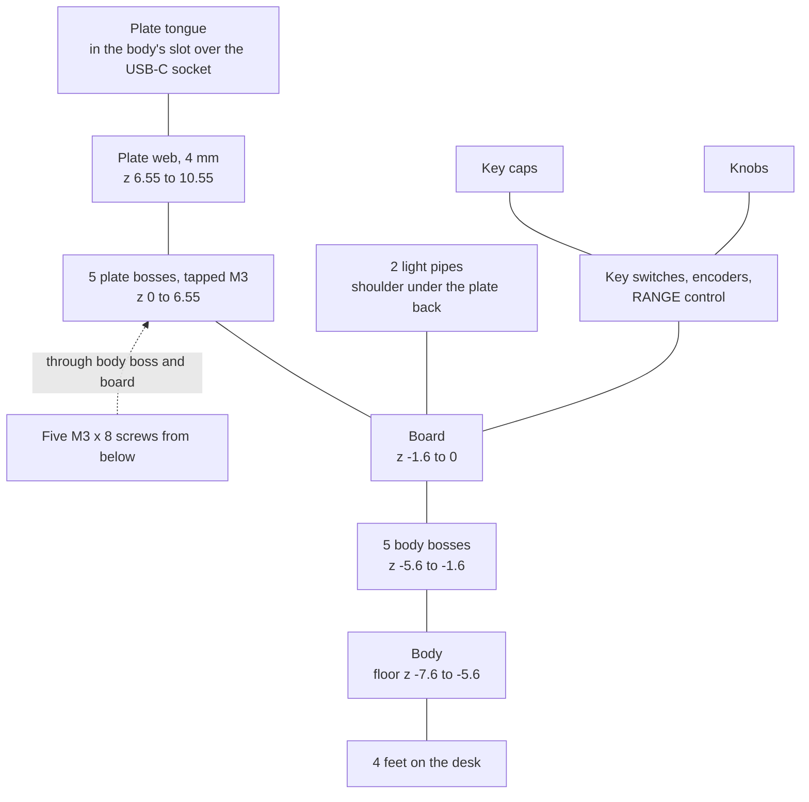

# Mechanics

How the body, the front plate, the key caps, the light pipes and the knobs stack and fasten, what each fit is
and how much margin it has. The steps at home are in [Assembly](../building/assembly.md).

| Numbers | Where they live |
| --- | --- |
| Every height, tolerance and datasheet dimension, with the reason beside it | [mech/stack.py](../../mech/stack.py) |
| The body's own sizes: walls, cavity, counterbores, middle column, post, ribs, USB-C opening, feet | [mech/make_mech.py](../../mech/make_mech.py) |
| The knob and light pipe solids | [mech/make_knobs.py](../../mech/make_knobs.py) |
| The key cap solids and their legends | [mech/make_caps.py](../../mech/make_caps.py) |
| The plate's legends, their positions and the DXF layers | [mech/make_plate_art.py](../../mech/make_plate_art.py) |
| The notes and tolerances on the plate drawing | [mech/make_plate_step.py](../../mech/make_plate_step.py) |
| The mounts, the key grid, the knob and light positions | [pcb/board.py](../../pcb/board.py) |
| Every fit with its margin | [mech/check_fit.py](../../mech/check_fit.py): one printed row per fit, and a failed build when a margin reaches zero; it also draws the [sections](../../renders/8-fit-check.png) |

To change a dimension, change it there and run `./build.sh` ([Generators](generators.md#build)): the fit
rows show what the change costs.

## Stack

Five screws from below clamp the board between the body's bosses and the plate's bosses. Everything else
stands on the board or hangs from the plate.

Heights as drawn, z = 0 at the top of the board. Anodising raises the plate's face by up to 0.05 mm
(`stack.ANODISE`).

| z (mm) | Part |
| --- | --- |
| -7.6 to -5.6 | Body floor, 2 mm. Below it the 6° wedge is hollow down to the desk plane (-7.2 at the front, about -14 at the back), with 2 mm ribs and a solid band along the front |
| -5.6 to -1.6 | 5 body bosses (Ø8 on the board) carry the board: four joined to the corner walls, one on a bar-shaped column in the middle of the key field. One post (Ø4.0) ends 0.3 mm under the board |
| -3.2 | Counterbore seats (Ø8.4), 1.6 mm of PA12 under the board: the screw heads stay recessed |
| -1.6 to 0 | Board. The two LEDs on its bottom shine up through 2.2 x 2.4 mm cutouts |
| 0 to 6.55 | The plate's 5 bosses (Ø5.5, tapped M3). Beside them: key switch bodies (3.6 mm high), encoder bodies (8.0), the RANGE control's body (8.6), the light pipes' bases (5.65). The body walls end at 5.6, the plate's tongue at 1.05 |
| 6.55 to 10.55 | Plate web, 4 mm. Pockets from the back for the encoders (2.5 mm deep) and the RANGE control (3.05) |
| 6.8 to 12.5 | Key caps, their socket ceiling on the plunger top (9.5): 1.95 mm over the plate |
| 11.7 to 18.0 | Outer knob ring, its key on the floor of the shaft slot |
| 13.4 to 21.6 | RANGE knob, its bore end on the lever tip |
| 19.5 to 29.9 | Inner knob, its bore end on the 28 mm shaft tip: 19.35 mm over the plate |

## Fastening

- Screws: five M3 x 8 flanged button head screws (ISO 7380-2, 2 mm hex key), all alike, go from below through
  a body boss and the board into a plate boss. The flange bears on the floor of the body's counterbore (Ø8.4
  round a Ø4.2 hole). The length is not free: an M3 x 6 would engage under 1 mm, an M3 x 10 would reach the
  drill point.
- Plate height: the plate's five bosses (Ø5.5, 6.55 ±0.05 mm high, milled with the plate from 12 mm stock)
  alone set it. That height sits between the fits that want the plate low and those that want it high: the
  first two groups of the [fits](#fits) table. With its bosses the plate is 10.55 mm high, up to 10.7.
- Body walls: they end 0.95 mm under the plate back and must never reach it. A wall that touched the plate
  would take the screws' clamp off the board.
- Threads: M3-6H from each boss's end face, full thread at least 6.0 mm deep, the tap drill 7.5 mm plus its
  point, which leaves at least 2.15 mm of metal in front of it. An anodised thread does not gauge, so the
  drawing asks for the threads masked or cut again afterwards. The boss end faces may be bare or anodised, all
  alike (`stack.ANODISE`).
- What locates what: the plate's bosses locate the screws. The key caps centre the board in the key holes
  while it is lowered into the plate, and its 3.8 mm holes let it stay there. A cap turned on its round
  plunger has less room in its hole, so each row of caps is squared on a steel rule first (step 1 of
  [Putting it together](../building/assembly.md#putting-it-together)); the fit rows take 1° of turn, and
  2.5° that a cap may creep in use. The body locates nothing: its 4.2 mm holes pass the screws wherever the
  plate puts them, with up to 0.82 mm of play, so it is centred by eye for the tongue's gaps.
- Middle mount: the fifth boss and screw, at board (72.25, 30.75), hold the board and the plate together in
  the middle of the key field. The body's column there is a bar along board y, 4.0 mm wide and 12.2 mm long,
  because the leads of the four keys round it stand 5.3 mm off its axis. The counterbore is wider than the
  bar, so it is open to the room under the board on the bar's two long sides.
- Board support: with the middle mount a firm key press (10 N, about six times the switch force) dips the
  board by 0.21 mm at most (`stack.PRESS_FIRM`). The post at board (98.3, 30.75) is a backstop that never
  lifts the board.

## Plate and body

- Pockets: 15.8 x 20 mm over each encoder body and Ø19.6 over the RANGE control's body, depth +0/-0.1 mm,
  floor corner R0.3 at most. They leave 1.5 and 0.95 mm of plate, 1.4 and 0.85 mm on a thin plate, over the
  0.8 mm JLCCNC recommends.
- Holes for the controls: the Ø9.5 encoder holes and the Ø11.1 RANGE hole take the board wherever the caps
  centre it and stay hidden under the knobs.
- RANGE control (Alps RKJXT1F42001, RKJXT below): it can sit up to 0.26 mm off on its pins before soldering,
  because its locating peg goes into the 1.3 mm hole of JLC's footprint
  ([Electronics](electronics.md#through-hole-parts)). The pocket and the hole give it that room.
- Key and light holes: key holes 10.4 x 7.2 mm +0.1/-0 after anodising, 0.4 mm per side round the caps,
  corners R1.6 (R1.7 at most), their back edges broken 0.3 to 0.5 mm as a lead-in for the caps. Light holes
  Ø2.3 +0.1/-0, their back edges sharp, because the light pipes' shoulders bear there. The laser-marked line
  between the AUDIO and RADIO keys passes 0.575 mm from the key holes beside it (0.525 mm with a hole 0.1 mm
  large). Where a laser mark meets a hole's edge break it is only cosmetic, so the fit check holds only the
  amber print to the holes.
- USB-C: the USB-C socket (J1) stands 0.52 mm past the board edge, level with the cavity wall, so the plug
  opening in the back wall (16.8 x 8.7 mm) runs on up through the wall top as a slot of the same width, and
  the socket passes the wall when the body goes on. A tongue on the plate's back edge (15.0 mm wide, 2.0 mm
  thick, 5.5 mm long) fills the slot from above; its end is the top edge of the plug opening, 1.05 mm over the
  board. The opening takes a straight plug whose overmould is at most 12.85 x 7.0 mm, USB Type-C's maximum
  (R2.5, Figure 3-3); a larger or angled one does not pass the 2 mm wall far enough to seat. The gaps beside
  and under the tongue are cosmetic (the dark cavity shows through them); the fit check keeps them under
  1.6 mm (`stack.USB_GAP_MAX`).
- Body: PA12 printed by MJF (JLC3DP's nylon print), with 2.0 mm walls and ribs (JLC3DP's wall for parts over
  100 mm). The cavity leaves 0.5 mm per side round the board and 4.0 mm under it for the SMD (surface-mount)
  parts, the socket and the untrimmed leads (2.7 mm at most). The milled outline fits as delivered, and so
  does the V-cut (scored and snapped) rail edge (±0.4 mm); V-cut short edges would have to be sanded
  ([On arrival](../building/bring-up.md#on-arrival)).
- Bottom: a 5 mm hole in the floor over the two BOOT pads, for recovery only
  ([Bring-up](../building/bring-up.md#updates-and-recovery)), and four flat 12 mm pads under the corners for
  self-adhesive feet up to 10 mm across.

## Caps, light pipes, knobs

### Key caps

- Seat: the cap's socket is a 3.8 mm bore with four rigid ribs that follow the cone of the switch plunger
  (TE's STEP model of the 1-1825910-4), so a cap that grips cannot rock. The ribs stop 0.35 mm under the
  socket ceiling, and the flat ceiling sits on the flat plunger top: the plunger, not the fit, sets the cap
  height.
- Sets: a rigid friction fit holds from 0.02 to 0.15 mm of interference, but JLC3DP's full-colour resin
  prints holes within ±0.2 mm. So the order has four full sets that differ only in their rib circle: 3.05 (D),
  3.15 (A), 3.25 (B) and 3.35 mm (C) at the socket mouth, where the plunger is 3.29 mm. Together they cover a
  print 0.2 mm small to 0.2 mm large. One to four dimples on the bottom name the set (A to D).
  [Bring-up](../building/bring-up.md#choosing-the-cap-set) says how to find the set; a plunger lot near the
  edge of TE's ±0.30 mm needs the sets moved (`stack.CAP_SETS_MOVE`).
- Turn: only friction on the round plunger holds a cap square, so it may creep round in use. Up to 2.5° it
  keeps its room in the key hole (in a set printed 0.2 mm large, up to about 1.5°); one that rubs is turned
  back square in place ([Care](../using/controls.md#care)).
- Firm press: the board bends, and the cap can dip up to 0.85 mm under the plate back and tilt 0.43° with its
  plunger. It may then rub the face edge of its hole on one side. It cannot wedge across the hole, and the
  edge break on the hole's back edge leads it back in; `check_fit.py` has a row for each.
- Legends: Barlow Semi Condensed Bold, grown by 0.055 mm all round, so every coloured stroke prints at least
  0.4 mm wide (JLC3DP's minimum for full-colour lines).
- Tactile bars on SHIFT, UP and DN: 1.0 mm wide and 0.5 mm proud. A taller front bar would hide the bottom of
  the SHIFT and DN legends from the seat (a fit row checks the sightline at 45°).

### Light pipes

- Shape: a stepped rod of translucent resin, held by its shape alone. The Ø2.8 mm base stands on the board
  over the LED's cutout, up to a shoulder 5.65 mm up; the Ø2.0 mm rod, 4.45 mm long, goes through the
  Ø2.3 mm light hole. Lifted, the shoulder stops on the plate back, so the pipe is captive.
- Height: in use the pipe rests on the board. Its top is 0.50 mm under the anodised face in the nominal stack
  (0.45 mm under the face as drawn), and between 0.40 mm over it (a long pipe grown in its first week) and
  1.25 mm under it at the ends of the tolerances. Lifted onto its shoulder it can stand 0.95 mm over the face
  of a thin plate. Between the two it has 0.9 mm of play, so it may tick when the panel is moved.
- Never clamped: the longest base, grown by the 0.2 mm that resin may gain in its first week and with
  0.1 mm of sanded stub left on, stays under the smallest gap between the board and the plate back. A clamp
  would load the pipe with newtons (the board is 13 to 17 N/mm stiff at the lights). This row limits the
  plate's flatness: the drawing asks for 0.1 mm, and the row fails just above 0.22 mm, or just above 0.17 mm
  with the bosses at ±0.1 mm. The rod's 0.05 mm in its hole cannot take that growth: a rod that grows tight is
  sanded ([Putting it together](../building/assembly.md#putting-it-together)).
- Visibility from the seat (45°): 81 % of each top in the nominal stack, 70 % with the rod against the near
  side of its hole, 21 % at the worst depth. The UNIT light sits 5.5 mm east of the HOME and SHIFT column,
  in the gap between two cap columns, so no cap stands in front of it.
- Print: both pipes come on one 2.2 x 2.0 mm bar under their bases (JLC3DP prints resin parts from
  10 x 2 x 2 mm), on Ø1.0 mm necks, so the visible tops stay as printed. The stubs are sanded flush.
- Fallback: the 4.45 mm rod is over JLC3DP's pillar guideline (Ø2.0 up to 4 mm). With `top_len` in
  `stack.PIPE` at 4.0 the fit check still passes: the top is then 0.95 mm under the anodised face and 52 % of
  it shows.
- The LEDs under the pipes are in [Electronics](electronics.md#lights).

### Knobs

- Fit: friction only. The bores are drawn at the shaft size (`stack.FIT` = 0), and JLC3DP's resin holes vary
  by ±0.3 mm, so one outer ring, one FMS ring, one inner knob and the RANGE knob also come 0.2 mm tighter and
  0.2 mm looser (`stack.FIT_VARIANTS`). A rigid fit grips over about 0.13 mm, less than the step between the
  variants, so for about four knobs in ten none grips as printed and the next tighter one is opened
  ([Assembly](../building/assembly.md#fitting-the-knobs)).
- Heights: the uncut shafts of the Bourns PEC11D encoders set them. The outer ring rests with its key (1.4 mm
  wide) on the floor of the shaft slot, its counterbore 1.05 mm over the bushing. In the 2.0 mm slot the key
  has 11.5° of play in all (21.4° at the ends of the tolerances), against 12° a detent: only the bore's grip
  takes it out. The inner knob rests with its bore end on the shaft tip; its D bore ends 0.7 mm short of the
  shaft's D flat, so the bore end, not a short flat, sets the height. A bore drilled deeper lowers the knob.
- Proportions: outer rings Ø17, inner knobs Ø12, so 2.5 mm of ring shows on each side. The FMS ring has 14
  flutes 0.9 mm deep where the other rings have 24 at 0.45 mm: FREQ and FMS, the same size one above the
  other, are told apart by feel.
- RANGE knob: Ø13.6 with a Ø17.3 skirt that hides the plate hole at full tilt, 3.7 mm of its D bore on the
  lever. Its bottom is dished: flat over the hub, then a cone that rises 1.3 mm to the rim, steeper than the
  tilt's 9°. At full tilt the knob also cocks on the lever by its play (2.3° for the 0.15 mm a kept knob may
  have, `stack.RANGE_PLAY`), and the lever may be pushed in, which takes the rim down further than the hub's
  corner. A looser knob cocks until its skirt touches the plate. Every RANGE row assumes the tilt fulcrum
  (4.65 mm off the axis) on whichever side is worse. The four pan arrows start 10.15 mm from the hole's
  centre, outside the skirt.

## Fits

The main margins from `check_fit.py`'s output, in this page's words; the script prints more rows. Each margin
is what is left at the worst end of every tolerance in its row, and "over 0.8 mm" names the minimum it is
counted from. A margin of zero fails the build. RSS: independent errors added as a root sum square. "Plate
low" and "Plate high" are the two groups the boss height sits between. Margins of 0.05 mm or less are bold.

| Group | Fit | Margin (mm) |
| --- | --- | --- |
| Plate low | Outer knob ring over the plate face | 0.22 |
| Plate low | RANGE knob's underside over the plate at full tilt, cocked on the lever by its play and pushed | 0.17 |
| Plate high | Encoder pocket over the encoder body | 0.485 |
| Plate high | RANGE pocket over the RKJXT body, also at the pocket's floor corner | 0.435 |
| Plate high | Cap socket ceiling under the plate face, on a plunger at TE's +0.3 mm | 0.51 |
| Plate high | Tongue's end over the plug overmould | 0.29 |
| Plate high | Body wall tops under the plate back | 0.33 |
| Plate high | Light pipe base under the plate back, grown 0.2 mm in its first week (never clamped) | 0.125 |
| Light pipes | Top over the face of a thin plate, lifted and grown in its first week, under the 1.0 mm allowed | **0.05** |
| Light pipes | Rod in its hole, on the diameter | **0.05** |
| Light pipes | Base clear of the switch bodies (SHIFT, UNIT) | 0.125, 0.85 |
| Light pipes | Base out from under the key holes (SHIFT, UNIT) | 0.20, 0.43 |
| Light pipes | Light hole web to the next key hole at tolerance, over JLCCNC's 0.5 mm minimum (SHIFT, UNIT) | 0.30, 0.53 |
| Light pipes | LED lens in its board cutout | **0.01** |
| Caps | Cap's play in its key hole beyond the per-key position errors (RSS) | 0.13 |
| Caps | The same with the cap turned 1° | 0.10 |
| Caps | The same with the cap crept round to 2.5° in use | **0.02** |
| Caps | A whole set printed 0.2 mm large (WJP's outline error as a bias), turned 1° | **0.024** |
| Caps | Firmly pressed cap lands on the back edge break | 0.29 |
| Caps | Cap sets' coverage beyond a rib circle printed 0.2 mm small or large | **0.012** |
| Caps | Wall round the socket at the worst print, over 1.0 mm | 0.10 |
| Caps | Amber legends beyond the largest key hole's edge break, for the UV print's register | 0.505 |
| Screws | M3 through the narrowest board hole, the board where the caps centre it | **0.045** |
| Screws | Plate boss end covers the widest board hole all round | 0.10 |
| Screws | Plate boss inside the board's 3.6 mm copper keep-out | 0.20 |
| Screws | Body screw hole round the M3 where the plate puts it | **0.02** |
| Screws | Flange covers the widest body hole all round | 0.09 |
| Screws | Full thread engaged, over 2.0 mm | 0.75 |
| Screws | Tip short of the end of the full thread | 0.45 |
| Body | Plate corner bosses clear of the cavity walls at the end of the body's screw play | 0.08 |
| Body | Board in the cavity, per side: across (V-cut rail edge), along | 0.15, 0.08 |
| Body | Middle column, corner bosses and post clear of leads, solder fillets and bottom parts, over 0.3 mm | 0.16, 0.125, 0.205 |
| Body | Column bar and corner boss walls round the counterbore, over JLC3DP's 1.5 mm | 0.10 |
| Body | Untrimmed leads over the body floor | 1.00 |
| USB-C | Tongue's smallest side gap in the body's slot, the body centred (largest gap 1.50 mm, limit 1.6) | 0.30 |
| USB-C | Tongue covers the plug overmould across | 0.25 |
| USB-C | Tongue's inner face short of the J1 shell tabs | 0.725 |
| USB-C | Plug overmould (12.85 x 7.0 mm) in the opening | 0.315 |
| Controls | Encoder bushing in its Ø9.5 hole, radial | 0.15 |
| Controls | Encoder lugs in their pocket, per side | 0.15 |
| Controls | RKJXT body in its Ø19.6 pocket, radial | 0.39 |
| Controls | RKJXT hub at full tilt in its Ø11.1 hole, radial | 0.18 |
| Controls | Plate left over the RANGE pocket on a thin plate, over 0.8 mm | **0.05** |
| Knobs | RANGE skirt covers its hole at full tilt, cocked and pushed or not | 0.18 |
| Knobs | Pan arrows outside the RANGE skirt, seen square on | 0.39 |
| Knobs | RANGE knob's underside over the plate, should the lever reach 9° on both axes at once (12.6°): nominal, pushed 0.3 mm (0.57 not pushed) | 0.27 |
| Knobs | Outer ring covers its encoder hole, seen from above | 1.10 |
| Knobs | Outer knob's counterbore over the bushing | 0.08 |
| Knobs | Outer knob's key face clear of the inner shaft in the slot | **0.05** |
| Knobs | Outer knob's key in the narrowest shaft slot | 0.10 |
| Knobs | Outer ring's lash in the shaft slot, should its bore not grip, within a detent (12°), nominal | 0.54° |
| Knobs | Inner knob over the outer ring, pushed | 0.18 |
| Knobs | Knob bore variants' coverage beyond the resin's ±0.3 mm | **0.05** |

## Assumptions

Values that no datasheet or vendor states; the fit rows take them as given.

- RKJXT: body tolerance ±0.3 mm; the tilt fulcrum on either side (the RANGE rows take the worse); the centre
  push may still go down at full tilt; between two directions the lever reaches at most 9° on each axis.
- PEC11D: the inner shaft at most 0.05 mm off the outer one (`stack.SHAFT_ECC`).
- Knob bores: a variant fits when it prints within 0.15 mm of the size drawn (`stack.FIT_OFF`), and a kept
  RANGE knob has at most that much play on the lever (`stack.RANGE_PLAY`).
- Key switch: TE's plunger lot is close enough to its STEP model for the four cap sets.
- Key caps: they creep round on their plungers by at most 2.5° in use (`stack.CAP_CREEP`).
- MJF: rounds a counterbore's floor corner by 0.2 mm at most (`stack.CB_FLOOR_R`).
- JLCCNC's UV print: registers within 0.5 mm.
- JLCPCB's drill positions: ±0.075 mm (`stack.POS_TOL`).
- JLCPCB's routed LED cutouts: ±0.1 mm per side (`stack.PCB_CUTOUT_TOL`).

## Dimensions

| Item | Value |
| --- | --- |
| Board | 160 x 60 mm, 4 layers, every SMD part on the bottom (`pcb/board.py`) |
| Panel | 165 x 65 mm, 17.75 mm high at the front and about 24.6 mm at the back (6° wedge, for a flat desk in front of the pilot) |
| Plate | 4 mm web, 10.55 mm high with its bosses, 32 cm³, 86 g |
| Body | 39 cm³, about 40 g |
| Key pitch | 11.85 mm horizontal (17.1 mm between AUTOPILOT and AUDIO), 11 mm vertical, 14.5 mm between rows 2 and 3 for the FMS line. The rows stay aligned across the panel, so the autopilot block shares that gap |
| Caps | 9.6 x 6.4 mm, 1.95 mm over the plate, one legend size (capitals about 2.0 mm high, strokes at least 0.4 mm). The flip-flop icon is narrow, so COM ⇆ does not shrink every legend |
| Dual knob centres | x 15 and 145, y 15 and 45 (30 mm apart). Between the knobs: 12.85 mm on the left (ALT/HDG ring to RANGE skirt), 13 mm on the right |
| Knobs | Matte black resin, vertical flutes, slight taper, chamfered flat top. Outer ring Ø17 x 6.3 mm on all three, inner knob Ø12 x 10.4 mm above it. RANGE knob Ø13.6 x 8.2 mm with a Ø17.3 skirt |
| Amber | The plate's UV print is JLCCNC's standard orange. #d9a441 (RGB 217, 164, 65) approximates it for the SHIFT cap legend and the 3D view (`stack.AMBER`) |
