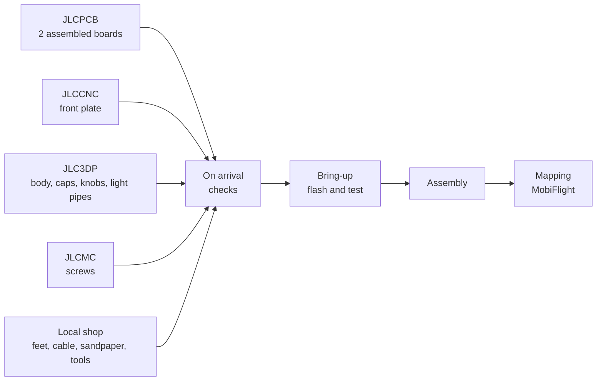

# Building one

The steps from ordering to mapping.

1. [Ordering](ordering.md): what to order where, step by step, with the
   [shopping list](ordering.md#shopping-list).
2. [Bring-up](bring-up.md): the checks on arrival and the cap set, then flashing the firmware and testing
   every key, knob and light on the bare board.
3. [Assembly](assembly.md): caps, light pipes, board, body and five screws, feet, knobs.
4. [Mapping](../using/mapping.md): the two joysticks in MobiFlight, or the
   [keyboard mode](../using/keyboard.md) for a console and for the sim without MobiFlight.

Two options: [Hand-soldering](hand-soldering.md) the keys, the encoders and the RANGE control, and the
[Pico bench](bring-up.md#pico-bench), which runs the firmware before the boards arrive.
