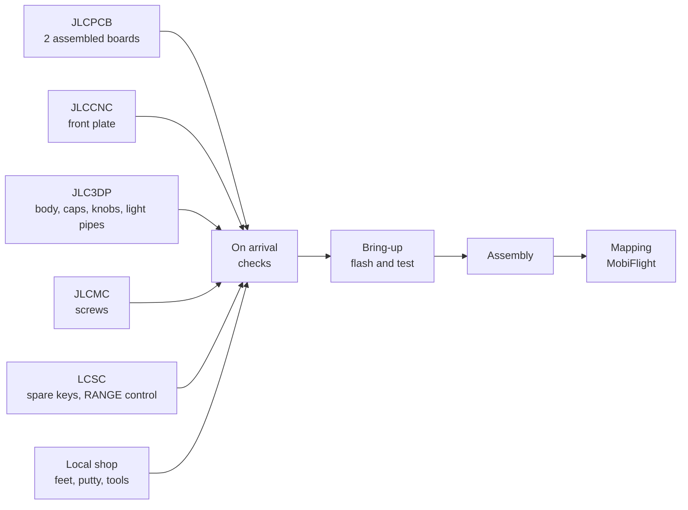

# Building one

The steps from ordering to mapping. The pages, in build order: [Ordering](ordering.md),
[Bring-up](bring-up.md), [Assembly](assembly.md), then [Mapping](../using/mapping.md).

1. **Order** ([details, shopping list](ordering.md)), in the sequence of
   [Order step by step](ordering.md#order-step-by-step): the six encoders into JLCPCB's Parts Manager first,
   JLCCNC before JLC3DP. Every file name below starts with `avionics-panel-rev1-`:

   | Shop | What | Files |
   | --- | --- | --- |
   | JLCPCB | the board, 2 fully assembled | [gerbers.zip](../../production/avionics-panel-rev1-gerbers.zip), [BOM-full.csv](../../production/avionics-panel-rev1-BOM-full.csv), [CPL-full.csv](../../production/avionics-panel-rev1-CPL-full.csv) |
   | JLCCNC | the aluminium front plate | [plate.step](../../production/avionics-panel-rev1-plate.step), [plate-drawing.pdf](../../production/avionics-panel-rev1-plate-drawing.pdf), [plate.dxf](../../production/avionics-panel-rev1-plate.dxf) |
   | JLC3DP | body, four key cap sets, knobs, light pipes | [body.step](../../production/avionics-panel-rev1-body.step), [caps-A.zip](../../production/avionics-panel-rev1-caps-A.zip) to [caps-D.zip](../../production/avionics-panel-rev1-caps-D.zip), `knob-*.step`, [lightpipes.step](../../production/avionics-panel-rev1-lightpipes.step) |
   | JLCMC | six M3 x 8 flanged button-head screws | |
   | LCSC | spare keys and a reference RANGE control | |
   | local | feet, putty, sandpaper, a few tools | |

   Hand-soldering the keys, encoders and RANGE control is an option
   ([assembly variants](ordering.md#assembly-variants)).
2. **What arrives**: two assembled boards (and three bare ones), the plate, the body with two USB-C fillers,
   four sets of 28 key caps (one of them fits), the knobs with tighter and looser spares, two light pipe bars,
   the screws and the LCSC parts.
3. **Check on arrival**: look at the rail edge, try the plate threads, check that the encoders and the RANGE
   control sit flat and the J1 shell tabs are soldered, choose the cap set
   ([On arrival](bring-up.md#on-arrival); with hand-soldering only the threads and the cap set).
4. **Bring-up**: flash CircuitPython and the [firmware](../../firmware/), then test every key, knob and light
   on the bare board ([Flash and test](bring-up.md#flash-and-test); with hand-soldering, you solder the J1
   tabs, the keys and last the encoders and RANGE control along the way). Optional before the boards arrive:
   the [Pico bench](bring-up.md#pico-bench).
5. **Assemble**: caps onto the keys, light pipes into the plate, the board face down into the plate, the body
   over it with four screws, the USB-C filler, the knobs and the feet
   ([Assembly](assembly.md#putting-it-together)).
6. **Map**: two joysticks, every function a fixed button ([Mapping](../using/mapping.md),
   [BUTTONS.md](../../firmware/BUTTONS.md)); then the knob timing check of the
   [first board](bring-up.md#first-board).
