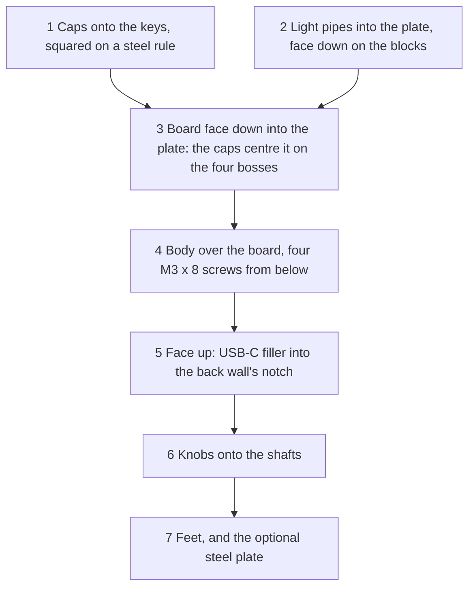

# Arrival and assembly

What to do with the parts at home: check the boards on arrival, solder (only with the hand-soldering option),
put the panel together and take it apart. The tools are in the [shopping list](building.md#shopping-list); why
the parts are shaped as they are is in [Mechanics](../architecture/mechanics.md).

## On arrival

Full assembly (the default), in this order:

1. Rail: break the V-scored rail off the long edge away from J1 (pliers along the score, without bending the
   board), then file or sand that edge flush (outdoors or wet: glass-fibre dust). The V-cut edge (±0.4 mm)
   fits the cavity as it is, so there is nothing to measure. A corner at that edge that came back square is
   filed to R3: it would stand about 0.74 mm into the body's R3.5 cavity corner.
2. Plate threads: turn one of the M3 screws into each boss by hand with the 2 mm hex key, about ten turns, and
   out again. It must run freely: an anodised thread that was neither masked nor cut again stops it early
   (take it up with JLCCNC). Don't drive it home: without the body it would go past the 6.0 mm of full thread.
3. Seating: the plate pockets leave the encoders and the RANGE control little room
   ([why](../architecture/mechanics.md#seating)), so check what JLCPCB soldered:
   - Encoders: a 0.05 mm feeler blade must not slide under an encoder body anywhere round it, and the lugs are
     soldered.
   - RANGE control (RKJXT): press the loose one from the LCSC order fully down into the footprint of a bare
     board and note at each of its four [gauge spots](#gauge-spots) the thickest blade (or stack) that slides
     under its base frame: that is the reference, about 0.40 mm. On each assembled board that blade must slide
     in at every spot and that blade plus 0.03 mm must not. If both boards read outside the same way, read the
     loose part again in another bare board first.
   - The keys sit flat.

   A part that stands proud: reheat its pins while pressing it down, or use the second board for the panel.
4. J1 shell tabs: all four slots filled from the top and wetting the tabs; if not, solder them as in
   [hand-soldering](#hand-soldering).
5. Cap set: [choose it](#choosing-the-cap-set) on one of the spare loose keys from the LCSC order.

Nothing else needs a tool: the leads stay untrimmed, and a solder bridge shows up in [bring-up](bring-up.md)
steps 6 and 7, where every key, ring, tilt and push is read.

Hand-soldering option: the board comes without rails, milled all round, and fits the body as delivered. Do
steps 2 and 5 (the two spare keys come with the LCSC set); the rest follows in the bring-up.

Either variant: should JLCPCB have added rails the order did not ask for, break them off as in step 1; short
edges with rails are then sanded, both about equally, until the board drops into the body (160.2 mm or shorter
fits any body within the print tolerance).

Then [bring-up](bring-up.md), before the plate goes on.

## Hand-soldering

Only with the hand-soldering option, and for rework. The board comes with every SMD part on the bottom, the
two LEDs included; the keys, encoders and RANGE control are soldered by hand from the bottom side. The
[bring-up](bring-up.md) says when: the J1 tabs first, then flash and test the bare board, then the keys, and
the encoders and RANGE control last, as they are the parts that are hard to remove again.

- USB-C shell tabs: solder all four J1 shell tabs from the top before the first plug-in: flux, then feed
  solder into each slot until it is filled and wets the tab all round (they are GND). The tabs, not the 0.3 mm
  contacts, take the load of the plug; the reflow leaves only a fillet under them.
- Every part sits flat on the board: solder one pin, check from the side that the part sits flat and square
  (press it down while you reheat that pin if not), then solder the rest. Same for the 28 keys: a tilted key
  tilts its cap in the key hole. The leads need no trimming: they stand at most 2.7 mm under the board, which
  sits 4.0 mm over the body floor (3.7 with the print tolerance), so they clear it by 1.0 mm.
- Encoders: at most 0.05 mm proud: a 0.05 mm feeler blade must not slide under an encoder body. The mounting
  lugs go through their slots and get soldered too; they carry the push of the knobs.
- RANGE control (RKJXT): no centring needed, just seat it flat, checked against its own reading: before
  soldering, press it fully down (a finger on the hub) and note at each [gauge spot](#gauge-spots) the
  thickest blade or stack that slides in. After soldering, at every spot that blade must still slide in and
  that blade plus 0.03 mm must not. If a spot reads outside, reheat the pins while pressing the part down, and
  read again.
- The RKJXT's COM and ECOM pins are the closest hand-soldered pair on the board (0.38 mm of copper between the
  pads, RANGE_COM and GND): check them for a bridge with a magnifier and a continuity tester. A bridge makes
  the whole fifth column read pressed.

### Gauge spots

The RKJXT's base frame stands on moulded flanges that reach the frame edge only on a strip of each side, from
about 0.5 to 3 mm left of its middle, seen from outside (the same on all four sides). At the middle of a side
the flange is set back and a terminal 0.8 mm in stops the blade. These four strips are the gauge spots: slide
the blade in square to the side, about 0.5 mm, on the strip only (with the corner of the blade or a narrow
one).

## Choosing the cap set

The order has four sets of 28 caps (A to D, one to four dimples on the underside) that differ only in their
grip ([why](../architecture/mechanics.md#caps-light-pipes-knobs)). Try one cap of each set on a spare loose
key (no tools), so pulling off a tight cap loads no soldered switch.

- The right set pushes down by hand until the cap sits on the plunger top (it stops hard there; on the board
  its top is then level with its neighbours), holds when the key is turned over and does not wobble.
- Too tight: the cap stops short of the plunger top or needs more than a firm thumb. Too loose: it falls off
  or rocks.
- If two sets fit, take the tighter one (from tight to loose: D, A, B, C).
- Without a spare key, try them on a soldered key from loose to tight (C, B, A, D) and stop at the first set
  that holds, so no tight cap has to be pulled off.
- If even C is too tight, or even D too loose, reprint with `CAP_SETS` in [mech/stack.py](../../mech/stack.py)
  moved by 0.1 mm for each set it missed by (up to 0.3 mm; one round may not do).

Keep the other three sets as spares.

## Assembly

Nothing is glued: the screws hold the board between the plate's bosses and the body, and the light pipes are
held by their shape. The encoder shafts stick out 18 mm past the plate face, so the plate rests face down on
two blocks at least 25 mm high under its long front and back edges, at most 8 mm in from the edge (the nearest
caps and shafts are about 10 mm in), with a cloth on top.

1. Caps: push all caps of the chosen set onto their plungers, tactile bars as in the 3D view, down until each
   one sits on its plunger top. Then square them: hold a steel rule against the front edges of each row of
   caps and turn every cap until its edge lies flat on the rule. A cap turned by more than about 1° can rub
   its hole; one turned by more than about 5° lands on the plate back instead of in its hole.
2. Light pipes: break both off their bar and sand the two stubs flush with the base on fine sandpaper laid on
   the table, no further (the visible tops stay as printed). The two pipes are the same. Lay the plate face
   down on the blocks and the cloth and drop each pipe into a light hole from the back, rod first: the SHIFT
   hole below the SHIFT key and the UNIT hole between the HOME and SHIFT keys. Each rests on its shoulder on
   the plate back.
3. Board: lower it face down into the plate: the caps drop into their key holes and centre the board, and it
   comes to rest on the four bosses, the pipes' bases standing clear under it. Look at the face between the
   blocks: every cap must stand up through its hole; one that sits on the plate back was turned, so square it
   again.
4. Body: set it over the board, bottom up. Put the four screws in from below, turn each in by hand, then
   tighten them gently with the 2 mm hex key (two fingers on its short arm), crosswise. The wall tops stay
   clear of the plate back, so there is nothing to check there. Should the plate rock or the board rattle once
   the screws are in, a wall top touches the plate: sand it down a little on sandpaper laid flat on the table.
5. USB-C filler: turn the panel over (face up) with its back towards you. Put a small dab of adhesive putty on
   the inner, chamfered half of each side face of the filler (a dab further out is scraped off at the notch's
   edges and smears the back face), set it chamfered edges first onto the two ledges in the notch above the
   plug opening, and push it in with the 1.0 mm blade of the feeler gauge set, not a finger (nothing stops it
   inward; a thin blade bends and pushes it past flush): hold the blade flat against the back wall, its long
   side across the notch and its upper edge just under the plate edge, which can stand proud of the wall (a
   wide steel rule would bear on the plate instead), with its holder hanging past the nearer end of the back
   wall, and press on it close to the notch on both sides until it lies flat on the wall there. The filler is
   then flush and sits on both ledges. Check that a USB-C plug still goes all the way in.
6. Knobs: [fit them](#fitting-the-knobs).
7. Feet: stick the four self-adhesive feet onto the flat pads under the corners. With the steel plate, tape it
   into its recess first (notches at the back corners, round the back feet); the feet go on the same pads
   either way. Turning the panel over for this can slide the filler off its ledges: check it is back down on
   both ledges and flush afterwards (step 5).

### Fitting the knobs

Push the outer knob's key into the shaft slot until it sits on the slot floor, the inner knob onto the D flat
until its bore end sits on the shaft tip, and the RANGE knob onto the lever's D flat until its bore end sits
on the lever tip. The knobs are held by friction only, and resin bores vary, so the order has each knob type
also with a bore 0.2 mm tighter and 0.2 mm looser: keep whichever grips.

- A bore that is still too tight opens with a drill of the shaft size turned by hand (6.0 mm outer, 3.5 mm
  inner, 2.5 mm RANGE), then a needle file on the D flat. In the outer knob, drill from below only up to the
  key (4.41 mm deep) and file the rest, or the drill takes the key off.
- Never drill past the existing bore depth (mark the drill with tape at it): the inner and the RANGE knob sit
  with their bore end on the shaft or lever tip, so a deeper bore lowers the knob, and the RANGE skirt has
  only 0.22 mm over the plate at full tilt.
- A loose knob holds with a strip of tape on the shaft.
- Reprint the rest with that fit (`FIT` in [mech/stack.py](../../mech/stack.py)) if needed.

## Disassembly

1. Pull the knobs off (inner first). Lay the panel face down on the blocks.
2. Undo the four screws and lift off the body. The USB-C filler comes off with it in its notch, or, where the
   board or the socket is in its way, slides out through the notch's open top and stays on the plate back.
   Before the body goes back on, take the filler out of its notch (push it out from the inside): there it
   would stop the socket. If it stayed on the plate back, pick it off: the wall top would land on it.
3. Lift the board out; caps that stay in their key holes come out from the front. The light pipes stay on
   their shoulders in the plate as long as it lies face down.
4. To reassemble, push any cap that came out back onto its plunger and square the rows again (step 1), check
   that both light pipes sit in their holes, and do steps 3 to 6.

To take the filler out with the body on, press a ball of the same putty onto its outer face and pull it
straight out (tape grips the MJF surface poorly). Do it with the panel face up: face down the filler can slide
off its ledges towards the plate back.
