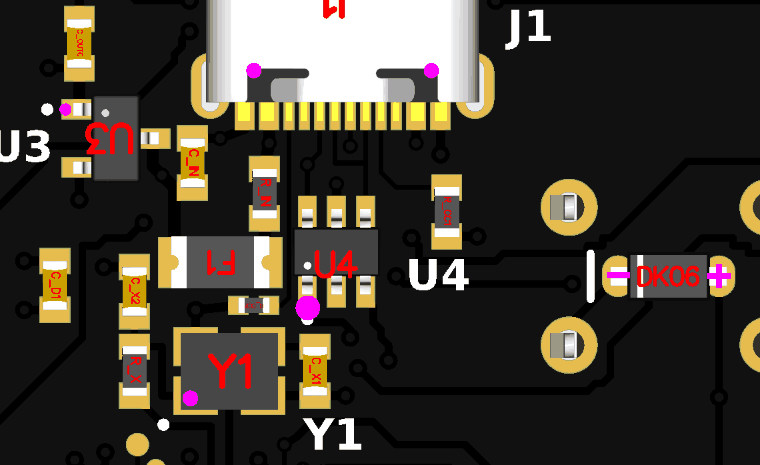
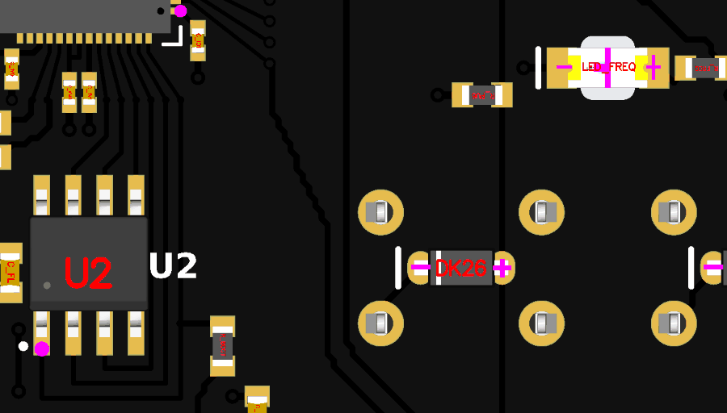
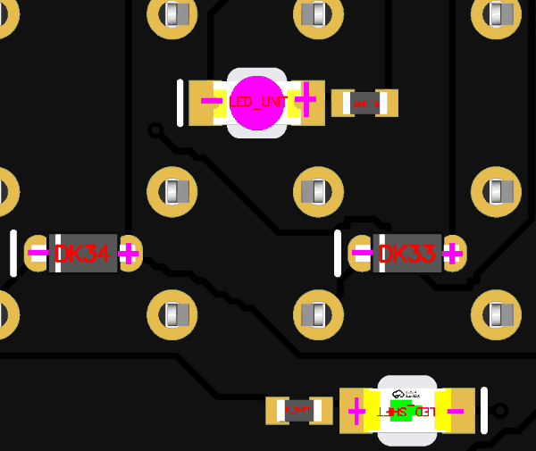

# Ordering

The board, the front plate and the printed parts come from the JLC group: the board from JLCPCB, the front
plate from JLCCNC, the printed parts from JLC3DP. The screws, the feet, a USB-C cable, sandpaper and a few
tools come from a local shop (the screws also from JLCMC); with the hand-soldering option, the keys, the
encoders and the RANGE control come from LCSC. The JLC group is the only supported route; other shops can work
from the same files, unsupported. The files are in [production/](../../production/): to get them, download the
repository (on GitHub: Code, then Download ZIP). Every name there starts with `avionics-panel-rev1-`, which
this page leaves out (`body.step` is `avionics-panel-rev1-body.step`). What follows the order is in
[Bring-up](bring-up.md).

JLCPCB fits and solders both sides of the board, so nothing needs soldering at home. Soldering the keys, the
encoders and the RANGE control yourself is a cheaper option: [Hand-soldering](hand-soldering.md) has what
differs, the order included. A few fallbacks on these pages change a dimension and build the files again with
`./build.sh`, which needs Nix on Linux (on Windows: WSL 2, [Generators](../architecture/generators.md#build)).

## Order step by step

First freeze what you order: every file from one download, so from one commit. Take a release with a version
tag if there is one (on GitHub: Releases, its Source code zip; not the rolling Latest build), otherwise Code,
Download ZIP. Write down the commit: `firmware/version.py` in the download names it, its date and short hash.
Keep with it what each shop confirms (JLCPCB's production file and placement preview, the reviewed files of
JLCCNC and JLC3DP) and every review answer you accept.

1. Before spending anything, two quotes on JLC3DP's quote page; neither needs an order:
   - The key caps: upload the four sets' zips, `caps-A.zip` to `caps-D.zip`, with Full Color Resin (WJP),
     Color Multicolor, Surface Finish No. Each zip holds a set of 28 separate caps, and on 2026-11-16 the
     quote priced each as one part, about €6.10 a set. If it counts each cap as a part instead, ask their
     support: "Will you print this file, a set of 28 separate key caps, as it is, and price it as one part?"
     A no means set B one model per file, with a gauge cap of each other set ([JLC3DP](#jlc3dp)). Joining the
     caps on runners is no way round it: JLC3DP's connected-parts printing excludes WJP.
   - The knobs, sanded or not: upload the 24 knob files twice, once with Surface Finish Yes: Sanding, General
     Sanding and once with No, and compare the two totals. Unsanded saves the sanding fee and costs about an
     hour of sanding at home; sanded comes with the support marks gone. In November 2026 sanding cost almost
     nothing, about €1.40 for all 42 knobs, so the order takes it. Order them as [JLC3DP](#jlc3dp) says for
     that choice.

   The quote page keeps the files only until "SAVE TO CART": save the batches you keep, and they wait in the
   cart for step 5.
2. If JLCPCB has Y1 in stock, skip this step ([Parts and stock](#parts-and-stock)); on 2026-11-16 it had,
   the encoders too. Otherwise buy the crystals for Y1 into your Parts Manager stock through Global
   Sourcing (ten, or Parts Manager's minimum quantity if that is more), and the encoders from JLCPCB's stock
   (Parts Manager, Order Parts, JLCPCB Parts; search for C19270361; those show at once): as many as the
   part's order guide on JLCPCB's parts page asks for two boards (six, plus any attrition): own stock short
   of what the BOM step needs is not used at all. Global Sourcing takes 2 to 5 weeks, and step 3 can use the
   crystals only once Parts Manager shows them in stock. Steps 4, 5, 7 and 8 need not wait.
3. [JLCPCB](#jlcpcb): the boards, saved to the cart. Go through the [placement preview](#placement-preview).
4. [JLCCNC](#jlccnc): the plate, saved from its quote page. It lands in the same cart: the JLC shops share
   one.
5. [JLC3DP](#jlc3dp): the body, the key caps, the knobs and the light pipes, saved to the same cart.
6. Check out once: in the cart tick "All", so the boards, the plate and the printed parts are paid together
   and ship in one parcel; pick the shipping ([Shipping, tax and cost](#shipping-tax-and-cost)) and tick
   "Review Before Payment". Submit Order then only sends the files to the shops' reviews; you pay once they
   have approved them.
7. Locally: the screws and the rest of the [shopping list](#shopping-list).
8. Optional, to run the firmware before the boards arrive: the [Pico bench](bring-up.md#pico-bench) parts.

Before paying, read the [review questions](#review-questions) and the [tax lines](#shipping-tax-and-cost).
To pay less:

- Duty paid: pick DDP (delivered duty paid) shipping at checkout, the cheapest DDP line, so no duty, VAT or
  carrier's fee comes on delivery.
- The plate at Economic build time: it waits for the boards anyway ([JLCCNC](#jlccnc)).
- Coupons: before paying, look at JLCPCB's coupons (there is usually a monthly one for SMT assembly) and at
  JLCCNC's and JLC3DP's (Account, Coupons). They apply at payment, after the review.

## Shopping list

Everything one panel needs, with its spare board:

| ☐ | Item | Qty | Shop, part | Spec | For |
| --- | --- | --- | --- | --- | --- |
| ☐ | Crystals for Y1 | 10, or Parts Manager's minimum | JLCPCB Global Sourcing, ABM8-272-T3 | 12 MHz, Abracon | Y1 on both boards; not needed while JLCPCB stocks it ([Parts and stock](#parts-and-stock)) |
| ☐ | Encoders | 6, plus what the order guide adds for attrition | JLCPCB Parts Manager, C19270361 | Bourns PEC11D-4120F-S0015 | Both boards: bought in step 2, or taken from JLCPCB's stock in the BOM step ([Parts and stock](#parts-and-stock)) |
| ☐ | Board, assembled | 2 (PCB quantity 5; three come bare) | JLCPCB | [Settings below](#jlcpcb) | The panel; the second is the spare for the first |
| ☐ | Front plate | 1 | JLCCNC | [Settings below](#jlccnc) | [Putting it together](assembly.md#putting-it-together) |
| ☐ | Body | 1 | JLC3DP | [Files and processes](#jlc3dp) | Step 4 of [Putting it together](assembly.md#putting-it-together) |
| ☐ | Key caps | 4 sets of 28: A, B, C and D | JLC3DP | [Files and processes](#jlc3dp) | [Choosing the cap set](bring-up.md#choosing-the-cap-set) |
| ☐ | Knobs | 42: the panel's 7, each in six bores | JLC3DP | [Files and processes](#jlc3dp) | [Fitting the knobs](assembly.md#fitting-the-knobs) |
| ☐ | Light pipes | 6 (3 + 3 spare) | JLC3DP | [Files and processes](#jlc3dp) | Step 2 of [Putting it together](assembly.md#putting-it-together) |
| ☐ | Screws | 7 (5 + 2 spare) | Local; or JLCMC, EDDH-C16E1-M3-L8 (10B21 blackened, 8.8) or EDDH-S1W-M3-L8 (A2-70), its pack minimum, as an order and a parcel of their own | M3 x 8 flanged button head, ISO 7380-2, 2 mm hex socket; steel (black, 8.8 or 10.9) or stainless A2 | Step 4 of [Putting it together](assembly.md#putting-it-together) |
| ☐ | Feet | 4 | Local | Self-adhesive silicone (high friction), up to 10 mm across | Step 4 of [Putting it together](assembly.md#putting-it-together) |
| ☐ | USB-C cable | 1 | Local | USB-C at the panel, the other end to suit the PC (USB-A or USB-C). Data-capable (a charge-only cable shows no RPI-RP2 drive). Any straight USB-C plug within the USB-C spec fits (its limit is 12.85 x 7.0 mm, [why](../architecture/mechanics.md#plate-and-body)); avoid angled plugs and chunky or braided boots | Step 2 of [Flash and test](bring-up.md#flash-and-test), step 5 of [Putting it together](assembly.md#putting-it-together) |
| ☐ | Fine sandpaper | 1 sheet | Local | 400 to 1000 grit | The light pipes' support nubs, step 2 of [Putting it together](assembly.md#putting-it-together); a knob that rubs, or the support marks of knobs ordered unsanded, [Fitting the knobs](assembly.md#fitting-the-knobs) |
| ☐ | Hex key | 1 | Local | 2 mm | The screws, the plate threads, the BOOT pads |
| ☐ | Two blocks and a cloth | 2 | At home (books, wood) | At least 25 mm high | Face-down work in [Putting it together](assembly.md#putting-it-together) |
| ☐ | Steel rule | 1 | Local | | Squaring the caps and checking the board's bow, steps 1 and 2 of [Putting it together](assembly.md#putting-it-together) |
| ☐ | Multimeter | 1 | Local | Continuity beeper and diode mode | Steps 1 and 2 of [Flash and test](bring-up.md#flash-and-test) |

Only if something does not fit or fails:

| ☐ | Item | Shop, part | For |
| --- | --- | --- | --- |
| ☐ | Flat file or 240 grit sandpaper on a block | Local | A square corner, a burr or a V-cut edge that does not fit the body, [On arrival](bring-up.md#on-arrival); a body wall that touches the plate, step 4 of [Putting it together](assembly.md#putting-it-together) |
| ☐ | Flat-nose pliers | Local | A board that arrives with its rail, [On arrival](bring-up.md#on-arrival) |
| ☐ | Drill, 4.2 mm, and a pin vice to turn it by hand | Local | A screw that does not pass a body hole, step 4 of [Putting it together](assembly.md#putting-it-together) |
| ☐ | Magnifier or loupe | Local | [When bring-up fails](bring-up.md#when-bring-up-fails); the joints after [soldering](hand-soldering.md#soldering) |
| ☐ | Soldering iron (temperature controlled), solder, flux, solder wick | Local | Rework ([Soldering](hand-soldering.md#soldering)) |

## JLCPCB

Layers 4, PCB Thickness 1.6 mm, Surface Finish ENIG, PCB Color Black (white silkscreen), Via Covering Plugged
([why](../architecture/electronics.md#solder-mask)): the form greys out Tented for this board ("The Via
Tented option is upgraded to Via Plugged for free"). Everything else at JLCPCB's defaults (0.3 mm via, 1 oz
outer copper, stackup, PCB quantity 5). Edge Rails/Fiducials: Added by JLCPCB. Confirm Production file: Yes.
Product Desc (the customs category, required): Research/Education/DIY > DIY. PCB Remark, 200 characters at
most:

> J1 overhangs the y=60 edge 0.5mm: no rail there. One rail >=10mm on y=0 only, removed before delivery; keep
> R3 corners. Keep mask dams at U1, J1, C_X2/R_X. 3 LED cutouts: R0.5 corners (1mm router).

PCB Assembly: Standard, Assembly Side Both Sides, PCBA Qty 2 in the Custom Qty field (JLCPCB's minimum); the
panel needs one, the second is the spare. Confirm Parts Placement: Yes. Each of the two confirmations opens a
dialog: tick "Do not confirm automatically" in both, or JLCPCB confirms on its own after 48 hours (the
production file) or 72 hours (the placement). Under Advanced Options set "Depanel boards & edge rail before
delivery" to Yes (€2.10 in November 2026, charged after the review). Its note says it adds two 5 mm rails
(the board then 160 x 70 mm); the remarks ask for one rail on y = 0 only, and the production file to confirm
shows which JLCPCB made ([Edge rails](#edge-rails)). Set PCBA Remark to Yes and enter, in 500 characters at
most (JLCPCB quotes it in the review):

> Solder the mounting lugs of ENC_ALTHDG, ENC_FREQ and ENC_FMS in their slots. Solder the four J1 shell
> tabs from the top, filling the slots. All through-hole joints by hand soldering: no wave or selective
> soldering over the bottom side. Rails: J1 overhangs the y=60 mm edge by 0.5 mm, so no rail and never a
> V-cut on that edge; one rail on the y=0 edge only, removed before delivery.

Upload `gerbers.zip`, then `BOM-full.csv` (the parts list) and `CPL-full.csv` (the placement file): one of
each, for both sides. The BOM step must find all 29 lines with stock for 2 boards, the encoders and Y1 from
your own parts if step 2 bought them ([Parts and stock](#parts-and-stock)). Lines that group several
designators come up unticked, with "There may be multiple types of parts, but one type of part has been
matched. Please check.": tick them, as the part numbers are ours. The three reverse-mount LEDs show "The
processing of this component is difficult", with a review and maybe a fee
([Review questions](#review-questions)).

The reasons: [edge rails](#edge-rails), [solder mask](../architecture/electronics.md#solder-mask),
[LED cutouts](../architecture/electronics.md#lights), [encoder lugs](hand-soldering.md#soldering),
[J1's shell tabs and the through-hole joints](../architecture/electronics.md#through-hole-parts).

### Edge rails

- No rail on the J1 edge (y = 60 mm in the Gerbers): J1 overhangs it by 0.5 mm, so that the plug reaches it
  through the body wall. If JLCPCB insists on one there, accept only one joined by mouse bites behind a
  routed gap, never a V-cut: its blade would run under J1.
- One rail of at least 10 mm on the opposite long edge (y = 0): Standard assembly needs rails and 70 x 70 mm
  with them, and the board is 60 mm wide. JLCPCB removes it before delivery; the V-cut edge it leaves (scored
  and snapped, ±0.4 mm), or a mouse-bite edge filed flat, fits the body. A rail on a short edge as well leaves
  a V-cut edge there that may need sanding.
- In the confirmed production file: the rail on y = 0, the J1 edge free and the corners milled round (R3; a
  V-cut square corner does not fit the body). JLCPCB's default is a 5 mm rail on two opposite edges, the J1
  edge included, and the depanel option's note says the same.

A board that arrives with a rail anyway: [On arrival](bring-up.md#on-arrival).

### Parts and stock

`BOM-full.csv` lists the parts for one board; JLCPCB multiplies by the 2 assembled boards. The BOM step shows
any line that is short. On 2026-11-16 all 29 lines were in stock, Y1 and the encoders among them, but stock
moves: two parts are worth a look before ordering.

Y1 (Abracon ABM8-272-T3, a 12 MHz crystal, C20625731) is rarely in stock at JLCPCB, and a board without it
has no USB. JLCPCB places at least five of this part and adds attrition on top (the part's order guide on
JLCPCB's parts page gives both). While the parts page shows that many in stock, order the boards at once.
Otherwise:

- Buy the crystals through Global Sourcing first (Parts Manager, Order Parts, Global Sourcing Parts; search
  for ABM8-272-T3): ten, or the minimum quantity Parts Manager shows for the part if that is more. Own stock
  that falls short of what the BOM step needs is not used at all. The review takes 1 to 3 business days and
  the buying 9 to 20, and a kind of part may carry a $20 inspection fee. In the BOM step, Y1 must then come
  from your own parts, like the encoders; if the step does not find the crystals, match them by the part
  number ABM8-272-T3.
- A stocked 12 MHz 3225 crystal, picked in the BOM step in place of C20625731, saves the wait, but
  Raspberry Pi's guide asks for extensive testing of any change to its crystal circuit. The part to take
  first is C21900467 (13 pF): its datasheet gives at most 40 ohm of ESR (series resistance; the less, the
  more surely the crystal starts), under the 50 ohm of Raspberry Pi's design. C5310728 (10 pF), C362368
  (9 pF) and C50430 (10 pF) are listed with 60 to 80 ohm. Check in the placement preview that the part's four
  pads land on ours, and on the first board that RPI-RP2 appears at every plug-in (step 2 of
  [Flash and test](bring-up.md#flash-and-test)).

The encoders (Bourns PEC11D-4120F-S0015, C19270361) are the other tight part: JLCPCB stocks few of them,
which is why step 2 buys them ahead while the crystals take their weeks. If the stock is short, buy them in
through Global Sourcing (2 to 5 weeks, with the same inspection fee).

Any other line short: wait for stock or buy it in through Global Sourcing. Do not substitute another part
number: the footprints and checks are made for these parts.

### Placement preview

In JLCPCB's placement preview every part must sit on its own pads, and the parts below the right way round.
The preview draws JLC's own footprint over our pads; the marks are on our bottom silkscreen, so they hold
whichever way round the preview shows the board. If a part shows turned, correct its rotation there or ask
JLCPCB's engineer in the review; do not order as is. On the rev 1 order all of them showed right.

- LED_SHIFT, LED_UNIT and LED_FREQ (reverse-mount LEDs over the three cutouts in the board): JLC's cathode
  (pin 1) at our cathode bar, west of LED_SHIFT and east of the other two (seen from the top), the part centred
  over its cutout. JLC draws other cutouts than ours: go by the pads.
- The 35 diodes (D...): JLC's cathode band on the pad with our silkscreen bar. All 35 bars are at the same end
  of their diodes, towards the short edge nearer J1 and the RP2040 (U1), both named on the bottom silkscreen;
  a band at the other end is a reversed diode, which the firmware cannot work round
  ([why](../architecture/electronics.md#gpio-map)).
- U1 (RP2040): JLC's pin 1 mark in the corner with our silkscreen corner mark (an L next to the corner pad).
- U2 (flash), U3 (regulator) and U4 (ESD array, the SOT-23-6 below J1): JLC's pin 1 mark at our pin 1 dot.
  U3's single pin faces J1. U4 turned by 180° damages the board at the first plug-in
  ([why](../architecture/electronics.md#usb-protection)); step 1 of
  [Flash and test](bring-up.md#flash-and-test) tests for it.
- Q_UNIT (the UNIT light's transistor, the SOT-23 12 mm from that light towards the J1 edge): JLC's single pin
  towards the light.
- Y1 (crystal): all four of JLC's pads exactly on ours, long side along the board, JLC's pin 1 at our dot or
  diagonally opposite. Go by the pads and JLC's pin 1, not by a chamfered corner.
- J1 (USB-C): the opening at the board edge (y = 60 mm), the two pegs in the unplated holes and the four shell
  tabs in the slots.
- The top side (no polarity marks there): each footprint on all its holes. ENC_ALTHDG, ENC_FREQ and ENC_FMS
  have their two-pin row (the push switch) on the side of the three-pin row towards the J1 edge; the RANGE
  control's pattern fits one way only; a key is the same switch either way round.

What right looks like, from the rev 1 order's preview of the bottom side (2D view, zoomed in). JLC's pin 1
is the magenta dot or minus sign; our marks are the white silkscreen bars, dots and the corner L:

## JLCCNC

JLCCNC's order form overrides the drawing, so set these on it (the labels may differ a little):

- Material: aluminium 6061.
- Surface finish: "Bead blasting + Anodizing", colour Black in its dropdown (the default is Natural).
  Anodising alone is still blasted, at 120 mesh, unless the remark says no bead blasting.
- Threads: Yes (five M3). Its "+ Add file" says a 2D drawing with the thread information counts, so
  `plate.pdf`, attached under the tolerance, does.
- Tightest tolerance: ±0.05 mm, for the boss height. At the default, ISO 2768-m, the bosses come ±0.2 mm.
  Attach `plate.pdf` with "+ Upload Drawing" under it.
- Marking: "+ Add finish", then "Laser marking", which asks for `plate.dxf` through "+ Drawing Required"; no
  UV printing. The laser leaves one light grey on the black anodising, so there is no colour to choose.
- Appearance: Standard, which costs least. It allows up to four rack marks, where JLCCNC picks so that they do
  not affect assembly, and up to five scratches under 10 mm anywhere, the front face included. The remark
  asks for the rack marks off the front face and the boss end faces, which Standard does not promise. Strict,
  the level above, keeps rack marks and scratches off the cosmetic surfaces, the laser-marked face among
  them, for a price.
- Build time: Economic, as the plate waits for the boards anyway. In November 2026 that was 11 days for
  €51.70, against Standard (6 days, €58.05) and Expedited (3 days, €79.23).
- Product Desc (the customs category, required): Aluminum Alloy Rectangular Plate.

Files: `plate.step` (the model), `plate.pdf` (the drawing, with every tolerance, the threads, the finish, the
edge breaks and a front view of the marking) and `plate.dxf` (the marking). Uploaded together, the drawings
were not paired with the model: upload `plate.step` and attach the other two as above. Saved from the quote
page, the plate goes into the cart it shares with JLCPCB and JLC3DP. Remark, 500 characters at most:

> Machined to drawing avionics-panel-rev1-plate.pdf; all its notes and tolerances apply, even where tighter
> than your general tolerance. Threads M3-6H, plugged through blasting and anodising; must gauge afterwards.
> Anodising rack contacts on the back face, in the pockets or in the encoder and RANGE hole bores; never on
> boss end faces, front face, outline or key holes. Front face cosmetic. Marking per
> avionics-panel-rev1-plate.dxf: layer LASER laser marked (no UV print), layer CUT reference only.

## JLC3DP

| File | Quantity | Process | Product Desc | Part |
| --- | --- | --- | --- | --- |
| `body.step` | 1 | MJF PA12-HP, Dyed Black | Enclosure... > Plastic Enclosure | Body |
| `caps-A.zip`, `caps-B.zip`, `caps-C.zip`, `caps-D.zip` | 1 each | Full Color Resin (WJP), Color Multicolor, Surface Finish No | Irregular shape > Plastic Button | The key caps: four sets of 28 |
| `knob-outer-1.step` to `knob-outer-6.step` | 2 each | SLA Black Resin, Surface Finish Yes: Sanding, General Sanding | Irregular shape > Plastic Knob | Outer rings of ALT/HDG and FREQ |
| `knob-outer-fms-1.step` to `knob-outer-fms-6.step` | 1 each | SLA Black Resin, Surface Finish Yes: Sanding, General Sanding | Irregular shape > Plastic Knob | Outer ring of FMS (coarser grip) |
| `knob-inner-1.step` to `knob-inner-6.step` | 3 each | SLA Black Resin, Surface Finish Yes: Sanding, General Sanding | Irregular shape > Plastic Knob | Inner knobs |
| `knob-range-1.step` to `knob-range-6.step` | 1 each | SLA Black Resin, Surface Finish Yes: Sanding, General Sanding | Irregular shape > Plastic Knob | RANGE knob |
| `lightpipes.step` | 6 | SLA 8001 Resin, translucent, Surface Finish No | Irregular shape > Plastic Button | One light pipe: the panel's three and three spare |

That is 30 files: the body, the four sets' zips, the 24 knob files and the light pipe, ordered 6 times. The
quote page takes at most 10 files at a time and keeps them only until "SAVE TO CART": upload them in three
batches and save each to the cart. The cart submits up to 30 together (JLC3DP's FAQ; its order guide says
50), so the 30 go in one submission. "Batch Edit" sets the material, the finish, the quantity, the Product
Desc and the remark of all the rows ticked, but its quantity overwrites every one of them: set the
quantities row by row after it. Build time: Standard (3 to 5 days), the default. Each knob comes in six
bores, 1 the tightest and 6 the loosest, every one in the panel's quantity: 42 knobs
([why](../architecture/mechanics.md#knobs)). Black Resin is the material of that name, not JLC Black Resin
or Imagine Black Resin, and Full Color Resin (WJP) is not Full-Color Tough Resin.

The remark is per part, 500 characters at most. Body:

> Please print as designed. The counterbore of the screw column in the middle is open on two sides on purpose.

Key caps, each set:

> Please print as designed: a set of 28 separate key caps, priced as one part. No oil spray or coating: the
> sockets hold the caps by friction and stay as printed.

Outer rings, FMS rings and inner knobs:

> Please print as designed. Knobs: supports on the bottom faces only, none inside the bores and recesses;
> support marks sanded flush, no more than 0.05 mm proud. The bores hold the knobs by friction: leave them as
> printed, with no sanding, blasting, oil or coating inside; General Sanding is for the outside only. The
> 1.0 mm dimples in the undersides number the bores: keep them open, do not fill them.

RANGE knobs:

> Please print as designed. Knobs: supports on the bottom faces only, none inside the bores and recesses;
> support marks sanded flush, no more than 0.05 mm proud. The bores hold the knobs by friction: leave them as
> printed, with no sanding, blasting, oil or coating inside; General Sanding is for the outside only. The
> 1.0 mm dimples in the undersides number the bores: keep them open. The 1.2 mm wide, 0.25 mm deep groove
> along the bore is on purpose: keep it open, no supports in it.

Light pipe:

> Please print as designed: upright, rod up, supports on the base's bottom face only; no sanding and no oil
> spray. The 2.0 mm rod is 4.45 mm long on purpose.

- Key caps: upload the zips, they carry the texture (the OBJ alone prints without legends). Which of the four
  sets fits depends on the print ([why](../architecture/mechanics.md#key-caps)), and the bench finds it, set
  B first ([Choosing the cap set](bring-up.md#choosing-the-cap-set)). The order takes all four: JLC3DP
  priced a set as one part, €6.08 to €6.13 in November 2026 with Surface Finish No (€7.60 with the default,
  Oil Spraying), while a single cap costs at least €6.26: the three other sets cost less than a cap of each.
- Key caps, one model per file, if JLC3DP asks for it in step 1: set B alone, from `caps-single-B.zip`. It
  holds the set's 28 caps as one zip per cap (`cap-B-01-AP.zip` and so on); upload those zips, quantity 1
  each, with the AP cap of each other set as a gauge: `cap-A-01-AP.zip`, `cap-C-01-AP.zip` and
  `cap-D-01-AP.zip`, unzipped from `caps-single-A.zip`, `caps-single-C.zip` and `caps-single-D.zip`. With the
  other 26 files that is 57, more than the cart submits together (30, or 50 by the order guide): two
  submissions. In step 1, ask their support how to place them so they ship together with the boards.
- Knobs: General Sanding (the form's default for Black Resin) sands, bead blasts and oils them, and the
  remark keeps it out of the bores, whose grip the six sizes are made for
  ([why](../architecture/mechanics.md#knobs)).
- Knobs unsanded instead, if the quote in step 1 made sanding not worth its price or their review says they
  cannot keep it out of the bores: Surface Finish No in the four knob rows, and in both knob remarks replace
  "support marks sanded flush, no more than 0.05 mm proud. The bores hold the knobs by friction: leave them
  as printed, with no sanding, blasting, oil or coating inside; General Sanding is for the outside only."
  with "leave the support marks on, they are sanded at home. No sanding, blasting, oil or coating: the bores
  hold the knobs by friction and stay as printed." The support marks then stay on the bottom faces, and the
  builder sands them flush ([Fitting the knobs](assembly.md#fitting-the-knobs)).
- Light pipes: set Surface Finish to No. The form's default is Oil Spraying for transparent 8001 and Fine
  Sanding for translucent, and either can break the thin rods; the remark asks for neither.

## Review questions

Some items are at or under a shop's published guideline, so expect questions in the reviews. These have an
answer of their own:

| Shop | They may question | Answer |
| --- | --- | --- |
| JLCPCB | Black solder mask: 64 dams on the bottom (U1's pads, J1's contacts, C_X2 to R_X) are 0.13 mm wide, between pads 0.2 mm apart; JLCPCB's rule for a dam in black mask is a pad spacing of at least 0.13 mm (green 0.10 mm) | Check that the confirmed production file still has a dam between every pair of those pads. If any is gone, change the order to green, whose rule is 0.10 mm |
| JLCPCB | Encoder lug slots 1.5 x 3.0 mm, 0.4 mm longer than JLC's own footprint of C19270361 (and Bourns' recommended 2.6) | As drawn, on purpose: 3.0 mm meets JLC's 2:1 rule for slots, and the lugs are soldered in, so the extra length only takes solder |
| JLCPCB | The reverse-mount LEDs over their board cutouts: JLCPCB may question them, as reverse-mount parts over a cutout are rare. The BOM step already flags them: "The processing of this component is difficult", reviewed, with additional fees | As designed (PCB remark): the cutouts are 2.2 x 2.6 mm with R0.5 corners, and each LED sits on its pads over its cutout ([why](../architecture/electronics.md#lights)); check it in the [placement preview](#placement-preview). Accept the fee |
| JLCPCB | J1 overhangs the y = 60 mm edge by 0.5 mm | By design, as the PCB remark says: the plug reaches it through the body wall. No rail on that edge ([Edge rails](#edge-rails)) |
| JLCPCB | A single edge rail, on y = 0 | As in the PCB remark. If the line needs a second one, it goes on a short edge (x = 0 or x = 160 mm), with no bottom-side part within 12.8 mm of either (the nearest are D_ALTHDG and D_FMS); never on the J1 edge, which J1 overhangs and C_OUT0 and U3 sit 3.7 and 6.75 mm from |
| JLCCNC | The laser marking's small legends: capitals 1.55 and 1.7 mm high (6.1 and 6.7 pt), strokes 0.19 mm at the thinnest. JLCCNC's marking guide gives no minimum for the laser (only lines thick enough to keep their detail); for its print it asks for 6 pt and 0.176 mm lines | Mark as drawn, which meets the print's figures too; accept a sample or a little blur |
| JLCCNC | The laser marking near the holes: the shift legends start 0.7 mm from the key holes, and the line between the AUDIO and RADIO keys passes 0.575 mm from the key holes beside it, where JLCCNC usually keeps a 3 mm margin from an edge | Mark it as drawn. The shift legends keep 0.5 mm beyond the holes' edge breaks for the marking's register. Where the line meets a hole's edge break it is only cosmetic: accept it fading or ending short there |
| JLCCNC | The floor over the RANGE pocket: 0.95 mm (at least 0.85 mm, the drawing's note); JLCCNC recommends 0.8 mm, and over 1.5 mm where the part is bead blasted (the floors over the encoder pockets are 1.65 mm) | As drawn. Hold the pocket depths +0/-0.1 mm (a thicker floor takes the room over the parts) and the flatness after blasting. If they will not blast it as drawn: anodising without blasting (tool marks may then show); never a thicker floor, and no blasting of the front face alone, which can bow the plate |
| JLCCNC | The boss height, 6.55 ±0.05 mm | ±0.1 mm is acceptable, with the flatness then held to 0.15 mm (see the next row) |
| JLCCNC | Flatness 0.1 mm: milling most of a 12 mm plate off one side can bow it, and JLCCNC publishes no flatness figure | Up to 0.2 mm is acceptable with the boss height held at ±0.05 mm, or up to 0.15 mm with the bosses at ±0.1 mm; not 0.2 mm and ±0.1 mm together ([why](../architecture/mechanics.md#light-pipes)). Stress-relieved plate (T651) helps, if they offer it |
| JLC3DP | Light pipes: the 2.0 mm rods are 4.45 mm long, over the pillar guideline (Ø2.0 up to 4 mm) | Print as is. If they refuse: in `mech/stack.py` set `top_len` in `PIPE` to 4.0 and `PIPE_ON_BAR` to `True`, run `./build.sh` and upload `lightpipes.step` again, quantity 2 (also in the file table and the shopping list). The pipe is then 9.65 mm long, under the least part of 10 mm, so the three come on one bar on Ø1.0 mm necks that snap off by hand ([Putting it together](assembly.md#putting-it-together)); the remark then reads "supports on the bar only" |

The answer to every other question is "as drawn" (JLC3DP: "print as is"). Accept a change only if it keeps
the drawing's notes (JLCCNC) and the remarks. If a review does end in a change, change
[mech/stack.py](../../mech/stack.py), run [`./build.sh`](../architecture/generators.md#build), see which files
in `production/` changed and upload each to its shop again.

## Shipping, tax and cost

The JLC shops share one cart: the boards, the plate and the printed parts are paid in one checkout and ship
in one parcel once the boards are built (step 6). Screws from JLCMC come as an order and a parcel of their
own, which costs more to ship than the screws do.

The checkout offers CPT shipping (DHL, UPS or FedEx), DDP (DHL Express DDP, FedEx Express DDP) and FCA. Pick
the cheapest DDP line: it collects the duty, the VAT and any carrier's fee at checkout. On 2026-11-16, for the
cart below, that was FedEx Express (DDP), which waives the duty and tax disbursement fee:

| Shipping | Shipping fee | Duty and tax | Carrier's fee | Total |
| --- | --- | --- | --- | --- |
| FedEx Express (DDP) | €38.53 | €89.21 | none | €508.28 |
| DHL Express (DDP) | €34.68 | €88.48 | €7.49 disbursement fee | €511.18 |
| CPT, DHL | €31.48 | on delivery | on delivery | €412.01, plus VAT, duty and the carrier's fee on delivery |

In the EU, IOSS lets the shop collect the VAT at checkout on up to €150 of goods. The panel's order is well
over that, so with CPT the VAT, the duty and the carrier's fee are all paid on delivery. Under €150 (a cap
set reordered, say), the CPT notes say that IOSS cannot prepay the customs duty (since 1 July 2026, a flat
€3 per item line declared) or the Union Handling Fee (since 1 November 2026): they come on delivery, with the
carrier's fee. DDP collects all of it at checkout, whatever the value.

### What rev 1 cost (November 2026)

The quotes and the checkout on 2026-11-16, in EUR; prices move, so take them as a guide:

| Item | Shop | EUR |
| --- | --- | --- |
| PCB, 5 boards: engineering 22.65, ENIG 16.22, black mask 7.25, board 6.34, production file confirmation 0.95 | JLCPCB | 53.41 |
| Standard assembly of 2 boards, both sides: setup 46.66, stencil 7.49, parts (29 lines) 72.09, feeders 36.52, SMT 1.65, placement confirmation 0.41, hand soldering 3.27, manual assembly 4.60, fixture 14.99, packaging 0.45 | JLCPCB | 188.14 |
| Front plate, Economic build time | JLCCNC | 51.70 |
| Key caps, sets A to D (6.08 to 6.13 a set) | JLC3DP | 24.43 |
| Knobs, 42 with General Sanding: outer rings 11.88, FMS rings 5.88, inner knobs 17.64, RANGE knobs 6.00 | JLC3DP | 41.40 |
| Body, MJF PA12-HP, Dyed Black | JLC3DP | 13.43 |
| Light pipes, 6 at 0.29 | JLC3DP | 1.74 |
| Merchandise at checkout | | 380.53 |
| Shipping, FedEx Express (DDP) | | 38.53 |
| Duty and tax, collected at checkout | | 89.21 |
| Total before coupons | | 508.28 |

The shops round each fee and line on its own, so sums can differ by a few cents. The checkout's merchandise
came to €6.36 more than the cart's lines (€374.17), about the plate's step from Economic to Standard (€6.35):
check its build time before paying. The cart showed a JLCPCB coupon of -€18.12. After the review JLCPCB adds
the depanelling (€2.10) and whatever it quotes for the PCBA remark. The local items, the screws among them,
come on top.

Build times: JLCPCB 3 days for the PCB and 5 to 6 days for the assembly (a day more with the advanced
options), JLCCNC 11 days at Economic, JLC3DP 3 to 5 days at Standard; the parcel leaves once all are done.
If step 2 is needed, allow 2 to 5 weeks for Y1 through Global Sourcing before the boards can be ordered.
