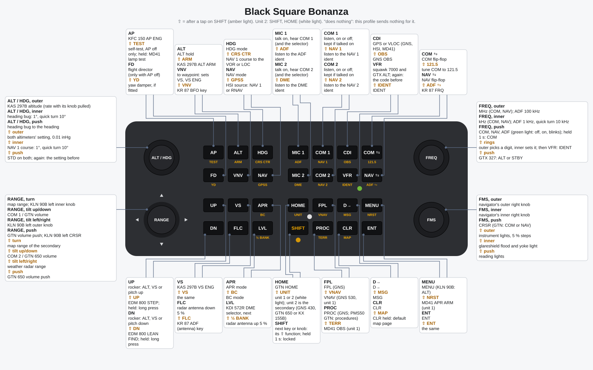

# Black Square Bonanza

The cheat sheet of the Black Square Bonanza profile: Black Square's Bonanza with the KFC 150 and KAS 297B,
for every avionics selection of its tablet. Print it on A4 or Letter in landscape, or open the picture to zoom
in.

Good to know:

- Unit 1 is the primary selection (KX 155B, KLN 90B, GNS 530 or GTN 750), unit 2 the secondary (KX 155B, GNS
  430 or GTN 650). One profile works whichever the tablet selected.
- VNV works out the descent rate to the selected altitude at the active waypoint, sets it and presses VS ENG
  ([how](../mapping.md#vnv-without-vnav)).
- SHIFT, UP and SHIFT, DN are the EDM 800's STEP and LEAN FIND: a tap is a short press, held longer than 0.35
  s a long one.
- FLC and ½ BANK tilt the weather radar's antenna; SHIFT with the RANGE knob tilted left and right sets its
  range.
- FD and the UP/DN rocker send the simulator's events, which the aircraft may ignore.

The same sheet with the commit of the latest build in its title:
[avionics-panel-black-square-bonanza-sheet.svg](https://saschagrunert.de/avionics-panel/cards/avionics-panel-black-square-bonanza-sheet.svg).
The profile:
[avionics-panel-black-square-bonanza.mfproj](https://github.com/saschagrunert/avionics-panel/releases/download/rolling/avionics-panel-black-square-bonanza.mfproj)
([how to use it](../mapping.md#generated-profiles)). Every detail, and what each control sends:
[Mapping](../mapping.md#black-square-bonanza).

The same profile for the Octavi IFR-1, with its card and cheat sheet: [Octavi IFR-1](../ifr1.md#downloads).
