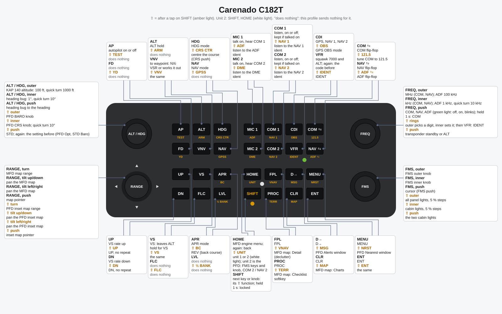

# Carenado C182T

The cheat sheet of the Carenado C182T profile: Carenado's CT182T Skylane with the G1000 NXi and the KAP 140.
Print it on A4 or Letter in landscape, or open the picture to zoom in.

Good to know:

- The autopilot keys work the KAP 140 as in the [GNS profile](gns.md); the FMS keys, the knobs round the
  autopilot and CRS CTR (the PFD's CRS push) work the G1000 as in the [G1000 NXi profile](g1000.md).
- VNV takes the NXi's required vertical speed (VSR) first, else it works the rate out itself
  ([how](../mapping.md#vnv-without-vnav)).
- SHIFT with the outer FMS ring sets all panel lights; the push turns the two cabin lights on or off.

The profile:
[avionics-panel-carenado-c182t.mfproj](https://github.com/saschagrunert/avionics-panel/releases/download/rolling/avionics-panel-carenado-c182t.mfproj)
([how to use it](../mapping.md#generated-profiles)). Every detail, and what each control sends:
[Mapping](../mapping.md#carenado-c182t).
