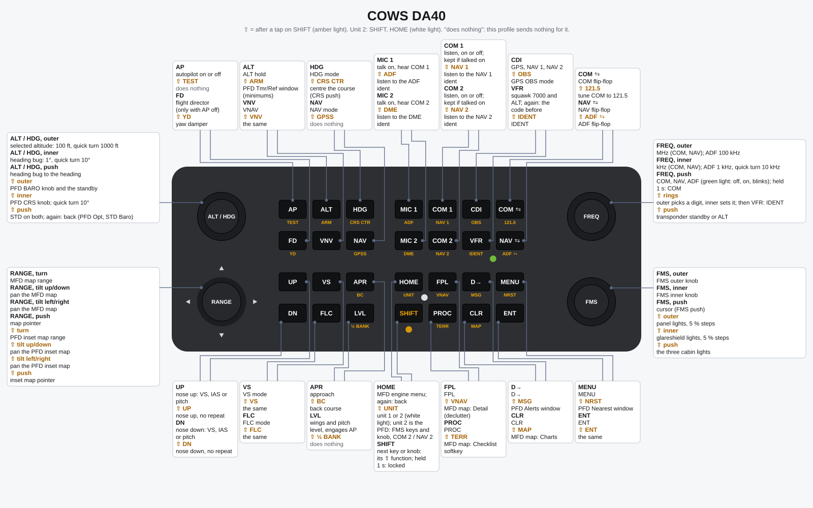

# COWS DA40

The cheat sheet of the COWS DA40 profile: the COWS DA40 (XLS and NG) with the G1000 NXi and its autopilot.
Print it on A4 or Letter in landscape, or open the picture to zoom in.

Good to know:

- The G1000 NXi profile under the DA40's name, so a project of its own can be linked to the aircraft ([G1000
  NXi](g1000.md)).
- SHIFT with the FMS knob sets the panel lights (outer) and the glareshield lights (inner); its push turns the
  cabin lights on or off.

The same sheet with the commit of the latest build in its title:
[avionics-panel-cows-da40-sheet.svg](https://saschagrunert.de/avionics-panel/cards/avionics-panel-cows-da40-sheet.svg).
The profile:
[avionics-panel-cows-da40.mfproj](https://github.com/saschagrunert/avionics-panel/releases/download/rolling/avionics-panel-cows-da40.mfproj)
([how to use it](../mapping.md#generated-profiles)). Every detail: [Mapping](../mapping.md#cows-da40). What
each control sends, as MobiFlight lists it: the
[card](https://saschagrunert.de/avionics-panel/cards/avionics-panel-cows-da40-card.html).

The same profile for the Octavi IFR-1, with its card and cheat sheet: [Octavi IFR-1](../ifr1.md#downloads).
