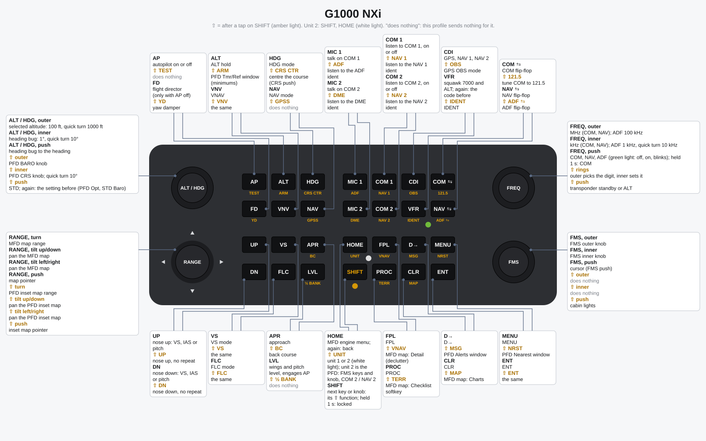

# G1000 NXi

The cheat sheet of the G1000 NXi profile: the Working Title G1000 NXi, as in the Cessna 172 Skyhawk G1000.
Print it on A4 or Letter in landscape, or open the picture to zoom in.

Good to know:

- Unit 1 is the MFD with COM 1 / NAV 1, unit 2 (SHIFT, HOME) the PFD with COM 2 / NAV 2.
- HOME opens the MFD's engine menu and, pressed again, goes back.
- MAP, TERR and VNAV (SHIFT, CLR, PROC, FPL) press softkeys of the MFD's map page; MSG, NRST and ARM open PFD
  windows from the top level of its softkeys.
- STD pressed again returns to the setting before, through PFD Opt and STD Baro, from the top level of the
  PFD's softkeys.
- UP and DN step the VS, IAS or pitch reference, not the altitude in ALT hold.

The profile:
[avionics-panel-g1000.mfproj](https://github.com/saschagrunert/avionics-panel/releases/download/rolling/avionics-panel-g1000.mfproj)
([how to use it](../mapping.md#generated-profiles)). Every detail, and what each control sends:
[Mapping](../mapping.md#g1000-nxi).
