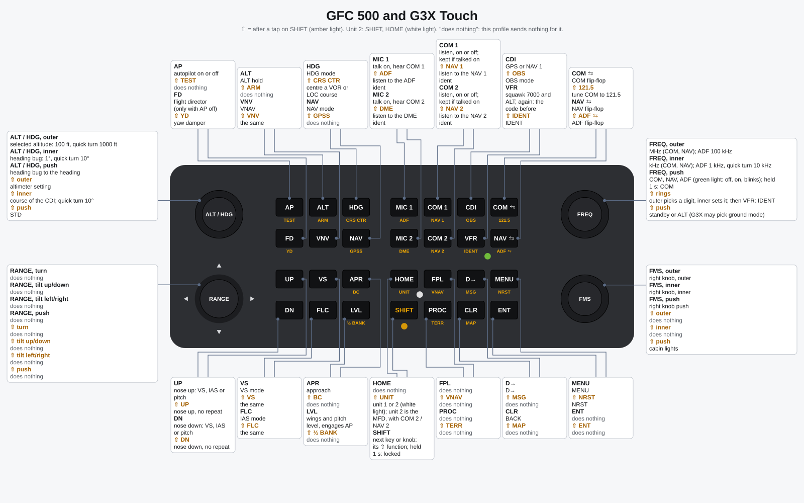

# GFC 500 and G3X Touch

The cheat sheet of the GFC 500 and G3X Touch profile: the GFC 500 with Working Title's G3X Touch, as in the
CubCrafters XCub and the Draco X. Print it on A4 or Letter in landscape, or open the picture to zoom in.

Good to know:

- Unit 1 is the PFD (or the only display), unit 2 the MFD; with one display the FMS keys do nothing in unit 2.
- The FMS keys and knob are the G3X's bezel: D→, MENU, CLR as BACK, NRST and the right knob.
- The BARO push only sets STD; leave it with the BARO ring.
- UP and DN step the VS, IAS or pitch reference, not the altitude in ALT hold.

The profile:
[avionics-panel-g3x.mfproj](https://github.com/saschagrunert/avionics-panel/releases/download/rolling/avionics-panel-g3x.mfproj)
([how to use it](../mapping.md#generated-profiles)). Every detail, and what each control sends:
[Mapping](../mapping.md#gfc-500-and-g3x-touch).
