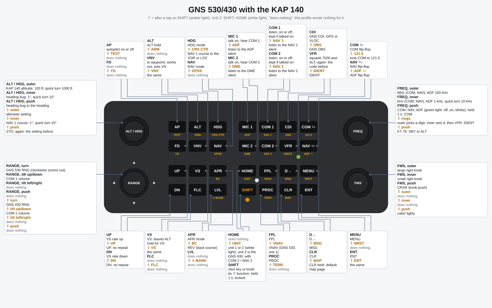

# GNS 530/430 with the KAP 140

The cheat sheet of the GNS 530/430 with the KAP 140 profile: the Working Title GNS 530 and 430 with the KAP
140, as in the Cessna 172 Skyhawk Classic; also KX 155/165 radios without a GNS. Print it on A4 or Letter in
landscape, or open the picture to zoom in.

Good to know:

- Unit 1 is the GNS 530 with COM 1 / NAV 1, unit 2 (SHIFT, HOME) the GNS 430 with COM 2 / NAV 2.
- With SHIFT, the ALT/HDG knob sets the course of NAV 1 and the altimeter; STD pressed again returns to the
  setting before.
- VNV is a vertical speed calculator: it works out the vertical speed to the selected altitude at the active
  waypoint, up or down, and sets it ([how](../mapping.md#vnv-without-vnav)).
- The KAP 140 has no VS, FLC or FD key: it engages in VS, and UP and DN set the rate. The panel's VS leaves ALT
  hold for VS, as the KAP 140's ALT key does.

The same sheet with the commit of the latest build in its title:
[avionics-panel-gns-sheet.svg](https://saschagrunert.de/avionics-panel/cards/avionics-panel-gns-sheet.svg).
The profile:
[avionics-panel-gns.mfproj](https://github.com/saschagrunert/avionics-panel/releases/download/rolling/avionics-panel-gns.mfproj)
([how to use it](../mapping.md#generated-profiles)). Every detail: [Mapping](../mapping.md#gns-530430). What
each control sends, as MobiFlight lists it: the
[card](https://saschagrunert.de/avionics-panel/cards/avionics-panel-gns-card.html).

The same profile for the Octavi IFR-1, with its card and cheat sheet: [Octavi IFR-1](../ifr1.md#downloads).
