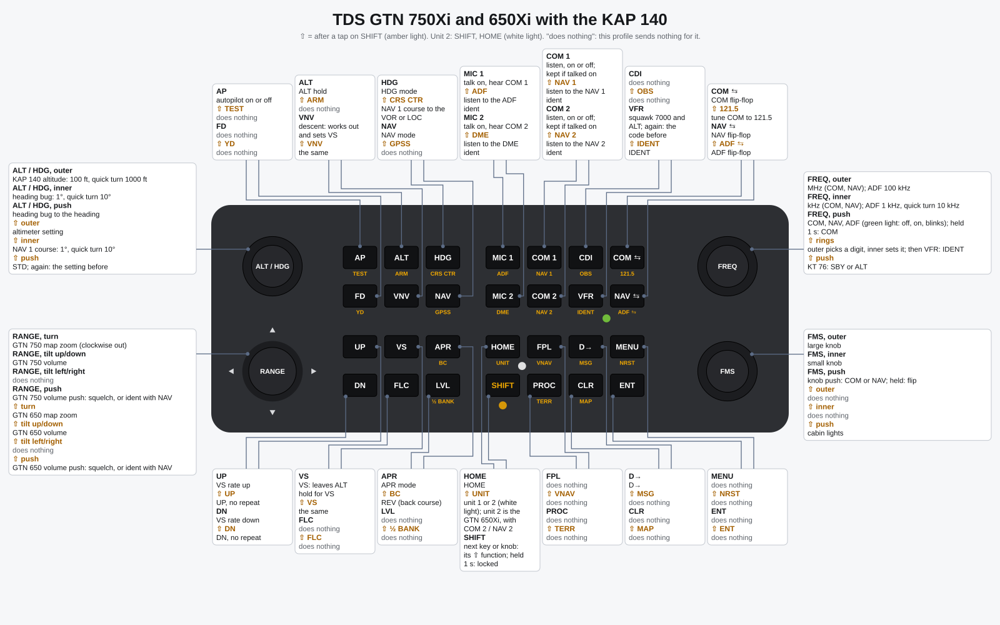

# TDS GTN 750Xi and 650Xi with the KAP 140

The cheat sheet of the TDS GTN 750Xi and 650Xi with the KAP 140 profile: TDS's GTN 750Xi and 650Xi in the KAP
140 cockpit of the GNS profile. Print it on A4 or Letter in landscape, or open the picture to zoom in.

Good to know:

- TDS takes only the bezel from outside: HOME, D→ and the knob; the rest is on the touchscreen.
- The RANGE knob works the GTN 750Xi, with SHIFT the GTN 650Xi: turn to zoom, tilt up and down for the volume,
  push for squelch. For 121.5, use SHIFT, COM ⇆.
- VNV is the descent calculator, with TDS's distance to the next waypoint
  ([how](../mapping.md#vnv-without-vnav)).

The profile:
[avionics-panel-gtn.mfproj](https://github.com/saschagrunert/avionics-panel/releases/download/rolling/avionics-panel-gtn.mfproj)
([how to use it](../mapping.md#generated-profiles)). Every detail, and what each control sends:
[Mapping](../mapping.md#tds-gtn-750xi-and-650xi).
