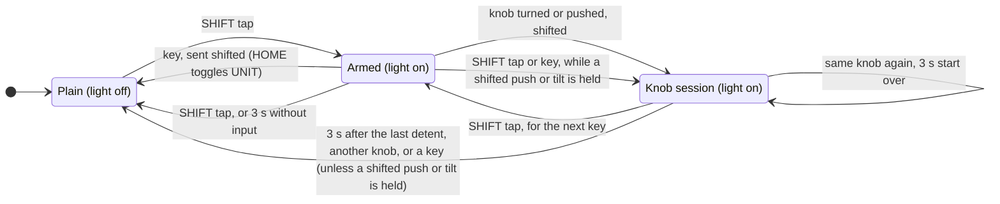
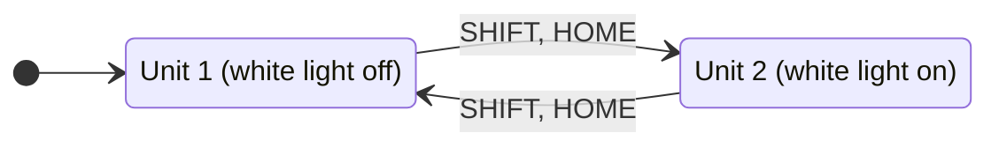

# Controls

What each key and knob does, and why it sits where it is. Button numbers for mapping are in
[BUTTONS.md](../../firmware/BUTTONS.md), how to map them in [Mapping](mapping.md). To try them without a
panel, the firmware runs on the PC and the browser shows the panel:
[The panel page](../architecture/firmware.md#the-panel-page).

## Principles

- Designed for one-handed use: the other hand is on the HOTAS. Every function works with one hand.
- Each knob sits next to its key group: ALT/HDG beside the autopilot keys, the FREQ knob beside the radio
  keys, FMS beside the FMS keys.
- The left side does the autopilot work and the right side does radios and navigation. Two exceptions keep the
  knob columns symmetric: the map's RANGE knob sits under ALT/HDG, and BARO and CRS share the ALT/HDG knob
  behind SHIFT.
- White legends are primary functions, amber legends are SHIFT functions. All caps are black. Two lights:
  amber whenever SHIFT applies (pulsing in its last second), white while unit 2 is selected.
- Everything behind SHIFT can wait until the autopilot flies, apart from IDENT (SHIFT, VFR). If both hands are
  needed, LVL first.

## SHIFT

SHIFT is tapped, never held. For keys it is one-shot; a knob keeps it while in use:

- Tap SHIFT: the amber light next to it comes on. The next key press uses the amber function, then the panel
  returns to normal and the light goes off.
- A knob turned or pushed after SHIFT stays shifted while you keep using it, including moving between its
  outer and inner ring (for a whole squawk code), and returns to normal 3 s after the last detent. A push or
  RANGE tilt held keeps it too, so a long shifted pan never outlasts the light: the 3 s start when it is let
  go.
- Tapping SHIFT again cancels it. It also cancels itself after 3 s without input. During the last second the
  amber light pulses between bright and dim, so a knob never drops back to its plain function unannounced in
  the middle of a turn.
- The light never goes dark while SHIFT still applies: dark means plain, and lit, even dim, means SHIFT is on,
  for the next key after a tap or for the knob that keeps it. A key pressed while a knob keeps SHIFT is sent
  plain.
- While a knob still keeps SHIFT (light on after a squawk entry, or a shifted push or tilt still held), a tap
  arms SHIFT for the next key instead, so SHIFT, VFR gives IDENT with one tap. A second tap cancels SHIFT,
  except for a shifted control still held.
- A shifted push or tilt that is still held keeps SHIFT and the light until it is let go, whatever is pressed
  meanwhile (SHIFT taps, the key a tap armed, plain keys). Only another knob, turned or pushed, ends it: SHIFT
  belongs to one knob at a time.
- The VFR key alone sends VFR, even right after a squawk entry: VFR is the plain function because squawking
  VFR is the common case in VFR flying; to ident, tap SHIFT first.
- The keys without an amber legend and the RANGE knob are free for your own shifted mappings
  ([Mapping](mapping.md#two-joysticks)). The FMS knob is different: with SHIFT it works the cockpit lighting,
  so a stray SHIFT before it changes a light level or toggles the cabin light instead of paging. The amber
  light shows it, and turning back, or pushing again, undoes it. After dimming, the knob stays on the lighting
  for 3 s like any shifted knob: wait for the amber light to go out before paging.
- The cap has a small raised bar near its front edge, so it can be found without looking. UP (bar at the back
  edge) and DN (bar at the front edge) are told apart the same way.
- It sits in the centre of the bottom row: shortest average travel to both sides.

## HOTAS

Not on the panel, mapped to the HOTAS instead, as in the real aircraft, where they sit on the yoke, stick or
throttle: GA (throttle), AP disconnect, CWS (control wheel steering) and elevator trim (stick). The GFC 700
and the KFC 150 both have CWS; it lets you hand-fly briefly without disengaging the autopilot.

## Workflows

- Takeoff: turn ALT (outer ring, left knob) to the cleared altitude, push the knob (HDG SYNC), press HDG and
  FLC, hold UP or DN to the climb speed.
- After takeoff: SHIFT, FD (YD, where installed), then AP.
- Descent: set the new altitude, press VS, hold DN to -500 to -1000 ft/min; ALT captures.
- Tuning: push the FREQ knob to choose COM, NAV or ADF, turn outer (MHz) and inner (kHz), then press COM ⇆ or
  NAV ⇆ (SHIFT, NAV ⇆ for the ADF). SHIFT, HOME (UNIT) first for COM 2 / NAV 2.
- Squawk: tap SHIFT, set the first digit with the inner ring of the FREQ knob, move to the next digit with one
  detent of the outer ring.
- Ident: SHIFT, VFR (IDENT).

## Knobs

| Position | Part | Turn | Push | With SHIFT |
| --- | --- | --- | --- | --- |
| Left top | Dual encoder, Ø17 / Ø12 knobs | Outer ALT, inner HDG | HDG SYNC | Outer BARO, inner CRS, push STD |
| Left bottom | Multi-control: turn, tilt 4 ways, push | RANGE | Map pointer | Own buttons, free for your own mappings |
| Right top | Dual encoder, Ø17 / Ø12 knobs | Frequency: outer MHz, inner kHz (ADF: outer 100s, inner 1s) | Cycles COM, NAV, ADF (ADF only in aircraft that have one; COM/NAV is C/V on the GNS 430) | Squawk: outer selects the digit, inner sets it; push XPDR mode |
| Right bottom | Dual encoder, Ø17 / Ø12 knobs | Outer page group, inner page | Cursor | Lighting: outer panel lights, inner glareshield flood, push cabin light |

The ALT/HDG knob:

- Plain: the outer ring sets ALT, the inner knob HDG, and the push syncs the heading, as on the G1000. ALT
  gets the bigger outer ring: it changes most per flight and is easier to spin.
- With SHIFT: the outer ring sets BARO, the inner knob CRS, as on the G1000's CRS/BARO knob. The push sets
  BARO to standard (STD), for transition altitudes in Europe. Centring the course is a key: CRS CTR (SHIFT,
  HDG).
- BARO and CRS have no knob of their own: a knob stays shifted while it is turned (both rings, 3 s after the
  last detent), so setting either is one tap and then turning, and a fourth dual knob would make the panel
  wider.

Outer rings have a coarse knurl, inner knobs a fine one. The FMS ring's knurl is coarser and deeper again, so
FREQ and FMS, the same size one above the other, are told apart by feel without looking.

Each knob legend names what the rings do, outer ring first, then what the push does. One word stands for
both rings where it covers them (FREQ, SQUAWK, FMS).

| Knob | White legend | Amber legend (with SHIFT) |
| --- | --- | --- |
| ALT/HDG | ALT · HDG · PUSH SYNC | BARO · CRS · PUSH STD |
| RANGE | RANGE · PUSH PTR, and four pan arrows | |
| FREQ | FREQ · PUSH COM/NAV/ADF | SQUAWK · PUSH XPDR |
| FMS | FMS · PUSH CRSR | PANEL · FLOOD · PUSH CABIN |

The legends sit beside each knob on the side facing the keys, turned towards you. Seated, the pan arrow
pointing away from you is hidden behind the RANGE knob; the other three are enough.

The cockpit lighting sits behind SHIFT on the FMS knob for the same reason as BARO and CRS: it is set once or
twice per flight, and more knobs would break the symmetric layout.

Frequency mode: the FREQ push cycles the knob through COM, NAV and ADF. The panel has no light for the mode;
it starts at COM after plugging in or a firmware restart and stays until the next push, and both units share
it, so watch which standby frequency moves.

Squawk (SHIFT, FREQ knob): the outer ring selects the digit and the inner ring sets it, one step per detent.
Every shifted session starts at the first digit. Turning the outer ring clockwise moves on to the next digit,
counter-clockwise back; it stops at the first and the fourth. A SHIFT tap during an entry, also to keep the
pulsing light on, starts a new session: the next detent is on the first digit again.

Acceleration (firmware): the first detent of a turn makes the fine step, and detents that follow within 60 ms
in the same direction make the coarse step. Turned faster than about 9 detents a second, the knob mixes in
coarse steps, so it stops within about 0.2 s of your hand. A spin faster than about 16 detents a second can
lose steps and runs on for up to about 0.9 s ([details](../architecture/firmware.md#knob-steps)).

| Function | Slow | Fast |
| --- | --- | --- |
| ALT | 100 ft | 1000 ft |
| HDG, CRS | 1° | 10° |
| ADF, inner ring | 1 kHz | 10 kHz |

COM, NAV, BARO, the squawk digits, the FMS knob and RANGE have no acceleration: frequencies already have a
coarse outer ring, and digits, pages, characters and zoom steps must move exactly one per detent. The dimmers
move one step per detent too; the profile sets the step size.

## Keys (label, shift legend in parentheses)

Autopilot. The columns are engage, vertical and lateral:

| | | |
| --- | --- | --- |
| AP (TEST) | ALT (ARM) | HDG (CRS CTR) |
| FD (YD) | VNV | NAV (GPSS) |
| UP | VS | APR (BC) |
| DN | FLC | LVL (½ BANK) |

- VS sits beside UP and FLC beside DN, as on the G1000, where they are beside NOSE UP and NOSE DN.
- LVL is in the corner, away from DN. The corner marks it, so it has a normal black cap.
- FD is the plain key and YD sits behind SHIFT: the GFC 500/700 and the KFC autopilots have a flight director,
  while many GA aircraft have no yaw damper, and where one is installed it is switched once per flight.

UP and DN are keys, as on the G1000. They auto-repeat while held (first repeat after 400 ms, then about 8
steps per second), so -1000 ft/min takes about 1.4 s.

One laser-marked frame surrounds all keys and single lines split it into AUTOPILOT, AUDIO, RADIO and FMS
(separate frames read as a double rule between AUTOPILOT and AUDIO).

Audio and radio: AUDIO (left half) selects what you talk on (MIC) and listen to (COM; with SHIFT NAV 1, NAV 2,
ADF, DME for station identifiers). It does not tune anything. RADIO (right half) holds the CDI key, the
transponder key and the flip-flops next to the FREQ knob:

| | | | |
| --- | --- | --- | --- |
| MIC 1 (ADF) | COM 1 (NAV 1) | CDI (OBS) | COM ⇆ (121.5) |
| MIC 2 (DME) | COM 2 (NAV 2) | VFR (IDENT) | NAV ⇆ (ADF ⇆) |

- 121.5 tunes the emergency frequency, like holding the COM flip-flop for two seconds on the G1000 and GNS, or
  the volume knob on the GTN.
- ADF ⇆ is the ADF flip-flop (FRQ on the KR 87). MIC 1 (ADF) is different: it only listens to the ADF.
- CRS CTR centres the course needle on the active VOR, like pushing the CRS knob on the G1000.
- DME listens to a separate DME such as the KN 62. A DME paired with a VOR or ILS already sends its ident on
  the NAV audio, and the marker lights show on the PFD without audio.

FMS, D→ / MENU / CLR / ENT next to the FMS knob as on the G1000:

| | | | |
| --- | --- | --- | --- |
| HOME (UNIT) | FPL (VNAV) | D→ (MSG) | MENU (NRST) |
| SHIFT, light below | PROC (TERR) | CLR (MAP) | ENT |

MAP returns to the default map page, like holding CLR on the G1000 and GNS 530/430.

28 keys. UNIT (SHIFT, HOME) switches between unit 1 and unit 2 for the FMS keys and knob (GTN or GNS 530 /
second unit), for CDI and OBS, and for the radio the FREQ knob and flip-flops tune (COM 1 / NAV 1 or
COM 2 / NAV 2). A white light beside the amber UNIT legend is on while unit 2 is selected. There is no
automatic return to unit 1, because a timeout would interrupt long flight plan edits.

On the G1000 UNIT selects radio 2 only and the FMS keys always drive the MFD: the PFD and MFD share the
radios, so coupling them would tune COM 2 while editing on the PFD.

