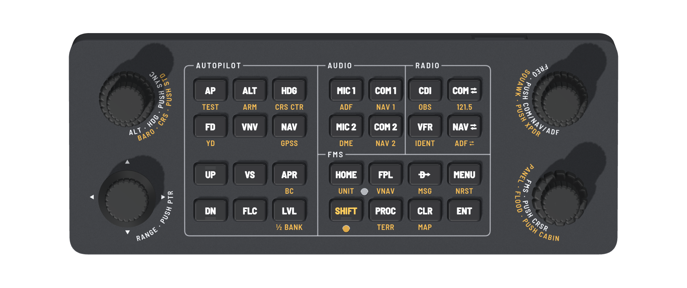
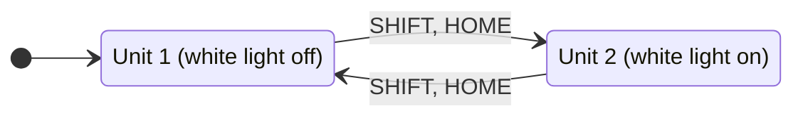

# Controls

What each key and knob does, why it sits where it is, and how to look after the panel. What a control does in
an aircraft depends on its avionics, and a function they lack does nothing there:
[Compatibility](compatibility.md). Button numbers for mapping are in [BUTTONS.md](../../firmware/BUTTONS.md),
how to map them in [Mapping](mapping.md); in the [keyboard mode](keyboard.md) the same functions send
shortcuts instead. To try them without a panel, the firmware runs on the PC and the browser shows the panel:
[Simulator](simulator.md).

## Principles

- Designed for one-handed use: the other hand is on the HOTAS. Every function works with one hand.
- Each knob sits next to its key group: ALT/HDG beside the autopilot keys, the FREQ knob beside the radio
  keys, FMS beside the FMS keys.
- The left side does the autopilot work and the right side does radios and navigation. Two exceptions keep the
  knob columns symmetric: the map's RANGE knob sits under ALT/HDG, and BARO and CRS share the ALT/HDG knob
  behind SHIFT.
- White legends are primary functions, amber legends are SHIFT functions. All caps are black. Two lights:
  amber whenever SHIFT applies (pulsing in its last second), white while unit 2 is selected. Both are dark while
  the PC is off, asleep, not connected or has suspended the panel. While the panel waits for the PC to take a
  report, up to 2.5 s, they stay as they were, and a key pressed meanwhile goes out as they showed if the PC
  then takes the report. While they are dark SHIFT does not apply: tap it again once the PC is back. In the
  [keyboard mode](keyboard.md) they take turns at each start.
- Everything behind SHIFT can wait until the autopilot flies, apart from IDENT (SHIFT, VFR). If both hands are
  needed, LVL first.

## Knobs

| Position | Part | Turn | Push | With SHIFT |
| --- | --- | --- | --- | --- |
| Left top | Dual encoder, Ø17 / Ø12 knobs | Outer ALT, inner HDG | HDG SYNC | Outer BARO, inner CRS, push STD |
| Left bottom | Multi-control: turn, tilt 4 ways, push | RANGE | Map pointer | Own buttons: a second map or a GTN's volume knob in the generated profiles, else free for your own mappings |
| Right top | Dual encoder, Ø17 / Ø12 knobs | Frequency: outer MHz, inner kHz (ADF: outer 100s, inner 1s) | Cycles COM, NAV, ADF (without an ADF in the aircraft, the ADF mode's turns do nothing) | Squawk: outer selects the digit, inner sets it; push XPDR mode |
| Right bottom | Dual encoder, Ø17 / Ø12 knobs | Outer page group, inner page | Cursor | Lighting: outer panel lights, inner glareshield flood, push cabin light |

The ALT/HDG knob:

- Plain: the outer ring sets ALT, the inner knob HDG, and the push syncs the heading, as on the G1000. ALT
  gets the bigger outer ring: it changes most per flight and is easier to spin.
- With SHIFT: the outer ring sets BARO, the inner knob CRS, as on the G1000's CRS/BARO knob. The push sets
  BARO to standard (STD), for transition altitudes in Europe. Centring the course is a key: CRS CTR (SHIFT,
  HDG).
- BARO and CRS have no knob of their own: a knob stays shifted while it is turned (both rings, 3 s after the
  last detent), so setting either is one tap and then turning, and a fourth dual knob would make the panel
  wider.

Outer rings have a coarse knurl, inner knobs a fine one. The FMS ring's knurl is coarser and deeper again, so
FREQ and FMS, the same size one above the other, are told apart by feel without looking.

Each knob legend names what the rings do, outer ring first, then what the push does. One word stands for
both rings where it covers them (FREQ, SQUAWK, FMS).

| Knob | White legend | Amber legend (with SHIFT) |
| --- | --- | --- |
| ALT/HDG | ALT · HDG · PUSH SYNC | BARO · CRS · PUSH STD |
| RANGE | RANGE · PUSH PTR, and four pan arrows | |
| FREQ | FREQ · PUSH COM/NAV/ADF | SQUAWK · PUSH XPDR |
| FMS | FMS · PUSH CRSR | PANEL · FLOOD · PUSH CABIN |

The legends sit beside each knob on the side facing the keys, turned towards you. Seated, the pan arrow
pointing away from you is hidden behind the RANGE knob; the other three are enough.

The cockpit lighting sits behind SHIFT on the FMS knob for the same reason as BARO and CRS: it is set once or
twice per flight, and more knobs would break the symmetric layout.

Frequency mode: the FREQ push cycles the knob through COM, NAV and ADF, always all three. The panel has no
light for the mode; it starts at COM after plugging in or a firmware restart and stays until the next push,
and both units share it, so watch which frequency moves.

Squawk (SHIFT, FREQ knob): the outer ring selects the digit and the inner ring sets it, one step per detent.
Every entry starts at the first digit. Turning the outer ring clockwise moves on to the next digit,
counter-clockwise back; it stops at the first and the fourth. The panel does not show the selected digit: the
transponder shows which one moves. The entry ends 3 s after the last detent of either ring, and the knob tunes
frequencies again. A SHIFT tap during an entry starts a new one: the next detent is on the first digit again.

Acceleration: on ALT, HDG, CRS and the ADF inner ring the first detent of a turn makes the fine step, and
detents that follow within 60 ms in the same direction make the coarse one; turned faster than about 9
detents a second, the knob mixes in coarse steps too ([details](../architecture/firmware.md#knob-steps)):

| Function | Slow | Fast |
| --- | --- | --- |
| ALT | 100 ft | 1000 ft |
| HDG, CRS | 1° | 10° |
| ADF, inner ring | 1 kHz | 10 kHz |

COM, NAV, BARO, the squawk digits, the FMS knob and RANGE have no acceleration: frequencies already have a
coarse outer ring, and digits, pages, characters and zoom steps must move exactly one per detent. The dimmers
move one step per detent too; the profile sets the step size.

## Keys (label, shift legend in parentheses)

Autopilot. The columns are engage, vertical and lateral:

| | | |
| --- | --- | --- |
| AP (TEST) | ALT (ARM) | HDG (CRS CTR) |
| FD (YD) | VNV | NAV (GPSS) |
| UP | VS | APR (BC) |
| DN | FLC | LVL (½ BANK) |

- VS sits beside UP and FLC beside DN, as on the G1000, where they are beside NOSE UP and NOSE DN.
- LVL is in the corner, away from DN. The corner marks it, so it has a normal black cap.
- FD is the plain key and YD sits behind SHIFT: the GFC 500/700 and the KFC autopilots have a flight director,
  while many GA aircraft have no yaw damper, and where one is installed it is switched once per flight.

UP and DN are keys, as on the G1000. They auto-repeat while held (first repeat after 400 ms, then about 8
steps per second), so -1000 ft/min takes about 1.4 s. UP has a small raised bar at the back edge of its cap
and DN one at the front edge, so they are told apart without looking.

One laser-marked frame surrounds all keys and single lines split it into AUTOPILOT, AUDIO, RADIO and FMS.

Audio and radio: AUDIO (left half) selects what you talk on (MIC) and listen to (COM; with SHIFT NAV 1, NAV 2,
ADF, DME for station identifiers). It does not tune anything. RADIO (right half) holds the CDI key, the
transponder key and the flip-flops next to the FREQ knob:

| | | | |
| --- | --- | --- | --- |
| MIC 1 (ADF) | COM 1 (NAV 1) | CDI (OBS) | COM ⇆ (121.5) |
| MIC 2 (DME) | COM 2 (NAV 2) | VFR (IDENT) | NAV ⇆ (ADF ⇆) |

- VFR squawks the VFR code. It is the plain function because squawking VFR is the common case in VFR flying;
  IDENT is SHIFT, VFR. The [generated profiles](mapping.md#generated-profiles) set 7000 (EASA), or the code a
  profile is made for (1200 in the US).
- 121.5 tunes the emergency frequency, like holding the COM flip-flop for two seconds on the G1000 and GNS, or
  the volume knob on the GTN.
- ADF ⇆ is the ADF flip-flop (FRQ on the KR 87). MIC 1 (ADF) is different: it only listens to the ADF.
- CRS CTR centres the course needle on the active VOR, like pushing the CRS knob on the G1000.
- DME listens to a separate DME such as the KN 62. A DME paired with a VOR or ILS already sends its ident on
  the NAV audio, and the marker lights show on the PFD without audio.

FMS, D→ / MENU / CLR / ENT next to the FMS knob as on the G1000:

| | | | |
| --- | --- | --- | --- |
| HOME (UNIT) | FPL (VNAV) | D→ (MSG) | MENU (NRST) |
| SHIFT, light below | PROC (TERR) | CLR (MAP) | ENT |

MAP returns to the default map page, like holding CLR on the G1000 and GNS 530/430 (the G1000 profile toggles
Charts instead, [Mapping](mapping.md#g1000-nxi)).

28 keys. UNIT (SHIFT, HOME) switches between unit 1 and unit 2 for the FMS keys and knob (GTN or GNS 530 /
second unit), for CDI and OBS, and for the radio the FREQ knob and flip-flops tune (COM 1 / NAV 1 or
COM 2 / NAV 2). A white light beside the amber UNIT legend is on while unit 2 is selected. There is no
automatic return to unit 1, because a timeout would interrupt long flight plan edits.

On the G1000 unit 1 is the MFD with radio 1 and unit 2 the PFD with radio 2: UNIT switches the display and
the radio together, so while you edit on the PFD the FREQ knob tunes COM 2 / NAV 2.

## SHIFT

SHIFT is tapped, never held. Its key sits in the centre of the bottom row, the shortest average travel to both
sides, and its cap has a small raised bar near the front edge, so it can be found without looking.

- Tap SHIFT: the amber light next to it comes on. The next key press sends the key's amber function, then the
  light goes off. A key without an amber legend (VS, UP, FLC, DN, VNV, ENT) sends a button of its own then,
  mapped like the plain key ([Mapping](mapping.md#two-joysticks)).
- A knob turned or pushed after the tap keeps SHIFT while you use it, on both rings and the push, until 3 s
  after its last detent, or after a held push or RANGE tilt is let go. Another knob ends it at once.
- In the last second the light pulses between bright and dim, so a knob never drops back to its plain
  function unannounced in the middle of a turn.
- A second tap cancels SHIFT, and it cancels itself after 3 s without input, plus any time the panel waited
  for the PC to take a report.
- Dark means plain. Lit, even dim, means SHIFT is on: for the next key after a tap, or for the knob that
  keeps it. The light does not tell the two apart, and a key pressed while a knob keeps SHIFT is sent plain
  and ends the knob's SHIFT. For an amber key then, tap SHIFT first: that tap arms SHIFT for the key, and a
  second one cancels it.
- A shifted push or RANGE tilt that is still held keeps SHIFT until it is let go, whatever key is pressed
  meanwhile, SHIFT included; only another knob ends it.
- With SHIFT the FMS knob works the cockpit lighting, so a stray SHIFT before it changes a light level or
  toggles the cabin light instead of paging. Turning back, or pushing again, undoes it. After dimming, wait
  for the amber light to go out before paging.

The full rules and the state diagram are in [Firmware](../architecture/firmware.md#shift).

## Workflows

- Takeoff: turn ALT (outer ring, left knob) to the cleared altitude, push the knob (HDG SYNC), press HDG and
  FLC. FLC holds an airspeed: hold UP for a lower climb speed (nose up) or DN for a higher one. GA is on the
  [HOTAS](#hotas).
- After takeoff: SHIFT, FD (YD, where installed), then AP.
- Descent: set the new altitude, press VS, hold DN to -500 to -1000 ft/min; ALT captures.
- Tuning: push the FREQ knob to choose COM, NAV or ADF, turn outer (MHz) and inner (kHz), then press COM ⇆ or
  NAV ⇆. SHIFT, HOME (UNIT) first for COM 2 / NAV 2. In the
  [generated profiles](mapping.md#generated-profiles) the ADF's turns tune its active frequency, so no
  flip-flop follows; ADF ⇆ (SHIFT, NAV ⇆) brings back the standby.
- Squawk: tap SHIFT, set the first digit with the inner ring of the FREQ knob, move to the next digit with one
  detent of the outer ring, and so on. Enter all four digits in one go: 3 s after the last detent the entry
  ends. To start over, turn the outer ring counter-clockwise to its stop, the first digit.
- Ident: SHIFT, VFR (IDENT). Right after a squawk entry the amber light is still on, but VFR alone sends VFR
  there and squawks the VFR code over the one just set: tap SHIFT again first.

## HOTAS

Not on the panel, mapped to the HOTAS instead, as in the real aircraft, where they sit on the yoke, stick or
throttle: GA (throttle), AP disconnect, CWS (control wheel steering) and elevator trim (stick). The GFC 700
and the KFC 150 both have CWS; it lets you hand-fly briefly without disengaging the autopilot.

## Care

- The panel weighs about 0.2 kg, so a RANGE tilt can slide it or tip it over its front feet: pinch the knob
  between thumb and finger to tilt it, or steady the panel with the other fingers. Hold the panel when you
  unplug the cable.
- A key that rubs or sticks has a cap that crept round on its plunger: turn the cap back square with its
  neighbours, in place.
- Keep the panel out of direct sun and away from heat: its printed parts soften from about 53 °C, the knobs
  and caps, held by friction, loosen when warm, and the light pipes yellow in UV. Clean it with a dry or damp
  cloth, no solvents.
- The amber legends are UV ink on the anodising and wear where fingertips land; the white ones are laser
  marked.
- The encoders are rated for 15,000 rotations and 20,000 pushes, the RANGE control's encoder for 15,000
  rotations, the keys for 100,000 presses. The spare board replaces a worn one; with hand-soldering it comes
  without its keys, encoders and RANGE control, so it needs a second set of them
  ([Disassembly](../building/assembly.md#disassembly), [Bring-up](../building/bring-up.md)).
